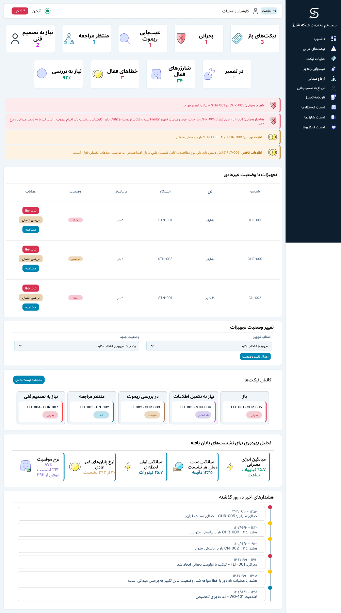

# EV Charging Station Management System

**Requirements analysis, UML modeling, and desktop/mobile interface design for a charging-network management system.**

A three-phase undergraduate Management Information Systems group project that connects operational requirements to domain models, user stories and role-specific interfaces.

## Project at a glance

| | |
| --- | --- |
| Domain | Electric vehicle charging infrastructure |
| Course | Management Information Systems |
| Project type | Collaborative undergraduate analysis and design project |
| Detailed workflows | Station and charger lifecycle, charging sessions, fault handling |
| Methods | Requirements analysis, UML, personas, user stories, acceptance criteria and Kanban |
| Design tools | Visual Paradigm, Figma and Graphviz |
| Languages | English project overview and diagrams; Persian reports and interface labels |

## Three project phases

| Phase | Focus | Deliverables |
| --- | --- | --- |
| 1 — Requirements | Operating context, stakeholders and five core workflows | [Requirements reports](docs/fa/phase1/report.md) |
| 2 — Analysis and design | Three detailed workflows, modeled with four UML diagram types | [Modeling reports](docs/fa/phase2/report.md) · [Diagram gallery](docs/UML.md) |
| 3 — User experience | Personas, 17 user stories, acceptance criteria and seven user roles | [UX specifications](docs/fa/phase3/report.md) · [Figma prototypes](docs/PROTOTYPE.md) |

## Explore the project

- Start with the [English project overview](docs/CASE-STUDY.md).
- Browse the [Persian report collection](docs/fa/INDEX.md).
- View the [diagrams and editable models](docs/UML.md).
- Explore the [desktop and mobile prototypes](docs/PROTOTYPE.md).
- Follow the [story-to-report and design mapping](traceability.csv).
- Read about [project organization](docs/PROJECT-MANAGEMENT.md).
- Download the [phase 1 presentation](supplementary/phase1-presentation.pptx).

## Operational scope

The requirements cover asset lifecycle, charging sessions, monitoring and events, tariffs and billing, and fault handling. Detailed models and UX specifications focus on the first, second and fifth workflows.

The interface provides views for a system administrator, charging-network operator, operations specialist, field technician, station owner, electricity distribution representative and EV driver. Prototype screens use illustrative data to show status, decisions and information flow.

## Repository structure

| Folder | Contents |
| --- | --- |
| `docs/` | Project overview, reports, diagram gallery and prototype guide |
| `assets/uml/` | Diagram images organized by workflow |
| `assets/ui/` | Interface previews |
| `models/` | Editable diagram sources |
| `supplementary/` | Project presentation |

## Academic context

Developed collaboratively as an undergraduate course project. The portfolio presents the team's combined work in requirements analysis, system modeling and interface design.
