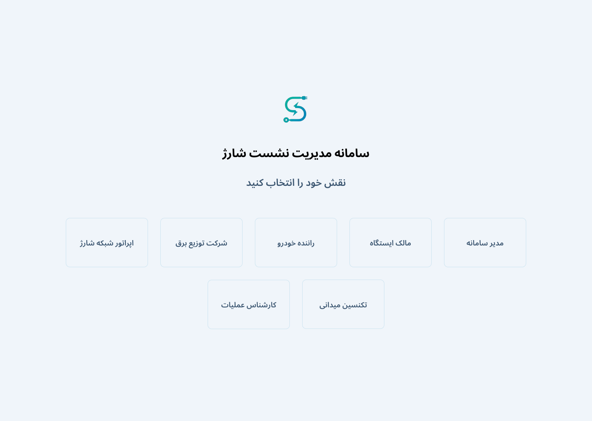
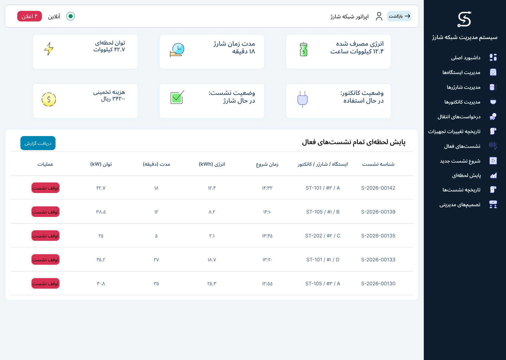

# Interface design and prototypes

The Figma design uses a shared visual language for desktop and mobile screens: color palette, typography, buttons, forms, status labels, tables and dashboard cards. Interfaces are organized around the decisions each role makes in station operations, charging sessions and fault handling.

| Role | Main views |
| --- | --- |
| System administrator | Asset registration, station management, analytical reports and tariffs |
| Charging-network operator | Transfer decisions, active sessions, history and management requests |
| Operations specialist | Alerts, equipment condition, remote troubleshooting and field referral |
| Field technician | Assignments, site visits and repair reports |
| Station owner | Owned assets, utilization and financial summaries |
| Electricity distribution representative | Capacity reports and station notifications |
| EV driver | Session start, monitoring and stop summaries |

- [Design file](https://www.figma.com/design/YEJwifXBvi72J0idkA6Qmr/Untitled?node-id=0-1&t=WVLWLYwjRX10yanT-1)
- [Desktop prototype](https://www.figma.com/proto/YEJwifXBvi72J0idkA6Qmr/Untitled?node-id=151-64&t=Zn453ege47YWJPXy-1&scaling=min-zoom&content-scaling=fixed&page-id=0%3A1&starting-point-node-id=151%3A64&show-proto-sidebar=1)
- [Mobile prototype](https://www.figma.com/proto/YEJwifXBvi72J0idkA6Qmr/Untitled?node-id=152-173&t=v25iv1F7IWs9fxCl-1&scaling=min-zoom&content-scaling=fixed&page-id=0%3A1&starting-point-node-id=152%3A173&show-proto-sidebar=1)

Select a role at the prototype entry screen to explore its dashboard. The interface uses Persian labels and illustrative operational data.

See [personas, user stories and acceptance criteria](fa/phase3/report.md) and the [story-to-frame mapping](../traceability.csv).
