# UML diagrams and model files

The three detailed workflows are represented by use case, activity, class and sequence diagrams. Images can be viewed directly; editable sources are linked beside each diagram.

## Station and charger lifecycle

### Activity

[Editable model](../models/visual-paradigm/lifecycle/activity.vpp)

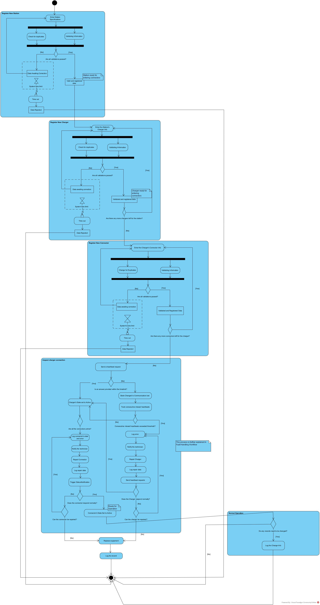

### Class

[Editable model](../models/visual-paradigm/lifecycle/class.vpp)

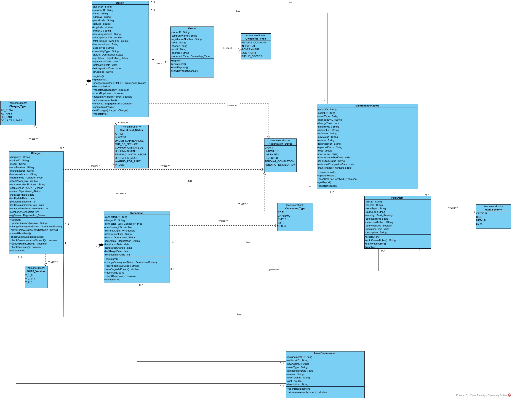

### Sequence asset registration

[Editable model](../models/visual-paradigm/lifecycle/sequence-asset-registration.vpp)

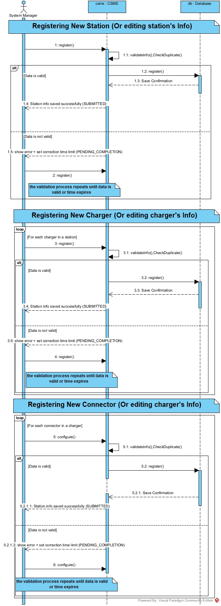

### Sequence charger transfer

[Editable model](../models/visual-paradigm/lifecycle/sequence-charger-transfer.vpp)

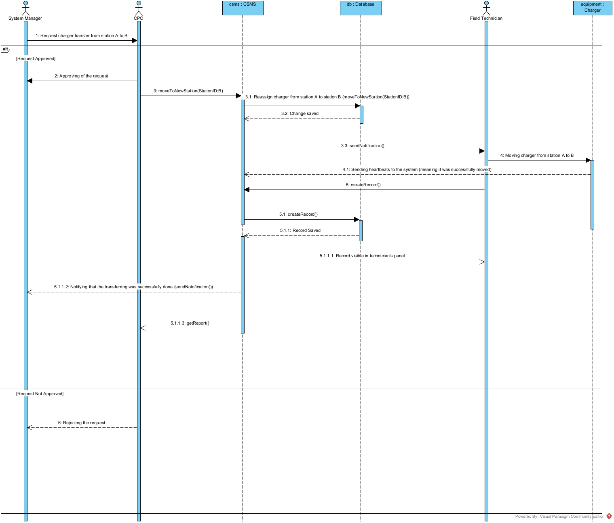

### Sequence maintenance

[Editable model](../models/visual-paradigm/lifecycle/sequence-maintenance.vpp)

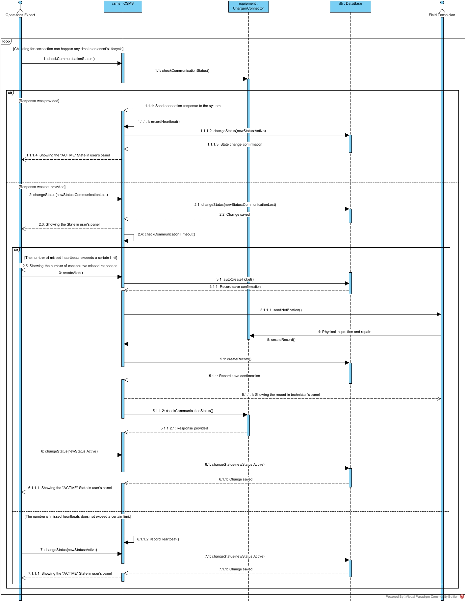

### Use case

[Editable model](../models/visual-paradigm/lifecycle/use-case.vpp)

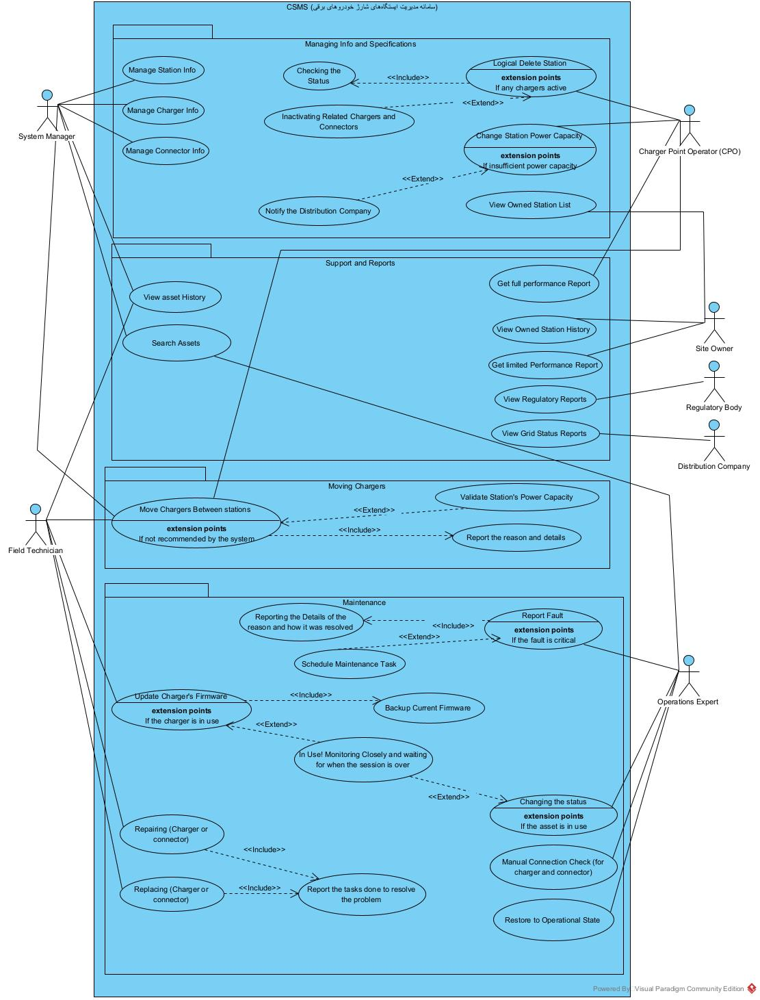

## Charging sessions

### Activity

[Editable model](../models/visual-paradigm/session/activity.vpp)

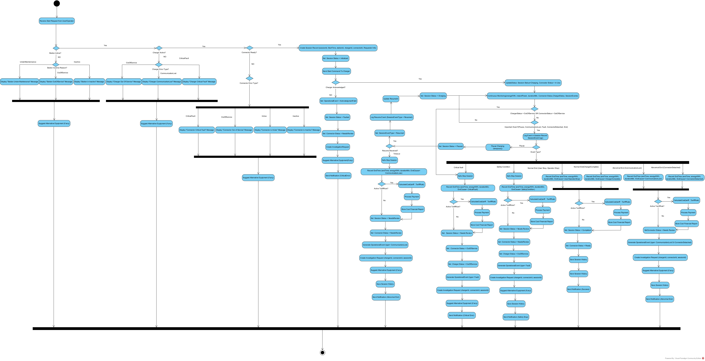

### Class

[Editable model](../models/visual-paradigm/session/class.vpp)

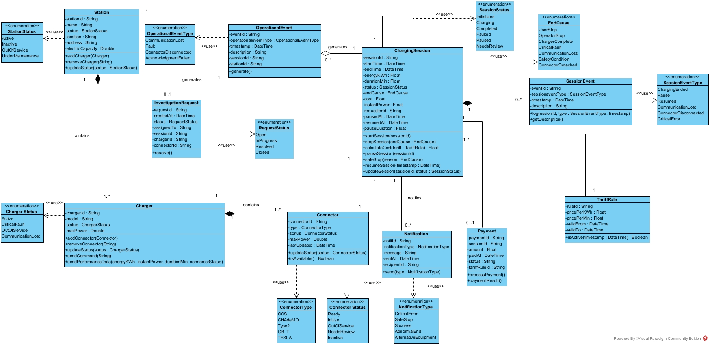

### Sequence

[Editable model](../models/visual-paradigm/session/sequence.vpp)

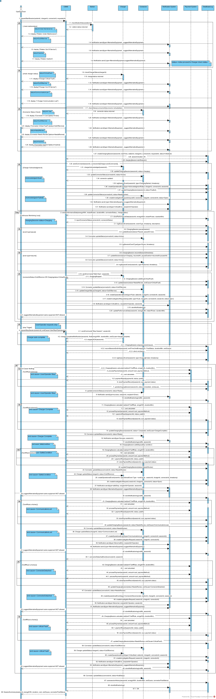

### Use case

[Editable model](../models/visual-paradigm/session/use-case.vpp)

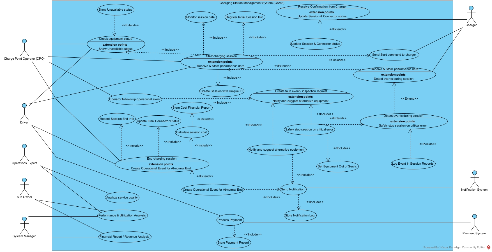

## Fault handling

### Activity

[Editable model](../models/graphviz/fault-activity.dot)

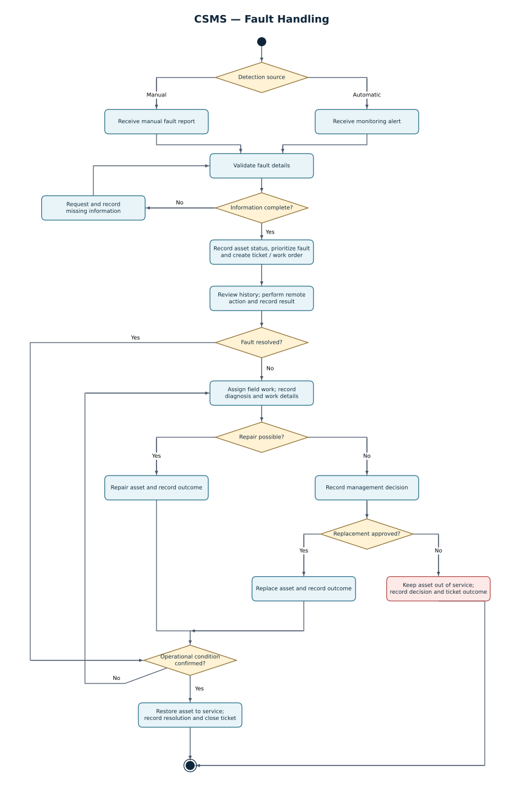

### Class

[Editable model](../models/visual-paradigm/fault/class.vpp)

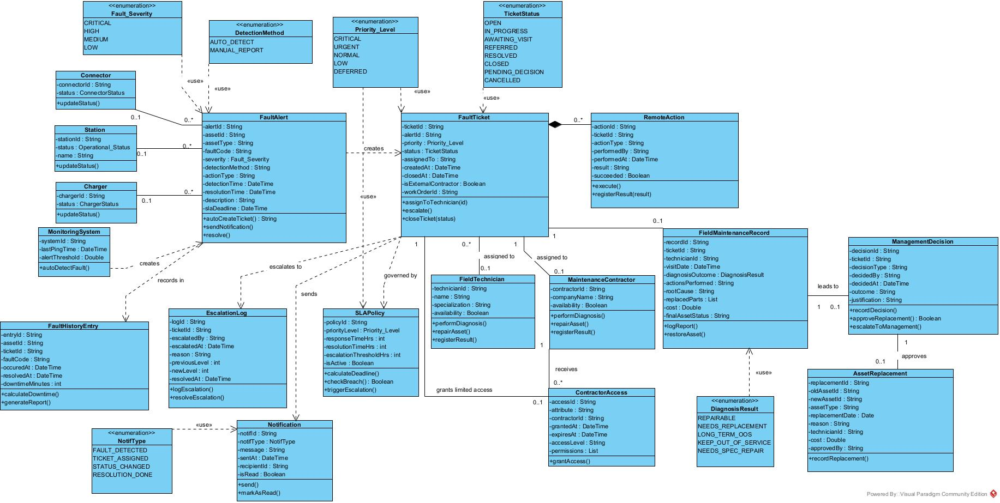

### Sequence

[Editable model](../models/visual-paradigm/fault/sequence.vpp)

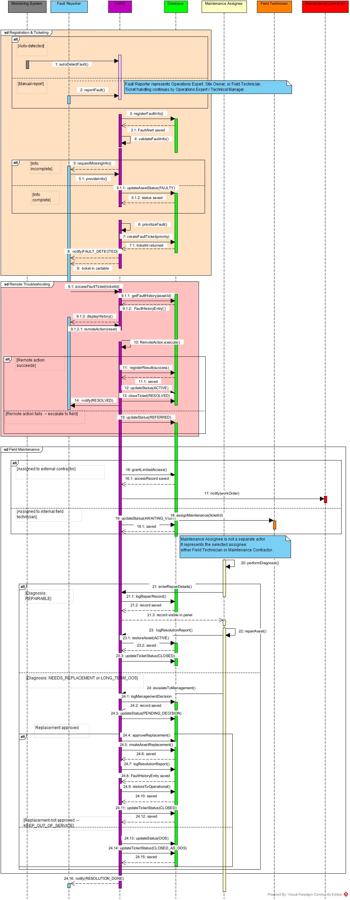

### Use case

[Editable model](../models/visual-paradigm/fault/use-case.vpp)

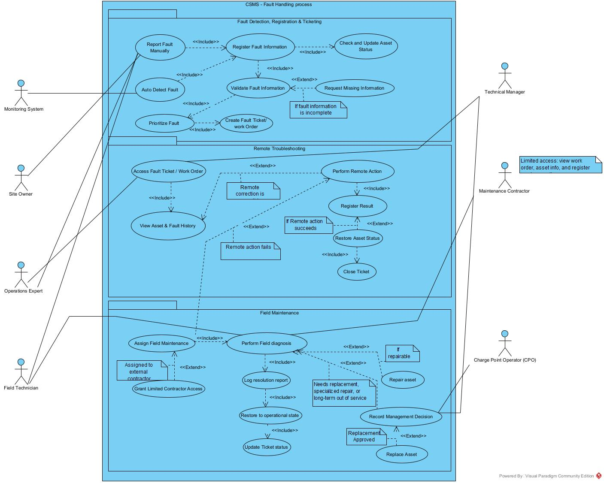
