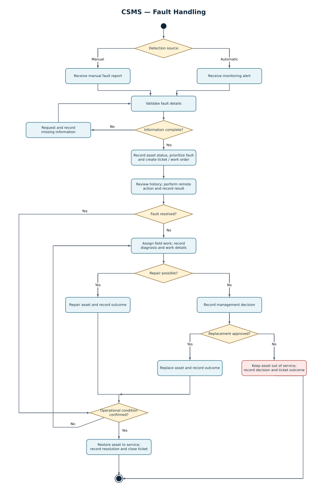

# Phase 2 — System analysis and UML modeling

**Charging Station Management System (CSMS)**  
Management Information Systems · Collaborative undergraduate analysis and design project

[Report index](README.md) · [Previous: requirements](phase-1-requirements.md) · [Next: user experience](phase-3-ux-design.md)

## Abstract

This phase develops the system models for three selected CSMS workflows: station and charger lifecycle, charging sessions and fault handling. Use case diagrams describe actor responsibilities; activity diagrams express decisions and alternative paths; class diagrams define domain records and relationships; sequence diagrams show the order of interactions. Fourteen diagram views cover these perspectives. The models connect equipment identity, operational condition, session events and maintenance decisions, providing the basis for the user stories and prototypes in phase 3.

## 1. Modeling approach and shared definitions

The selected workflows share the **station → charger → connector** hierarchy established in [phase 1](phase-1-requirements.md). Asset identifiers link registration, session, fault and maintenance records. Modeling the same equipment across several workflows makes the consequences of one action visible to the others: a connector under investigation is unavailable for a new session, while a session error can produce an equipment investigation.

The four UML perspectives have complementary purposes:

| Model type | Question addressed | Main content |
| --- | --- | --- |
| Use case | Who needs to do what? | Actors, system functions and supporting services |
| Activity | What happens, including alternatives? | Actions, validation, decisions, loops and outcomes |
| Class | What information and relationships are required? | Entities, identifiers, attributes, associations and enumerations |
| Sequence | In what order do participants interact? | Requests, checks, commands, responses and notifications |

The model collection contains six lifecycle views, four session views and four fault views. Lifecycle uses three sequence diagrams to separate asset registration, transfer and maintenance. The other two workflows each use one sequence view.

Three distinctions apply throughout the English specification:

- Administrative registration or assignment records a management decision; commissioning establishes physical readiness.
- Session status, end cause and equipment condition are separate record fields.
- Ticket progress and ticket outcome describe investigation work; equipment condition determines whether an asset can serve a new session.

## 2. Station and charger lifecycle

### 2.1. Use cases and actors

The lifecycle use cases are organized into information management, reporting, charger transfer and maintenance. The administrator registers and edits assets and submits transfer requests. The CPO reviews decisions affecting deployment and capacity. The operations specialist monitors condition and coordinates investigation. The field technician performs assigned physical work. Owners, supervisory actors and electricity distribution representatives receive reports or notifications within their responsibilities.

Information management covers creating station records, associating chargers with stations and defining connectors. Reporting covers asset lists, operating condition and history. Transfer use cases connect a request, a management decision, capacity coordination and field execution. Maintenance use cases connect response checks, fault investigation, repair and replacement.

### 2.2. Activity model

The activity starts with station-data entry and validation. Valid station information permits charger registration, followed by connector registration. Invalid entries return to the user for correction. The workflow retains the distinction between an accepted record and an operational asset.

Once equipment is registered, connection checks and condition monitoring support commissioning and ongoing operation. Repeated unanswered checks are compared with a configured threshold. A missing response is presented with the last valid response time. A counter below the threshold alone does not demonstrate that the equipment is active; a valid response and an acceptable condition support the return to service.

If investigation is required, operations staff examine the equipment history and arrange repair. The subsequent path depends on the technical finding: repair and verification, further work, or a replacement decision. Registration, monitoring and maintenance form a continuing lifecycle rather than a one-time data-entry process.

### 2.3. Class model

| Class or concept | Role in the lifecycle model |
| --- | --- |
| `Owner` | Identifies the party associated with a site and the scope of owner reports |
| `Station` | Stores the physical site, electrical capacity, location and operating information |
| `Charger` | Stores device identity, technical characteristics, communications information and assigned station |
| `Connector` | Stores connection-point identity, type, power and condition under a charger |
| `MaintenanceRecord` | Records work, timing, findings and the asset concerned |
| `FaultAlert` | Relates a detected issue to equipment and subsequent investigation |
| `AssetReplacement` | Retains replacement information and its connection to the lifecycle history |

Status and technical enumerations include operational status, registration status, OCPP version, connector type and charge type. Registration state describes the asset-information process; operational state describes equipment condition. A station groups chargers, and a charger groups connectors. Maintenance, alerts and replacement records refer to the affected assets so that history remains available after a change.

### 2.4. Sequence A: asset registration and editing

The administrator submits a station record. The system checks required values and identity, persists valid information and returns a result. Charger and connector registration then follow the same pattern within the established hierarchy. An edit updates the intended record while retaining the associated history.

The sequence separates the user's request, validation and persistence. This makes the point of successful registration explicit and supports form-level acceptance criteria in phase 3.

### 2.5. Sequence B: charger transfer

The administrator selects a charger, sees its current source and provides a destination and reason. The system checks destination capacity and records a pending request. The operator reviews the request, chooses the final destination and approves or rejects it. An inadequate capacity result initiates capacity coordination with the electricity distributor.

Approval records the administrative assignment and planned destination and creates field work. It does not itself make the charger available for sessions at the destination. The technician completes the move and installation, and the operational review confirms communications and readiness. The transfer is then recorded as complete, with request, decision, execution and completion times available in its history.

### 2.6. Sequence C: monitoring and maintenance

Periodic connection checks generate a valid response or a missed-response event. The system updates the count, current communications indication and last valid response. A threshold crossing raises a case for investigation.

The operations specialist evaluates the case and coordinates the repair path. The technician records actions and findings. The resulting equipment state is based on confirmed condition, while the maintenance record preserves what was done. A replacement follows the corresponding decision and asset-history path.

### 2.7. Lifecycle diagrams and sources

| View | Diagram | Editable source |
| --- | --- | --- |
| Use case | [Image](../../assets/uml/lifecycle/use-case.jpg) | [Visual Paradigm](../../models/visual-paradigm/lifecycle/use-case.vpp) |
| Activity | [Image](../../assets/uml/lifecycle/activity.jpg) | [Visual Paradigm](../../models/visual-paradigm/lifecycle/activity.vpp) |
| Class | [Image](../../assets/uml/lifecycle/class.jpg) | [Visual Paradigm](../../models/visual-paradigm/lifecycle/class.vpp) |
| Registration sequence | [Image](../../assets/uml/lifecycle/sequence-asset-registration.jpg) | [Visual Paradigm](../../models/visual-paradigm/lifecycle/sequence-asset-registration.vpp) |
| Transfer sequence | [Image](../../assets/uml/lifecycle/sequence-charger-transfer.jpg) | [Visual Paradigm](../../models/visual-paradigm/lifecycle/sequence-charger-transfer.vpp) |
| Maintenance sequence | [Image](../../assets/uml/lifecycle/sequence-maintenance.jpg) | [Visual Paradigm](../../models/visual-paradigm/lifecycle/sequence-maintenance.vpp) |

## 3. Charging-session management

### 3.1. Use cases and actors

The session use cases cover preparation and start, monitoring, event handling, termination, financial recording and analysis. A driver initiates and follows a personal session. An operator can initiate or stop a session within operational permissions and respond to critical events. Administrators manage tariffs and analytical views. Owners review their stations' results, and operations specialists assess service quality.

Equipment communications, payment and notification services support the workflow. The same readiness checks apply to driver-initiated and operator-initiated starts.

### 3.2. Activity model: preparation, operation and end

**Preparation and start.** The system checks the selected station, charger and connector in order. A usable selection produces a unique session record in `Initialized` state. The start command is then sent to equipment. Acknowledgement confirms `Charging` and changes the connector to `InUse`. If acknowledgement is not received, the session is `Faulted`, the connector is `NeedsReview`, and an event and investigation request are recorded.

**Operation and monitoring.** Measurements and events update energy, duration, power and estimated cost. The model considers pause/resume interactions, operational errors and abnormal termination. A critical or safety-related issue triggers a stop action and equipment investigation. Communications loss preserves the last valid measurements and their timestamp while the physical outcome is being established.

**End and financial recording.** A stop request sends a command; a confirmed end follows acknowledgement or reliable end data. The system records the end cause independently of session and equipment status. A final amount is associated with the tariff valid at the session start. The receipt and history refer to the confirmed end and valid measurements.

### 3.3. Class model

| Class | Purpose |
| --- | --- |
| `Station`, `Charger`, `Connector` | Identify the equipment hierarchy involved in a session |
| `ChargingSession` | Holds the session identity, equipment references, timing, measurements, status, end cause and financial association |
| `SessionEvent` | Records events within the charging process |
| `OperationalEvent` | Records equipment or service events relevant to operations |
| `InvestigationRequest` | Tracks a case requiring follow-up after an abnormal condition |
| `Notification` | Records a message to the relevant user or operational role |
| `Payment` | Records the financial transaction associated with a session |
| `TariffRule` | Defines the price components and validity used in session-cost calculation |

The class model uses composition for lifecycle-dependent parts, associations for linked domain records and dependencies where a function uses another record or service. A connector can participate in successive session records over time; the history links each one to the equipment used. Tariff identity and validity make a recorded amount traceable to its pricing rule.

Session states include `Initialized`, `Charging`, `Paused`, `Completed`, `Faulted` and `NeedsReview`. These labels describe session processing. Equipment states such as `Ready`, `InUse`, `OutOfService` and `CommunicationLost` have their own operational meaning.

### 3.4. Sequence model

The sequence starts with the driver's or operator's request. The system checks station, charger and connector, creates the initial record, sends the start command and processes equipment confirmation. Monitoring interactions then associate received data with the session.

During a pause or abnormal event, the sequence records the event, communicates with the equipment and notifies the relevant parties. A stop request and an end confirmation are distinct interactions. Final recording and financial processing follow confirmed completion information. This ordering supports an interface that can show a pending action while the equipment response is outstanding.

### 3.5. Confirmed-end outcomes

| End cause | Session state | Charger condition | Connector condition |
| --- | --- | --- | --- |
| Charge completed | `Completed` | `Active` after valid status confirmation | `Ready` after valid status confirmation |
| User or operator stop | `Completed` | `Active` after valid status confirmation | `Ready` after valid status confirmation |
| Critical fault | `NeedsReview` | `OutOfService` | `OutOfService` |
| Unsafe condition | `NeedsReview` | `OutOfService` | `NeedsReview` |
| Charger fault | `NeedsReview` | `OutOfService` | `NeedsReview` |
| Communications loss | `NeedsReview` | `CommunicationLost` | `NeedsReview` |
| Abnormal connector detachment | `NeedsReview` | According to valid equipment condition | `NeedsReview` |

The table applies after the session end has been established. If the physical end remains unconfirmed, the record is presented as requiring review with an unconfirmed end, retaining the last valid measurement time. An abnormal outcome also links the event and investigation records.

### 3.6. Session diagrams and sources

| View | Diagram | Editable source |
| --- | --- | --- |
| Use case | [Image](../../assets/uml/session/use-case.jpg) | [Visual Paradigm](../../models/visual-paradigm/session/use-case.vpp) |
| Activity | [Image](../../assets/uml/session/activity.jpg) | [Visual Paradigm](../../models/visual-paradigm/session/activity.vpp) |
| Class | [Image](../../assets/uml/session/class.jpg) | [Visual Paradigm](../../models/visual-paradigm/session/class.vpp) |
| Sequence | [Image](../../assets/uml/session/sequence.jpg) | [Visual Paradigm](../../models/visual-paradigm/session/sequence.vpp) |

## 4. Fault handling

### 4.1. Use cases and actors

The operations specialist receives alerts, checks equipment history, attempts authorized remote action and refers work to the field. The operator can submit a manual report and decide on requests that require management approval. The field technician receives assignments and records progress and findings. Monitoring, contractor access and notifications support the information flow.

Use cases cover reporting and validating a fault, prioritizing a ticket, reviewing history, recording remote actions, assigning field work, documenting repair, deciding on replacement and recording the outcome.

### 4.2. Activity model

An automatic alert or manual report enters the workflow. The system validates the information and requests missing details where necessary. A complete case becomes a trackable ticket associated with the equipment, a priority and the relevant session where applicable.

The operations specialist considers remote diagnosis or action. A successful remote action leads to verification of the resulting condition and an appropriate ticket outcome. If further investigation is required, a technician receives the asset, address, fault, priority and history.

Field findings lead to repair, a request for parts, a replacement decision or further investigation. A management decision can approve replacement, reject it or request more information. If the chosen outcome keeps equipment out of service, the asset remains `OutOfService` even when the ticket is closed with that documented outcome.

### 4.3. Class model

| Entity group | Classes | Information responsibility |
| --- | --- | --- |
| Detection and case | `MonitoringSystem`, `FaultAlert`, `FaultTicket` | Detection source, affected equipment, classification, priority and case state |
| Remote work | `RemoteAction` | Requested command, time, result and ticket reference |
| Field work | `FieldTechnician`, `MaintenanceContractor`, `ContractorAccess`, `FieldMaintenanceRecord` | Assignment, authorized contractor access, actions, parts and findings |
| Decisions and assets | `ManagementDecision`, `AssetReplacement` | Approval, rejection, additional-information requests and replacement outcome |
| History and service policy | `FaultHistoryEntry`, `EscalationLog`, `SLAPolicy`, `Notification` | Case history, escalation, policy and communications |

These records connect the detected condition to the actions and decisions taken. Service-level policy supplies the priority and escalation context. History entries retain who acted, when and with what result. The asset reference connects the case to earlier repairs and related charging incidents.

### 4.4. Sequence model

The sequence follows an alert or report through validation, ticket creation and notification to operations. Remote-action interactions record both the command and equipment response. Field referral produces an assignment and receives a maintenance report. Where needed, a management decision determines the next branch.

The final interactions record the ticket outcome and the verified equipment condition. Notifications communicate the result to the relevant roles. Keeping those records separate allows a ticket to conclude with a clear outcome even when the equipment must remain unavailable.

### 4.5. Fault diagrams and sources

| View | Diagram | Editable source |
| --- | --- | --- |
| Use case | [Image](../../assets/uml/fault/use-case.jpg) | [Visual Paradigm](../../models/visual-paradigm/fault/use-case.vpp) |
| Activity | [SVG](../../assets/uml/fault/activity.svg) | [Graphviz](../../models/graphviz/fault-activity.dot) |
| Class | [Image](../../assets/uml/fault/class.jpg) | [Visual Paradigm](../../models/visual-paradigm/fault/class.vpp) |
| Sequence | [Image](../../assets/uml/fault/sequence.jpg) | [Visual Paradigm](../../models/visual-paradigm/fault/sequence.vpp) |

## 5. Cross-workflow information and handoff

An asset record establishes identity and location. Session records use that identity to describe charging. Monitoring records observations and events, which can trigger fault handling. Maintenance and management decisions then update the operational information used by later session-readiness checks. Financial and service reports draw on the linked records.

The model collection provides a shared vocabulary for the next phase. Asset forms derive from lifecycle entities; active-session screens reflect session states and confirmed measurements; ticket and assignment views expose fault progress and technical findings. User stories in [phase 3](phase-3-ux-design.md) describe those interactions from each role's perspective.

## Supporting material

- [Complete image gallery](../UML.md)
- [English requirements report](phase-1-requirements.md)
- [Story and prototype traceability](../../traceability.csv)
- [Supplementary Persian phase 2 reports](../fa/phase2/report.md)

[Next: Phase 3 — User experience and acceptance specifications](phase-3-ux-design.md)
