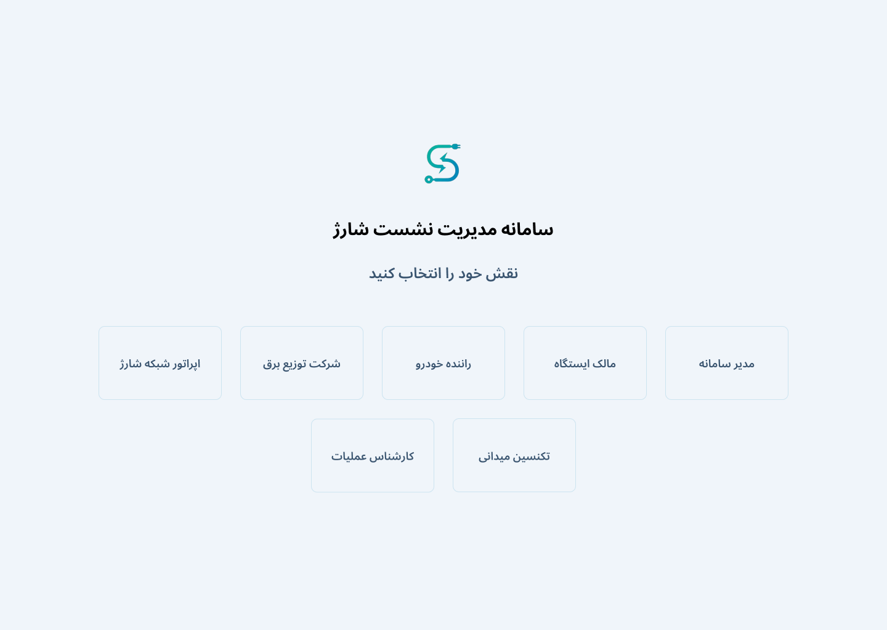
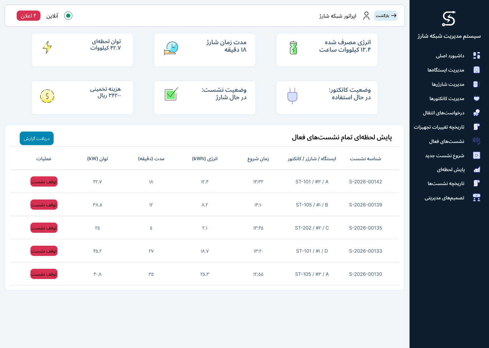

# Phase 3 — User experience and acceptance specifications

**Charging Station Management System (CSMS)**  
Management Information Systems · Collaborative undergraduate analysis and design project

[Report index](README.md) · [Previous: system modeling](phase-2-system-modeling.md)

## Abstract

This phase translates the lifecycle, session and fault models into role-specific user experiences. It defines workflow personas, 17 user stories and acceptance criteria, then connects them to desktop and mobile prototypes. Seven interface roles share a common visual language while receiving information and actions appropriate to their responsibilities. The specification describes successful actions, validation, pending equipment responses, abnormal outcomes and record history. Timing values are design targets, and prototype operational figures are illustrative.

## 1. From models to user interactions

The phase 2 models describe actors, entities and interaction sequences. This phase expresses those requirements through the information a user sees, the decision the user makes and the result the system records. The three detailed workflows remain:

| Workflow | Stories | Main interaction areas |
| --- | ---: | --- |
| Station and charger lifecycle | LC-01–LC-06 | Registration, connection checks, transfers, ownership views and capacity notifications |
| Charging sessions | SE-01–SE-08 | Start, monitoring, confirmed end, events, tariffs and analytical reports |
| Fault handling | FA-01–FA-03 | Triage, reporting, management decisions, field work and repair findings |

Each story has a stable identifier. The [traceability table](../../traceability.csv) connects it to the English requirements and modeling sections, its acceptance specification and the corresponding desktop/mobile Figma frame IDs.

## 2. Workflow personas

Personas organize the goals, working context and information needs of the roles identified in the earlier phases. They are design profiles for the course case. A role can appear in more than one workflow with a different immediate objective.

### 2.1. Lifecycle personas

| Persona | Working context and goals | Information and interaction needs |
| --- | --- | --- |
| System administrator | Maintains complete, unique asset records and initiates equipment changes | Validated station/charger/connector forms, technical details, search, history and transfer tracking |
| Operations specialist | Follows connectivity and equipment condition and coordinates maintenance | Connection responses, missed-response counts, last valid response, fault entry and repair history |
| Charging-network operator | Reviews deployment decisions and overall network condition | Transfer details, capacity results, approval/rejection reasons and completion history |
| Station owner | Reviews the condition and history of owned stations | A scoped asset list, equipment counts, chronological events and periodic reports |
| Electricity distribution representative | Coordinates capacity changes within an authorized area | Station identity/location, current and requested capacity, timely notifications and capacity reports |

### 2.2. Session personas

| Persona | Working context and goals | Information and interaction needs |
| --- | --- | --- |
| EV driver | Selects ready equipment, charges a vehicle and understands the result | Equipment hierarchy, readiness, start confirmation, energy/power/time, estimated cost, stop progress and receipt |
| Charging-network operator | Manages active charging and responds to severe events | Operational start/stop actions, equipment condition, warnings and abnormal-end information |
| System administrator | Defines pricing and reviews network-level charging records | Active tariffs, validity periods, energy/revenue reports and clearly defined service indicators |
| Station owner | Assesses use and financial performance of owned equipment | Delivered energy, success rate, recorded revenue and station-level scope |
| Operations specialist | Investigates service quality and equipment performance | Measurements, abnormal-end causes, event history and links to investigation records |

### 2.3. Fault-handling personas

| Persona | Working context and goals | Information and interaction needs |
| --- | --- | --- |
| Operations specialist | Reviews alerts, investigates issues and coordinates remote/field work | Prioritized cases, equipment/session context, action history, referrals and confirmed findings |
| Charging-network operator | Reports operational issues and makes management decisions | Structured report entry, pending requests, approve/reject/request-information actions and decision history |
| Field technician | Visits assigned equipment and records technical findings | Mobile assignment list, address, equipment/fault details, progress, parts, findings and follow-up needs |

Across workflows, the owner and utility roles have restricted reporting scopes, while the technician works with assigned cases. The same person may hold an organizational role in several processes; the interface presents the relevant tasks for the selected role.

## 3. Lifecycle stories and acceptance criteria

### LC-01 — Register a station

**User story:** As a system administrator, I want to register a station and its equipment so that each asset has a complete, traceable identity in the network.

Acceptance criteria:

- The station form includes name, geographic location, address, owner, electrical capacity and communications details. Required values and identifier uniqueness are validated.
- A valid submission produces a successful-save message within a design target of three seconds.
- Invalid information produces a specific message and a five-minute correction window. An incomplete request expires when that window ends.
- After station registration, the administrator can register multiple chargers and then each charger's connectors.
- Asset creation and status changes are retained in the history.

### LC-02 — Request a charger transfer

**User story:** As a system administrator, I want to request a charger's transfer between stations so that the operator can review deployment and capacity before field execution.

Acceptance criteria:

- The form identifies the charger, automatically shows its source, and captures a proposed destination and reason.
- Available destination capacity is checked, and a sufficient/insufficient result is shown with the request.
- A request with insufficient capacity remains traceable for operator review and capacity coordination; its submission does not authorize operation at the destination.
- A valid request receives a unique ID and pending-approval status and appears in the operator's view.
- The administrator can follow approval, rejection, field execution and completion.

### LC-03 — Check connectivity and record a fault

**User story:** As an operations specialist, I want to inspect equipment responses and record a fault so that an uncertain or abnormal condition can be investigated.

Acceptance criteria:

- The user can request a connection check for identified equipment and see consecutive unanswered checks.
- Crossing the configured threshold presents an investigation alert; fault type, time and description can be recorded.
- A `CommunicationLost` indication includes the last valid response time. The design target for saving and displaying the status change is three seconds.
- A below-threshold counter alone does not establish `Active` status. Return to active operation requires a valid response and confirmed acceptable equipment condition.
- Repair reports and resulting status changes remain in the asset history.

### LC-04 — Decide on a charger transfer

**User story:** As a charging-network operator, I want to review and decide on transfer requests so that the final destination, capacity coordination and physical work are recorded consistently.

Acceptance criteria:

- The request shows its source, proposed destination, reason, date and destination-capacity result.
- The operator selects the final destination and approves or rejects the request. Rejection requires a reason. Insufficient capacity creates a coordination notification for the electricity distributor.
- Approval records the administrative assignment and planned destination and creates a field assignment. The equipment is unavailable for new sessions at the destination until installation and condition are confirmed.
- Completion requires recorded field execution, confirmed communications and verified readiness.
- The transfer report shows request, decision, execution and completion times.

### LC-05 — View owned assets and their history

**User story:** As a station owner, I want to review my stations' condition and history so that I can follow their operation without changing administrative asset data.

Acceptance criteria:

- The view contains only the owner's stations, associated charger counts and equipment conditions.
- Status changes, faults and repairs are displayed chronologically.
- Access in this workflow is read-only for administrative asset data.
- The owner can obtain periodic reports for the owned stations. The dashboard-load design target is below three seconds.

### LC-06 — Receive capacity notifications

**User story:** As an electricity distribution representative, I want to receive station-capacity notifications and reports so that capacity changes can be coordinated within my area.

Acceptance criteria:

- An approved capacity change or identified destination-capacity shortfall creates a notification with station ID, location, current/requested capacity and reason.
- The delivery design target is within one minute of the relevant event.
- Notifications are chronological and have read/unread indications.
- Capacity reports are available for stations in the authorized geographical scope.
- The role's access is limited to the relevant notifications and capacity reports.

### Related lifecycle rule: station retirement

When a station is withdrawn from service, its dependent chargers and connectors become unavailable and its asset/maintenance history is preserved. Retirement is a separate administrative operation from deciding on a transfer request.

## 4. Session stories and acceptance criteria

### SE-01 — Start a charging session

**User story:** As an EV driver, I want to choose ready equipment and receive confirmation of charging so that I can identify the session and know whether charging has started.

Acceptance criteria:

- Selection follows station, charger and connector. Start is available only for an eligible station, usable charger and ready connector.
- An unsuitable selection shows the affected equipment's condition and suggests a ready alternative when one exists.
- The start request records a unique session ID, time, equipment IDs and requester identity. Its initial state is `Initialized`.
- A start command is sent to the charger. Equipment acknowledgement changes the session to `Charging` and the connector to `InUse`.
- If start acknowledgement is not received, the session becomes `Faulted`, the connector becomes `NeedsReview`, and an operational event and investigation request are recorded with an appropriate user message.

### SE-02 — Monitor and stop charging

**User story:** As an EV driver, I want to see charging progress and request a stop so that I can follow consumption and receive a confirmed final record.

Acceptance criteria:

- Received data update energy in kWh, duration in minutes, power in kW and estimated cost.
- A stop request sends the stop command and shows request progress. The final end is recorded after stop acknowledgement or reliable end data.
- The final receipt contains session ID, energy, duration, amount and end cause. The applied tariff is the one valid at the session start.
- During communications loss, the last valid measurement time remains visible. A final receipt is issued after the end is established.

### SE-03 — Manage operational starts and severe events

**User story:** As a charging-network operator, I want to start eligible sessions and respond to severe events so that charging decisions and equipment investigations remain traceable.

Acceptance criteria:

- The operator can submit a start request for ready equipment. Operator identity and the charging user's identity, when available, are distinguishable.
- The same station–charger–connector readiness checks apply as for a driver request.
- A critical fault or unsafe condition activates a stop command and equipment investigation. The event retains the actual fault type.
- A session ended by a fault is `NeedsReview`. Equipment requiring attention is unavailable for a new session.
- Communications loss shows charger `CommunicationLost` and connector `NeedsReview`; stop acknowledgement and session-end confirmation are recorded separately.
- The operational event, investigation request and user/operator notification refer to the affected session and equipment.

### SE-04 — Record outcomes and review session history

**User story:** As a charging-network operator, I want a history that distinguishes session outcome, end cause and equipment condition so that follow-up is based on the recorded event.

Acceptance criteria:

| Confirmed end cause | Session | Charger | Connector |
| --- | --- | --- | --- |
| Charge completed | `Completed` | `Active` after valid status confirmation | `Ready` after valid status confirmation |
| User/operator stop | `Completed` | `Active` after valid status confirmation | `Ready` after valid status confirmation |
| Critical fault | `NeedsReview` | `OutOfService` | `OutOfService` |
| Unsafe condition | `NeedsReview` | `OutOfService` | `NeedsReview` |
| Charger fault | `NeedsReview` | `OutOfService` | `NeedsReview` |
| Communications loss | `NeedsReview` | `CommunicationLost` | `NeedsReview` |
| Abnormal connector detachment | `NeedsReview` | According to valid equipment condition | `NeedsReview` |

- Session state, end cause and equipment condition are stored in separate fields.
- History includes start/end times, valid final measurements, tariff, amount, end cause and equipment-status changes.
- If the physical end is unconfirmed, the interface states that review is needed and the end is unconfirmed; it does not record a definitive end time.
- An abnormal end creates a linked event and investigation request and sends the appropriate notification.

### SE-05 — Review analytical session reports

**User story:** As a system administrator, I want reports by station, period and end cause so that I can assess network activity using defined indicators.

Acceptance criteria:

- Reports derive from session and event records and can be viewed by station, time interval and end cause.
- The session success rate is the number of sessions with a confirmed end caused by charge completion or a normal user/operator stop, divided by all sessions with confirmed ends in the reporting period.
- Active sessions and sessions without confirmed ends are excluded from that denominator and counted separately.

This indicator describes the designed reporting definition. It is distinct from a measured first-attempt charging-success rate in a deployed network.

### SE-06 — Manage tariffs

**User story:** As a system administrator, I want to define tariffs and their validity so that each session's amount can be traced to the applied pricing rule.

Acceptance criteria:

- A tariff has an ID, name, rates and validity period, and active tariffs can be viewed.
- The tariff model supports energy and time rates. The energy-rate form uses Iranian rials per kWh.
- Session calculation refers to the tariff valid at the start. Tariff ID, session ID and amount are recorded together.

### SE-07 — Review station use and revenue

**User story:** As a station owner, I want energy, session-success and revenue reports for my stations so that I can assess their operating and financial performance.

Acceptance criteria:

- The report shows total energy, the defined session success rate and recorded revenue.
- Data scope is restricted to the owner's stations.
- Revenue derives from recorded session amounts and the associated tariffs.

### SE-08 — Assess service quality

**User story:** As an operations specialist, I want to examine charging performance and abnormal ends so that I can investigate equipment requiring attention.

Acceptance criteria:

- Reports support analysis of energy, power, duration, the defined success rate and abnormal-end rate for the covered network.
- Indicators derive from recorded data, with links to related events and investigation requests.
- Each report identifies its time interval, equipment scope and indicator definition.

## 5. Fault-handling stories and acceptance criteria

### FA-01 — Triage and refer equipment faults

**User story:** As an operations specialist, I want to examine alerts, assign field work and review findings so that each fault has a traceable investigation path.

Acceptance criteria:

- The dashboard shows active-session counts, ready equipment and alerts requiring review.
- An alert contains equipment/station IDs, type, time, severity and status, with access to equipment details and history.
- A field assignment records equipment, address, fault type, priority and assignee and appears in the technician's view.
- Ticket progress reflects the applicable stages: open, under investigation, referred, awaiting a visit or awaiting a decision.
- After a repair report, the equipment state is determined from the confirmed result. Report submission alone does not activate the asset.
- Actions and status changes are retained in both equipment and ticket history.

### FA-02 — Report faults and make management decisions

**User story:** As a charging-network operator, I want to submit structured fault reports and decide on pending requests so that operational decisions are documented and visible to the requester.

Acceptance criteria:

- The reporting form selects a station, charger or connector and captures fault type/severity, source, time, proposed condition and description.
- Required fields are validated. A valid report receives a unique ID and becomes visible to operations staff.
- A session-related fault links the session ID to the report.
- Pending requests show the equipment, type, reporter, time and status.
- The operator can approve, reject or request more information. Rejection and information requests require an explanation.
- Decision, decision-maker role, time, explanation and resulting request status are recorded and traceable by the requester.
- If the technical decision is to keep equipment out of service, the asset remains `OutOfService`. Closing the ticket with a recorded outcome does not independently change the asset condition.

### FA-03 — Perform field work and record findings

**User story:** As a field technician, I want to see my assignments and submit technical findings so that operations staff can decide the next action using the field result.

Acceptance criteria:

- The assignment list and detail view show ID, equipment, station, address, fault, priority and registration time.
- The technician can record the visit start and progress.
- Outcomes include repaired, parts required, replacement required, issue not observed or further investigation required.
- The report records actions, outcome, time, parts and proposed equipment condition and is visible to operations staff.
- A case requiring another action remains open or referred. Return to service follows confirmation of the result.
- The technician does not delete or edit station administrative information. Assignment interactions are also designed for mobile use.

## 6. Design system and information presentation

The interface uses a shared palette, typography, navigation, buttons, form controls, status labels, tables and dashboard cards. Consistent components give common actions and conditions a recognizable presentation across roles and screen sizes.

Forms expose the unit of a numeric value and distinguish equipment identities. Station electrical capacity is presented in kW. Connector registration uses an internal connector ID. Session information separates energy (kWh), power (kW), elapsed time (minutes) and cost (Iranian rials).

Receipt content is arranged in separate readable lines for session identity, outcome/end cause, energy, duration and amount. Card text stays within the card width, with height adapting to content. Status labels and supporting text describe a pending request, confirmed result or condition requiring review.

Role-specific information remains central:

| Role | Main interface areas |
| --- | --- |
| System administrator | Asset forms, station management, tariffs and network reports |
| Charging-network operator | Transfer decisions, active sessions, history and pending management requests |
| Operations specialist | Equipment condition, alerts, troubleshooting and field referral |
| Field technician | Assignment list, visit progress and technical report |
| Station owner | Owned assets, energy/use and revenue summaries |
| Electricity distribution representative | Capacity notifications and scoped capacity reports |
| EV driver | Equipment selection, charging progress, stop request and final session summary |

## 7. Desktop and mobile prototypes

The Figma entry screen routes to the seven roles. Desktop views support network overviews, tables, forms and analytical work. Mobile views provide the corresponding role flows, including driver interactions and technician assignments. The interface uses Persian labels to reflect the course setting, while the workflow descriptions and acceptance specification are in English here.

Prototype data illustrate how information would be displayed. The prototypes demonstrate interface navigation and presentation of the proposed workflows.

- [Figma design file](https://www.figma.com/design/YEJwifXBvi72J0idkA6Qmr/Untitled?node-id=0-1&t=WVLWLYwjRX10yanT-1)
- [Desktop prototype](https://www.figma.com/proto/YEJwifXBvi72J0idkA6Qmr/Untitled?node-id=151-64&t=Zn453ege47YWJPXy-1&scaling=min-zoom&content-scaling=fixed&page-id=0%3A1&starting-point-node-id=151%3A64&show-proto-sidebar=1)
- [Mobile prototype](https://www.figma.com/proto/YEJwifXBvi72J0idkA6Qmr/Untitled?node-id=152-173&t=v25iv1F7IWs9fxCl-1&scaling=min-zoom&content-scaling=fixed&page-id=0%3A1&starting-point-node-id=152%3A173&show-proto-sidebar=1)

## 8. Traceability and collaborative organization

The 17 story IDs provide the connection between the three phases and the design. Each row in [traceability.csv](../../traceability.csv) points to an English requirements section, an English modeling section, the story and acceptance criteria, and its desktop/mobile frame IDs. A reader can begin with a story, open the operational context and then locate its corresponding interface in the Figma file.

Course work was organized collaboratively over three phases. Tasks moved through To Do, Doing, Review and Done on a Kanban board. Peer review connected requirements, models and interfaces and supported shared understanding of the full project.

The resulting UX specification contains role goals, actions, validation and outcomes that can guide implementation and subsequent acceptance testing. The timing values in the criteria are stated design targets; operational performance would be evaluated against them in an implemented system.

## Supporting material

- [Requirements report](phase-1-requirements.md)
- [System-modeling report](phase-2-system-modeling.md)
- [Prototype guide](../PROTOTYPE.md)
- [Diagram gallery](../UML.md)
- [Supplementary Persian phase 3 reports](../fa/phase3/report.md)
