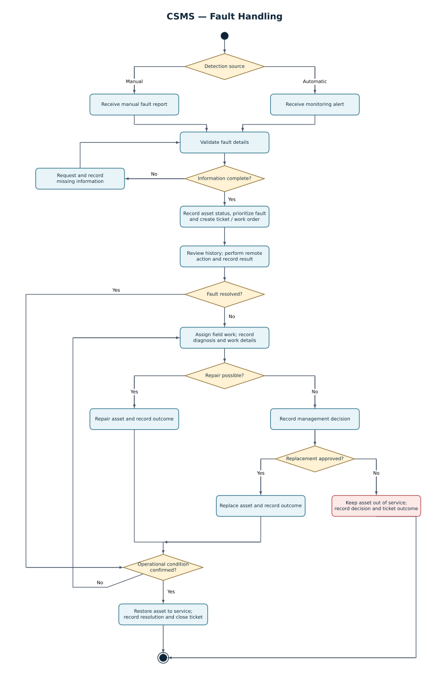

# نمودار فعالیت — رسیدگی به خرابی

[فهرست گزارش‌ها](../../../INDEX.md)

## ثبت و تشکیل تیکت

گزارش دستی یا هشدار سامانهٔ پایش، ورودی فرایند است. اطلاعات تجهیز، نوع خطا، زمان و منبع بررسی می‌شوند. در صورت ناکامل‌بودن اطلاعات، جزئیات تکمیلی دریافت می‌شود. سپس وضعیت دارایی، اولویت و تیکت یا دستورکار ثبت می‌شوند.

## عیب‌یابی از راه دور

کارشناس، تاریخچهٔ تجهیز را می‌بیند و اقدام از راه دور را همراه با نتیجه ثبت می‌کند. رفع خرابی پس از احراز وضعیت عملیاتی به بازگشت تجهیز به خدمت و بسته‌شدن تیکت می‌انجامد. در صورت رفع‌نشدن مشکل، مأموریت میدانی ایجاد می‌شود.

## رسیدگی میدانی و تصمیم فنی

تکنسین داخلی یا پیمانکار، مأموریت و جزئیات تشخیص را ثبت می‌کند. برای تجهیز قابل تعمیر، نتیجهٔ تعمیر و تأیید عملکرد ثبت می‌شود. در نیاز به جایگزینی، تصمیم مدیریتی مبنای اقدام است. جایگزینیِ تأییدشده پس از نصب و احراز عملکرد به بازگشت به خدمت می‌رسد؛ در تصمیم عدم جایگزینی، تجهیز خارج از سرویس باقی می‌ماند و نتیجهٔ تیکت ثبت می‌شود.

وضعیت تیکت و وضعیت عملیاتی دارایی مستقل‌اند. ثبت نتیجه یا بسته‌شدن تیکت، تجهیز خارج از سرویس را برای نشست جدید آماده نمی‌کند.

## نمودار

[فایل قابل ویرایش نمودار](../../../../../models/graphviz/fault-activity.dot)
