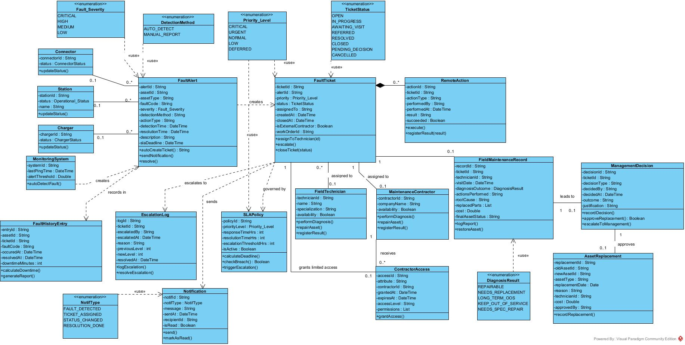

# نمودار کلاس - رسیدگی به خرابی

[فهرست گزارش‌ها](../../../INDEX.md)

# نمودار کلاس – رسیدگی به خرابی<a href="#fn-1-7730" id="fnref-1-7730">1</a>

## مقدمه

نمودار کلاس<a href="#fn-2-7730" id="fnref-2-7730">2</a> جریان کاری «رسیدگی به خرابی»، ساختار داده‌ای و ارتباط بین موجودیت‌های اصلی سامانه را در فرآیند تشخیص، ثبت، پیگیری، تعمیر و بستن خرابی نمایش می‌دهد. این نمودار نشان می‌دهد که خرابی ابتدا در قالب یک هشدار خرابی<a href="#fn-3-7730" id="fnref-3-7730">3</a> ثبت می‌شود، سپس به تیکت خرابی<a href="#fn-4-7730" id="fnref-4-7730">4</a> تبدیل می‌گردد و در ادامه، از طریق اقدام از راه دور، تعمیر میدانی، تصمیم مدیریتی، جایگزینی دارایی و ثبت سوابق، مدیریت می‌شود.

در این نمودار، کلاس‌های اصلی مربوط به دارایی‌ها، هشدار خرابی، تیکت خرابی، اقدام از راه دور، تعمیرات میدانی، تصمیم مدیریتی، پیمانکار، تکنسین، سطح توافق خدمات، اعلان‌ها و سوابق خرابی نمایش داده شده‌اند. همچنین برای جلوگیری از ابهام در مقادیر قابل قبول بعضی از فیلدها، چند enumeration نیز در نمودار تعریف شده است.

هدف اصلی این نمودار، مشخص‌کردن موجودیت‌هایی است که در فرآیند رسیدگی به خرابی باید در سامانه نگهداری شوند و همچنین نمایش روابط آن‌ها با یکدیگر است. به کمک این نمودار، می‌توان فهمید هر خرابی به کدام دارایی مربوط است، چگونه به تیکت تبدیل می‌شود، چه کسی مسئول رسیدگی است، آیا اقدام از راه دور انجام شده، آیا تعمیر میدانی ثبت شده، آیا تصمیم مدیریتی لازم بوده و در نهایت وضعیت خرابی چگونه در سابقه دارایی ذخیره می‌شود.

## ۱. کلاس‌های مربوط به دارایی‌ها

در سمت چپ نمودار، سه کلاس مربوط به دارایی‌های شبکه شارژ نمایش داده شده‌اند:

- **Station**
- **Charger**
- **Connector**

این سه کلاس همان دارایی‌هایی هستند که ممکن است خرابی برای آن‌ها ثبت شود. در این نمودار، هرکدام از این کلاس‌ها با کلاس **FaultAlert** رابطه دارند.

### ۱.۱. کلاس Station

کلاس **Station** نمایانگر ایستگاه شارژ است.

**صفات این کلاس:**

- stationId : String
- status : Operational_Status
- name : String

**عملیات این کلاس:**

- updateStatus()

رابطه این کلاس با **FaultAlert** نشان می‌دهد که یک ایستگاه می‌تواند منشأ چند هشدار خرابی باشد. در سمت Station عدد **0..1** و در سمت FaultAlert عدد **0..**\* قرار دارد؛ یعنی هر هشدار خرابی می‌تواند به صفر یا یک ایستگاه مربوط باشد و هر ایستگاه می‌تواند صفر تا چند هشدار خرابی داشته باشد.

### ۱.۲. کلاس Charger

کلاس **Charger** نمایانگر شارژر است.

**صفات این کلاس:**

- chargerId : String
- status : ChargerStatus

**عملیات این کلاس:**

- updateStatus()

رابطه این کلاس با **FaultAlert** مشابه رابطه ایستگاه با هشدار خرابی است. هر شارژر می‌تواند صفر تا چند هشدار خرابی داشته باشد و هر هشدار خرابی می‌تواند به صفر یا یک شارژر مربوط باشد.

### ۱.۳. کلاس Connector

کلاس **Connector** نمایانگر کانکتور متصل به شارژر است.

**صفات این کلاس:**

- connectorId : String
- status : ConnectorStatus

**عملیات این کلاس:**

- updateStatus()

رابطه این کلاس با **FaultAlert** نشان می‌دهد که خرابی ممکن است در سطح کانکتور نیز ثبت شود. هر کانکتور می‌تواند صفر تا چند هشدار خرابی داشته باشد و هر هشدار خرابی می‌تواند به صفر یا یک کانکتور مربوط باشد.

## ۲. کلاس MonitoringSystem

کلاس **MonitoringSystem** نمایانگر بخشی از سامانه است که می‌تواند خرابی را به‌صورت خودکار تشخیص دهد.

**صفات این کلاس:**

- systemId : String
- lastPingTime : DateTime
- alertThreshold : Double

**عملیات این کلاس:**

- autoDetectFault()

بین **MonitoringSystem** و **FaultAlert** رابطه وابستگی با برچسب **creates** وجود دارد. این رابطه نشان می‌دهد که سامانه پایش می‌تواند بر اساس تشخیص خودکار، یک هشدار خرابی ایجاد کند.

## ۳. کلاس FaultAlert

کلاس **FaultAlert** یکی از کلاس‌های مرکزی نمودار است. این کلاس اطلاعات اولیه مربوط به خرابی یا هشدار ایجادشده را نگهداری می‌کند.

**صفات این کلاس:**

- alertId : String
- assetId : String
- assetType : String
- faultCode : String
- severity : Fault_Severity
- detectionMethod : String
- actionType : String
- detectionTime : DateTime
- resolutionTime : DateTime
- description : String
- slaDeadline : DateTime

**عملیات این کلاس:**

- autoCreateTicket() : String
- sendNotification()
- resolve()

در نمودار، **FaultAlert** از enumerationهای **Fault_Severity** و **DetectionMethod** استفاده می‌کند. همچنین رابطه‌ای با **FaultTicket** دارد که با برچسب **creates** مشخص شده است. این رابطه نشان می‌دهد که هشدار خرابی می‌تواند باعث ایجاد تیکت خرابی شود.

## ۴. کلاس FaultTicket

کلاس **FaultTicket** مرکز اصلی پیگیری خرابی در نمودار است. پس از ایجاد هشدار خرابی، برای پیگیری ساختاریافته مشکل، تیکت خرابی ایجاد می‌شود.

**صفات این کلاس:**

- ticketId : String
- alertId : String
- priority : Priority_Level
- status : TicketStatus
- assignedTo : String
- createdAt : DateTime
- closedAt : DateTime
- isExternalContractor : Boolean
- workOrderId : String

**عملیات این کلاس:**

- assignToTechnician(id)
- escalate()
- closeTicket(status)

این کلاس از enumerationهای **Priority_Level** و **TicketStatus** استفاده می‌کند. همچنین با چند کلاس دیگر رابطه دارد:

- با **RemoteAction**
- با **FieldTechnician**
- با **MaintenanceContractor**
- با **FieldMaintenanceRecord**
- با **SLAPolicy**
- با **EscalationLog**
- با **ContractorAccess**

در نمودار، رابطه بین **FaultTicket** و **RemoteAction** به‌صورت composition نمایش داده شده است. این یعنی اقدام‌های از راه دور به تیکت خرابی وابسته هستند. در سمت RemoteAction عدد **0..**\* قرار دارد؛ یعنی هر تیکت می‌تواند صفر تا چند اقدام از راه دور داشته باشد.

رابطه FaultTicket با FieldTechnician و MaintenanceContractor نشان می‌دهد که تیکت می‌تواند به تکنسین میدانی یا پیمانکار تعمیرات اختصاص داده شود. در هر دو رابطه، در سمت افراد عدد **0..1** دیده می‌شود؛ یعنی هر تیکت می‌تواند به صفر یا یک تکنسین و همچنین صفر یا یک پیمانکار مرتبط شود.

## ۵. کلاس RemoteAction

کلاس **RemoteAction** مربوط به اقداماتی است که برای رفع خرابی از راه دور انجام می‌شوند.

**صفات این کلاس:**

- actionId : String
- ticketId : String
- actionType : String
- performedBy : String
- performedAt : DateTime
- result : String
- succeeded : Boolean

**عملیات این کلاس:**

- execute()
- registerResult(result)

رابطه این کلاس با **FaultTicket** نشان می‌دهد که هر اقدام از راه دور به یک تیکت مربوط است و هر تیکت می‌تواند چند اقدام از راه دور داشته باشد.

## ۶. کلاس FieldTechnician

کلاس **FieldTechnician** نمایانگر تکنسین میدانی است که می‌تواند برای رسیدگی حضوری به خرابی به تیکت اختصاص داده شود.

**صفات این کلاس:**

- technicianId : String
- name : String
- specialization : String
- availability : Boolean

**عملیات این کلاس:**

- performDiagnosis()
- repairAsset()
- registerResult()

در نمودار، بین **FaultTicket** و **FieldTechnician** رابطه assignment وجود دارد. همچنین **FieldTechnician** با **ContractorAccess** رابطه دارد و در نمودار مشخص شده است که تکنسین می‌تواند دسترسی محدود را اعطا کند.

## ۷. کلاس MaintenanceContractor

کلاس **MaintenanceContractor** نمایانگر پیمانکار تعمیرات است.

**صفات این کلاس:**

- contractorId : String
- companyName : String
- availability : Boolean

**عملیات این کلاس:**

- performDiagnosis()
- repairAsset()
- registerResult()

این کلاس مانند تکنسین میدانی می‌تواند برای رسیدگی به تیکت درگیر شود. در نمودار، بین **FaultTicket** و **MaintenanceContractor** رابطه assignment وجود دارد. همچنین پیمانکار با **ContractorAccess** ارتباط دارد و می‌تواند دسترسی محدود دریافت کند.

## ۸. کلاس ContractorAccess

کلاس **ContractorAccess** برای نمایش دسترسی محدود پیمانکار تعمیرات به سامانه در نظر گرفته شده است.

**صفات این کلاس:**

- accessId : String
- attribute : String
- contractorId : String
- grantedAt : DateTime
- expiresAt : DateTime
- accessLevel : String
- permissions : List

**عملیات این کلاس:**

- grantAccess()

در نمودار، **FieldTechnician** با این کلاس رابطه‌ای با برچسب **grants limited access** دارد. همچنین **MaintenanceContractor** از این کلاس دسترسی دریافت می‌کند. این رابطه با برچسب **receives** نمایش داده شده است.

## ۹. کلاس FieldMaintenanceRecord

کلاس **FieldMaintenanceRecord** برای ثبت نتیجه رسیدگی میدانی به خرابی استفاده می‌شود.

**صفات این کلاس:**

- recordId : String
- ticketId : String
- technicianId : String
- visitDate : DateTime
- diagnosisOutcome : DiagnosisResult
- actionsPerformed : String
- rootCause : String
- replacedParts : List
- cost : Double
- finalAssetStatus : String

**عملیات این کلاس:**

- logReport()
- restoreAsset()

این کلاس از enumeration **DiagnosisResult** استفاده می‌کند. رابطه بین **FaultTicket** و **FieldMaintenanceRecord** نشان می‌دهد که هر تیکت می‌تواند صفر یا یک رکورد تعمیرات میدانی داشته باشد و هر رکورد تعمیرات میدانی به یک تیکت مربوط است.

## ۱۰. کلاس ManagementDecision

کلاس **ManagementDecision** مربوط به تصمیم مدیریتی پس از بررسی نتیجه تعمیرات میدانی است.

**صفات این کلاس:**

- decisionId : String
- ticketId : String
- decisionType : String
- decidedBy : String
- decidedAt : DateTime
- outcome : String
- justification : String

**عملیات این کلاس:**

- recordDecision()
- approveReplacement() : Boolean
- escalateToManagement()

در نمودار، **FieldMaintenanceRecord** به **ManagementDecision** منتهی می‌شود. این رابطه با برچسب **leads to** نمایش داده شده است. همچنین **ManagementDecision** با **AssetReplacement** رابطه دارد و می‌تواند جایگزینی دارایی را تأیید کند.

## ۱۱. کلاس AssetReplacement

کلاس **AssetReplacement** برای ثبت اطلاعات مربوط به جایگزینی دارایی استفاده می‌شود.

**صفات این کلاس:**

- replacementId : String
- oldAssetId : String
- newAssetId : String
- assetType : String
- replacementDate : Date
- reason : String
- technicianId : String
- cost : Double
- approvedBy : String

**عملیات این کلاس:**

- recordReplacement()

رابطه بین **ManagementDecision** و **AssetReplacement** با برچسب **approves** نمایش داده شده است. طبق multiplicity نمودار، هر تصمیم مدیریتی می‌تواند صفر یا یک جایگزینی دارایی را تأیید کند و هر جایگزینی دارایی به یک تصمیم مدیریتی مربوط است.

## ۱۲. کلاس FaultHistoryEntry

کلاس **FaultHistoryEntry** برای ثبت سابقه خرابی‌ها و اطلاعات مرتبط با آن‌ها استفاده می‌شود.

**صفات این کلاس:**

- entryId : String
- assetId : String
- ticketId : String
- faultCode : String
- occurredAt : DateTime
- resolvedAt : DateTime
- downtimeMinutes : int

**عملیات این کلاس:**

- calculateDowntime()
- generateReport()

در نمودار، بین **FaultAlert** و **FaultHistoryEntry** رابطه‌ای با برچسب **records in** وجود دارد. این رابطه نشان می‌دهد که اطلاعات خرابی در سابقه خرابی ثبت می‌شود.

## ۱۳. کلاس EscalationLog

کلاس **EscalationLog** برای ثبت موارد ارجاع یا تشدید رسیدگی به خرابی استفاده شده است.

**صفات این کلاس:**

- logId : String
- ticketId : String
- escalatedBy : String
- escalatedAt : DateTime
- reason : String
- previousLevel : int
- newLevel : int
- resolvedAt : DateTime

**عملیات این کلاس:**

- logEscalation()
- resolveEscalation()

در نمودار، **FaultTicket** می‌تواند به **EscalationLog** ارجاع داده شود. این رابطه با برچسب **escalates to** نمایش داده شده است.

## ۱۴. کلاس SLAPolicy

کلاس **SLAPolicy** برای نمایش سیاست سطح توافق خدمات در رسیدگی به خرابی استفاده شده است.

**صفات این کلاس:**

- policyId : String
- priorityLevel : Priority_Level
- responseTimeHrs : int
- resolutionTimeHrs : int
- escalationThresholdHrs : int
- isActive : Boolean

**عملیات این کلاس:**

- calculateDeadline()
- checkBreach() : Boolean
- triggerEscalation()

در نمودار، رابطه **FaultTicket** با **SLAPolicy** با برچسب **governed by** نمایش داده شده است؛ یعنی رسیدگی به تیکت خرابی بر اساس سیاست SLA کنترل می‌شود.

## ۱۵. کلاس Notification

کلاس **Notification** برای ارسال اعلان‌های مربوط به فرآیند خرابی استفاده شده است.

**صفات این کلاس:**

- notifId : String
- notifType : NotifyType
- message : String
- sentAt : DateTime
- recipientId : String
- isRead : Boolean

**عملیات این کلاس:**

- send()
- markAsRead()

در نمودار، **FaultAlert** به **Notification** وابسته است و رابطه با برچسب **sends** نمایش داده شده است. همچنین **Notification** از enumeration **NotifyType** استفاده می‌کند.

## ۱۶. Enumerationها

در این نمودار چند enumeration برای محدود کردن مقدار بعضی صفات استفاده شده است.

### ۱۶.۱. Fault_Severity

این enumeration برای شدت خرابی در کلاس **FaultAlert** استفاده شده است.

مقادیر آن عبارت‌اند از:

- CRITICAL
- HIGH
- MEDIUM
- LOW

### ۱۶.۲. DetectionMethod

این enumeration برای روش تشخیص خرابی استفاده شده است.

مقادیر آن عبارت‌اند از:

- AUTO_DETECT
- MANUAL_REPORT

### ۱۶.۳. Priority_Level

این enumeration برای سطح اولویت تیکت خرابی و سیاست SLA استفاده شده است.

مقادیر آن عبارت‌اند از:

- CRITICAL
- URGENT
- NORMAL
- LOW
- DEFERRED

### ۱۶.۴. TicketStatus

این enumeration برای وضعیت تیکت خرابی استفاده شده است.

مقادیر آن عبارت‌اند از:

- OPEN
- IN_PROGRESS
- AWAITING_VISIT
- REFERRED
- RESOLVED
- CLOSED
- PENDING_DECISION
- CANCELLED

### ۱۶.۵. DiagnosisResult

این enumeration برای نتیجه عیب‌یابی میدانی در کلاس **FieldMaintenanceRecord** استفاده شده است.

مقادیر آن عبارت‌اند از:

- REPAIRABLE
- NEEDS_REPLACEMENT
- LONG_TERM_OOS
- KEEP_OUT_OF_SERVICE
- NEEDS_SPEC_REPAIR

### ۱۶.۶. NotifyType

این enumeration برای نوع اعلان در کلاس **Notification** استفاده شده است.

مقادیر آن عبارت‌اند از:

- FAULT_DETECTED
- TICKET_ASSIGNED
- STATUS_CHANGED
- RESOLUTION_DONE

## ۱۷. روابط اصلی نمودار

در جدول زیر، روابط اصلی نمایش‌داده‌شده در نمودار خلاصه شده‌اند:

<table>
<colgroup>
<col style="width: 25%" />
<col style="width: 25%" />
<col style="width: 25%" />
<col style="width: 25%" />
</colgroup>
<thead>
<tr class="header">
<th aria-sort="none" scope="col">

&#10;
</th>
<th aria-sort="none" scope="col">

&#10;
</th>
<th aria-sort="none" scope="col">

&#10;
</th>
<th aria-sort="none" scope="col">

&#10;
</th>
</tr>
</thead>
<tbody>
<tr class="odd">
<td>MonitoringSystem</td>
<td>creates</td>
<td>FaultAlert</td>
<td>سامانه پایش می‌تواند هشدار خرابی ایجاد کند.</td>
</tr>
<tr class="even">
<td>Station</td>
<td>association</td>
<td>FaultAlert</td>
<td>هر ایستگاه می‌تواند صفر تا چند هشدار خرابی داشته باشد.</td>
</tr>
<tr class="odd">
<td>Charger</td>
<td>association</td>
<td>FaultAlert</td>
<td>هر شارژر می‌تواند صفر تا چند هشدار خرابی داشته باشد.</td>
</tr>
<tr class="even">
<td>Connector</td>
<td>association</td>
<td>FaultAlert</td>
<td>هر کانکتور می‌تواند صفر تا چند هشدار خرابی داشته باشد.</td>
</tr>
<tr class="odd">
<td>FaultAlert</td>
<td>creates</td>
<td>FaultTicket</td>
<td>هشدار خرابی می‌تواند باعث ایجاد تیکت خرابی شود.</td>
</tr>
<tr class="even">
<td>FaultTicket</td>
<td>composition</td>
<td>RemoteAction</td>
<td>هر تیکت می‌تواند صفر تا چند اقدام از راه دور داشته باشد.</td>
</tr>
<tr class="odd">
<td>FaultTicket</td>
<td>assigned to</td>
<td>FieldTechnician</td>
<td>تیکت می‌تواند به تکنسین میدانی اختصاص داده شود.</td>
</tr>
<tr class="even">
<td>FaultTicket</td>
<td>assigned to</td>
<td>MaintenanceContractor</td>
<td>تیکت می‌تواند به پیمانکار تعمیرات اختصاص داده شود.</td>
</tr>
<tr class="odd">
<td>FaultTicket</td>
<td>association</td>
<td>FieldMaintenanceRecord</td>
<td>هر تیکت می‌تواند صفر یا یک رکورد تعمیرات میدانی داشته باشد.</td>
</tr>
<tr class="even">
<td>FieldMaintenanceRecord</td>
<td>leads to</td>
<td>ManagementDecision</td>
<td>نتیجه تعمیرات میدانی می‌تواند به تصمیم مدیریتی منجر شود.</td>
</tr>
<tr class="odd">
<td>ManagementDecision</td>
<td>approves</td>
<td>AssetReplacement</td>
<td>تصمیم مدیریتی می‌تواند جایگزینی دارایی را تأیید کند.</td>
</tr>
<tr class="even">
<td>FaultAlert</td>
<td>records in</td>
<td>FaultHistoryEntry</td>
<td>اطلاعات خرابی در سابقه خرابی ثبت می‌شود.</td>
</tr>
<tr class="odd">
<td>FaultTicket</td>
<td>escalates to</td>
<td>EscalationLog</td>
<td>تیکت می‌تواند به ثبت ارجاع یا تشدید منجر شود.</td>
</tr>
<tr class="even">
<td>FaultTicket</td>
<td>governed by</td>
<td>SLAPolicy</td>
<td>رسیدگی به تیکت بر اساس سیاست SLA کنترل می‌شود.</td>
</tr>
<tr class="odd">
<td>FaultAlert</td>
<td>sends</td>
<td>Notification</td>
<td>هشدار خرابی می‌تواند اعلان ارسال کند.</td>
</tr>
<tr class="even">
<td>FieldTechnician</td>
<td>grants limited access</td>
<td>ContractorAccess</td>
<td>تکنسین می‌تواند دسترسی محدود ایجاد کند.</td>
</tr>
<tr class="odd">
<td>MaintenanceContractor</td>
<td>receives</td>
<td>ContractorAccess</td>
<td>پیمانکار تعمیرات دسترسی محدود دریافت می‌کند.</td>
</tr>
</tbody>
</table>

## ۱۸. جمع‌بندی

نمودار کلاس رسیدگی به خرابی نشان می‌دهد که فرآیند خرابی در سامانه با چند موجودیت اصلی مدیریت می‌شود. در ابتدا، خرابی در قالب **FaultAlert** ثبت می‌شود و سپس می‌تواند باعث ایجاد **FaultTicket** شود. تیکت خرابی مرکز اصلی پیگیری فرآیند است و می‌تواند با اقدام از راه دور، تکنسین میدانی، پیمانکار تعمیرات، رکورد تعمیرات میدانی، سیاست SLA، ثبت ارجاع و دسترسی محدود پیمانکار در ارتباط باشد.

در ادامه، اگر رسیدگی میدانی انجام شود، نتیجه آن در **FieldMaintenanceRecord** ثبت می‌شود. در صورت نیاز، این رکورد می‌تواند به **ManagementDecision** منجر شود و تصمیم مدیریتی نیز می‌تواند جایگزینی دارایی را از طریق **AssetReplacement** تأیید کند. همچنین سوابق خرابی در **FaultHistoryEntry** ثبت می‌شوند و اعلان‌ها از طریق **Notification** ارسال می‌گردند.

وجود enumerationها در نمودار باعث شده است مقدارهایی مانند شدت خرابی، روش تشخیص، سطح اولویت، وضعیت تیکت، نتیجه عیب‌یابی و نوع اعلان به‌صورت مشخص و کنترل‌شده تعریف شوند. بنابراین، این نمودار ساختار داده‌ای لازم برای پیاده‌سازی بخش مدیریت خرابی‌ها و تیکت‌های تعمیراتی در **فاز نمونه‌سازی<a href="#fn-16-7730" id="fnref-16-7730">5</a>** را مشخص می‌کند.

## ۱۹. تصویر نمودار

------------------------------------------------------------------------

## پانویس‌ها

1.  

    Corrective Maintenance / Fault Handling [↩](#fnref-1-7730 "Back to reference 1")

    

2.  

    Class Diagram [↩](#fnref-2-7730 "Back to reference 2")

    

3.  

    Fault Alert [↩](#fnref-3-7730 "Back to reference 3")

    

4.  

    Fault Ticket [↩](#fnref-4-7730 "Back to reference 4")

    

5.  

    Prototyping [↩](#fnref-16-7730 "Back to reference 5")

    

