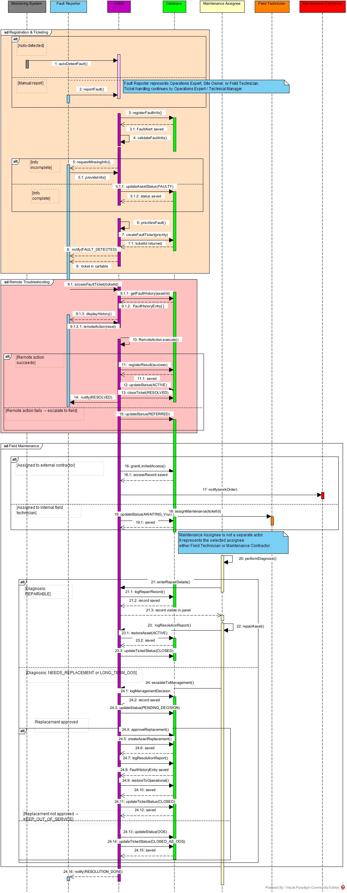

# نمودار توالی - رسیدگی به خرابی

[فهرست گزارش‌ها](../../../INDEX.md)

# نمودار توالی – رسیدگی به خرابی<a href="#fn-1-3588" id="fnref-1-3588">1</a>

## مقدمه

نمودار توالی<a href="#fn-2-3588" id="fnref-2-3588">2</a> جریان کاری «رسیدگی به خرابی»، ترتیب زمانی پیام‌ها و تعاملات میان اجزای مختلف سامانه را در فرآیند شناسایی، ثبت، بررسی، ارجاع، تعمیر و بستن خرابی نمایش می‌دهد. این نمودار نشان می‌دهد که پس از شناسایی خرابی، هر پیام از طرف کدام بازیگر یا جزء سامانه ارسال می‌شود، چه پاسخی دریافت می‌گردد و در هر مرحله، داده‌ها چگونه در پایگاه داده<a href="#fn-3-3588" id="fnref-3-3588">3</a> ذخیره یا به‌روزرسانی می‌شوند.

در این نمودار، فرآیند رسیدگی به خرابی در سه بخش اصلی نمایش داده شده است:

1.  **ثبت و ایجاد تیکت خرابی**
2.  **عیب‌یابی و اقدام اصلاحی از راه دور**
3.  **تعمیر و نگهداری میدانی**

این سه بخش با نمودار مورد کاربرد و نمودار فعالیت همین جریان کاری هماهنگ هستند. تفاوت نمودار توالی با آن‌ها این است که در اینجا تمرکز اصلی بر ترتیب پیام‌ها، پاسخ‌ها، ذخیره‌سازی داده‌ها و مسیرهای شرطی در طول زمان است.

## ۱. اجزای اصلی نمودار

در بالای نمودار، اجزا و بازیگران اصلی به صورت lifeline نمایش داده شده‌اند. هر lifeline نشان می‌دهد که آن بازیگر یا جزء سامانه در چه مرحله‌ای از فرآیند پیام ارسال یا دریافت می‌کند.

<table>
<colgroup>
<col style="width: 33%" />
<col style="width: 33%" />
<col style="width: 33%" />
</colgroup>
<thead>
<tr class="header">
<th style="text-align: center;" aria-sort="none" scope="col">

&#10;
</th>
<th aria-sort="none" scope="col">

&#10;
</th>
<th aria-sort="none" scope="col">

&#10;
</th>
</tr>
</thead>
<tbody>
<tr class="odd">
<td style="text-align: center;">۱</td>
<td>Monitoring System<a href="#fn-4-3588" id="fnref-4-3588">4</a></td>
<td>تشخیص خودکار خرابی و ارسال پیام autoDetectFault به سامانه</td>
</tr>
<tr class="even">
<td style="text-align: center;">۲</td>
<td>Fault Reporter<a href="#fn-5-3588" id="fnref-5-3588">5</a></td>
<td>نقش عمومی گزارش‌دهنده خرابی در مسیر گزارش دستی؛ این نقش می‌تواند نماینده کارشناس عملیات، مالک سایت یا تکنسین میدانی باشد</td>
</tr>
<tr class="odd">
<td style="text-align: center;">۳</td>
<td>CSMS<a href="#fn-6-3588" id="fnref-6-3588">6</a></td>
<td>هسته اصلی سامانه که پیام‌ها را دریافت، پردازش و به پایگاه داده ارسال می‌کند</td>
</tr>
<tr class="even">
<td style="text-align: center;">۴</td>
<td>Database<a href="#fn-7-3588" id="fnref-7-3588">7</a></td>
<td>ذخیره اطلاعات خرابی، تیکت، وضعیت دارایی، تاریخچه، تصمیم مدیریتی و نتیجه نهایی</td>
</tr>
<tr class="odd">
<td style="text-align: center;">۵</td>
<td>Maintenance Assignee<a href="#fn-8-3588" id="fnref-8-3588">8</a></td>
<td>نقش انتخاب‌شده برای رسیدگی میدانی؛ می‌تواند تکنسین میدانی یا پیمانکار تعمیرات باشد</td>
</tr>
<tr class="even">
<td style="text-align: center;">۶</td>
<td>Field Technician<a href="#fn-9-3588" id="fnref-9-3588">9</a></td>
<td>دریافت کار در حالت ارجاع به نیروی داخلی</td>
</tr>
<tr class="odd">
<td style="text-align: center;">۷</td>
<td>Maintenance Contractor<a href="#fn-10-3588" id="fnref-10-3588">10</a></td>
<td>دریافت کار در حالت ارجاع به پیمانکار بیرونی</td>
</tr>
</tbody>
</table>

## ۲. بخش ثبت و ایجاد تیکت خرابی

بخش اول نمودار با عنوان **Registration & Ticketing** نمایش داده شده است. این بخش مسیر آغاز فرآیند خرابی را نشان می‌دهد.

در ابتدای نمودار توالی، ثبت خرابی به دو مسیر اصلی تقسیم شده است:

- **تشخیص خودکار خرابی**
- **گزارش دستی خرابی**

در مسیر تشخیص خودکار، **Monitoring System** پیام **autoDetectFault()** را به **CSMS** ارسال می‌کند. این مسیر زمانی اجرا می‌شود که خرابی توسط سامانه پایش شناسایی شود.

در مسیر گزارش دستی، **Fault Reporter** پیام **reportFault()** را به **CSMS** ارسال می‌کند. در این نمودار، به‌جای نمایش جداگانه همه بازیگرانی که امکان ثبت گزارش خرابی دارند، از نقش عمومی **Fault Reporter** استفاده شده است. این نقش می‌تواند نماینده کارشناس عملیات، مالک سایت یا تکنسین میدانی باشد.

دلیل این انتخاب آن است که در نمودار توالی، هدف نمایش ترتیب تعاملات اصلی است، نه تکرار یک پیام مشابه برای چند بازیگر مختلف. بنابراین، به‌جای اینکه پیام **reportFault()** چند بار از چند بازیگر مختلف به سامانه ارسال شود، یک نقش عمومی برای همه گزارش‌دهندگان دستی در نظر گرفته شده است.

پس از دریافت گزارش خرابی، **CSMS** پیام **registerFaultInfo()** را به **Database** ارسال می‌کند. سپس پایگاه داده پیام بازگشتی **FaultAlert saved** را ارسال می‌کند تا نشان دهد هشدار خرابی در سامانه ذخیره شده است.

بعد از ذخیره هشدار، **CSMS** پیام **validateFaultInfo()** را اجرا می‌کند تا اطلاعات خرابی بررسی شود. سپس یک قطعه شرطی دیگر وجود دارد که دو حالت را نمایش می‌دهد:

- اگر اطلاعات ناقص باشد، **CSMS** پیام **requestMissingInfo()** را برای نقش مربوط به تکمیل اطلاعات ارسال می‌کند و پس از آن پیام **provideInfo()** به سامانه برمی‌گردد.
- اگر اطلاعات کامل باشد، **CSMS** پیام **updateAssetStatus(FAULTY)** را به **Database** ارسال می‌کند و پایگاه داده پیام **status saved** را برمی‌گرداند.

پس از ثبت گزارش خرابی، ادامه فرآیند الزاماً توسط همان فرد گزارش‌دهنده انجام نمی‌شود. برای مثال، مالک سایت ممکن است فقط خرابی را گزارش کند، اما پس از ثبت و اعتبارسنجی اطلاعات، تیکت خرابی در کارتابل نقش‌های عملیاتی مانند کارشناس عملیات یا مدیر فنی قرار می‌گیرد. بنابراین در ادامه نمودار، دسترسی به تیکت و انجام مراحل رسیدگی توسط نقش‌های مجاز عملیاتی نمایش داده شده است. این تفکیک نشان می‌دهد که «گزارش‌دهنده خرابی» و «مسئول رسیدگی به خرابی» لزوماً یک نقش یکسان نیستند.

پس از کامل شدن اطلاعات، **CSMS** پیام **prioritizeFault()** را اجرا می‌کند. سپس پیام **createFaultTicket(priority)** به پایگاه داده ارسال می‌شود و پایگاه داده پیام **ticketId returned** را برمی‌گرداند. این مرحله نشان می‌دهد که برای خرابی ثبت‌شده، یک تیکت خرابی ایجاد شده است.

در پایان این بخش، **CSMS** پیام **notify(FAULT_DETECTED)** را برای نقش عملیاتی مجاز ارسال می‌کند و تیکت در کارتابل قابل مشاهده می‌شود. این موضوع با پیام **ticket in cartable** نمایش داده شده است.

## ۳. بخش عیب‌یابی و اقدام اصلاحی از راه دور

بخش دوم نمودار با عنوان **Remote Troubleshooting** نمایش داده شده است. این بخش زمانی آغاز می‌شود که تیکت خرابی ایجاد شده و توسط نقش عملیاتی مجاز بررسی می‌شود.

ابتدا پیام **accessFaultTicket(ticketId)** به **CSMS** ارسال می‌شود. سپس سامانه برای نمایش سابقه خرابی، پیام **getFaultHistory(assetId)** را به **Database** ارسال می‌کند. پایگاه داده پیام **FaultHistoryEntry\[\]** را برمی‌گرداند و سامانه با پیام **displayHistory()** سوابق را نمایش می‌دهد.

پس از مشاهده تاریخچه، پیام **remoteAction(reset)** به **CSMS** ارسال می‌شود. سپس در نمودار، اجرای اقدام از راه دور با پیام **RemoteAction.execute()** نمایش داده شده است.

در ادامه، یک قطعه شرطی وجود دارد که نتیجه اقدام از راه دور را مشخص می‌کند:

- اگر اقدام از راه دور موفق باشد، **CSMS** پیام **registerResult(success)** را به **Database** ارسال می‌کند و پایگاه داده پیام **saved** را برمی‌گرداند. سپس سامانه پیام **updateStatus(ACTIVE)** را به پایگاه داده ارسال می‌کند و پس از ذخیره وضعیت، پیام **closeTicket(RESOLVED)** برای بستن تیکت ارسال می‌شود. در پایان این مسیر، **CSMS** پیام **notify(RESOLVED)** را برای نقش عملیاتی مجاز ارسال می‌کند.
- اگر اقدام از راه دور ناموفق باشد، **CSMS** پیام **updateStatus(REFERRED)** را به **Database** ارسال می‌کند. این وضعیت نشان می‌دهد که تیکت باید برای رسیدگی میدانی ارجاع داده شود.

بنابراین، در این بخش دو مسیر اصلی وجود دارد: یا مشکل از راه دور حل می‌شود و تیکت بسته می‌شود، یا مشکل حل نمی‌شود و فرآیند وارد مرحله تعمیر و نگهداری میدانی می‌گردد.

## ۴. بخش تعمیر و نگهداری میدانی

بخش سوم نمودار با عنوان **Field Maintenance** نمایش داده شده است. این بخش زمانی اجرا می‌شود که اقدام از راه دور موفق نباشد و لازم باشد رسیدگی به خرابی به صورت میدانی انجام شود.

در ابتدای این بخش، یک قطعه شرطی وجود دارد که دو حالت تخصیص کار را نشان می‌دهد:

- اگر کار به پیمانکار بیرونی اختصاص داده شود، **CSMS** پیام **grantLimitedAccess()** را به **Database** ارسال می‌کند. سپس پایگاه داده پیام **accessRecord saved** را برمی‌گرداند. پس از آن، سامانه پیام **notify(workOrder)** را برای **Maintenance Contractor** ارسال می‌کند.
- اگر کار به تکنسین داخلی اختصاص داده شود، **CSMS** پیام **assignMaintenance(ticketId)** را برای **Field Technician** ارسال می‌کند. همچنین پیام **updateStatus(AWAITING_VISIT)** به پایگاه داده ارسال می‌شود و پایگاه داده پیام **saved** را برمی‌گرداند.

در نمودار، یک یادداشت کنار **Maintenance Assignee** قرار داده شده است که توضیح می‌دهد این lifeline یک بازیگر جداگانه نیست، بلکه نماینده فرد یا واحدی است که برای رسیدگی انتخاب شده است؛ یعنی می‌تواند **Field Technician** یا **Maintenance Contractor** باشد.

پس از تخصیص کار، **Maintenance Assignee** پیام **performDiagnosis()** را اجرا می‌کند. سپس نمودار وارد یک قطعه شرطی دیگر می‌شود که نتیجه عیب‌یابی را مشخص می‌کند.

## ۵. مسیر قابل تعمیر بودن خرابی

در حالت **Diagnosis: REPAIRABLE**، یعنی نتیجه عیب‌یابی نشان می‌دهد که دارایی قابل تعمیر است.

در این مسیر، **Maintenance Assignee** پیام **enterRepairDetails()** را به **CSMS** ارسال می‌کند. سپس سامانه پیام **logRepairRecord()** را به **Database** ارسال می‌کند و پایگاه داده پیام **record saved** را برمی‌گرداند. پس از آن، پیام **record visible in panel** نمایش داده شده است تا مشخص شود نتیجه ثبت‌شده در پنل قابل مشاهده است.

در ادامه، **Maintenance Assignee** پیام **repairAsset()** را اجرا می‌کند. سپس **CSMS** پیام **logResolutionReport()** را به **Database** ارسال می‌کند. بعد از آن، پیام **restoreAsset(ACTIVE)** به پایگاه داده ارسال می‌شود و پس از ذخیره، پیام **updateTicketStatus(CLOSED)** نیز برای بستن تیکت ثبت می‌گردد.

این مسیر نشان می‌دهد که اگر خرابی قابل تعمیر باشد، پس از ثبت جزئیات تعمیر، دارایی به وضعیت فعال بازگردانده شده و تیکت بسته می‌شود.

## ۶. مسیر نیاز به جایگزینی یا خروج بلندمدت از سرویس

در حالت **Diagnosis: NEEDS_REPLACEMENT or LONG_TERM_OOS**، نتیجه عیب‌یابی نشان می‌دهد که دارایی به تعمیر ساده نیاز ندارد و باید تصمیم مدیریتی درباره آن ثبت شود.

در این مسیر، **CSMS** پیام **escalateToManagement()** را اجرا می‌کند. سپس پیام **logManagementDecision** به **Database** ارسال می‌شود و پایگاه داده پیام **record saved** را برمی‌گرداند. بعد از آن، پیام **updateStatus(PENDING_DECISION)** به پایگاه داده ارسال می‌شود تا وضعیت تیکت یا دارایی در حالت انتظار تصمیم ثبت شود.

سپس یک قطعه شرطی دیگر با عنوان **Replacement approved** وجود دارد که دو حالت را نمایش می‌دهد:

### ۶.۱. تأیید جایگزینی

اگر جایگزینی تأیید شود، **CSMS** پیام **approveReplacement()** را به **Database** ارسال می‌کند. سپس پیام **createAssetReplacement()** ارسال می‌شود و پایگاه داده پیام **saved** را برمی‌گرداند.

پس از ثبت جایگزینی، **CSMS** پیام **logResolutionReport()** را ارسال می‌کند. در ادامه، پیام **FaultHistoryEntry saved** نمایش داده شده است. سپس سامانه پیام **restoreToOperational()** را به پایگاه داده ارسال می‌کند و پس از ذخیره، پیام **updateTicketStatus(CLOSED)** را نیز ثبت می‌کند.

این مسیر نشان می‌دهد که در صورت تأیید جایگزینی، رکورد جایگزینی دارایی ثبت می‌شود، نتیجه در سابقه خرابی ذخیره می‌گردد، وضعیت عملیاتی بازگردانده می‌شود و تیکت بسته می‌شود.

### ۶.۲. عدم تأیید جایگزینی

اگر جایگزینی تأیید نشود، مسیر **Replacement not approved -- KEEP_OUT_OF_SERVICE** اجرا می‌شود.

در این حالت، **CSMS** پیام **updateStatus(OOS)** را به **Database** ارسال می‌کند. سپس پیام **updateTicketStatus(CLOSED_AS_OOS)** ارسال می‌شود و پایگاه داده پیام **saved** را برمی‌گرداند.

این مسیر نشان می‌دهد که اگر جایگزینی تأیید نشود، دارایی در وضعیت خارج از سرویس باقی می‌ماند و تیکت با وضعیت مربوط به خارج از سرویس بسته می‌شود.

در پایان بخش تعمیر و نگهداری میدانی، **CSMS** پیام **notify(RESOLUTION_DONE)** را برای نقش عملیاتی مجاز ارسال می‌کند تا نتیجه نهایی فرآیند اطلاع‌رسانی شود.

## ۷. قطعه‌های شرطی موجود در نمودار

در این نمودار، چند قطعه شرطی برای نمایش مسیرهای جایگزین استفاده شده است.

<table>
<colgroup>
<col style="width: 25%" />
<col style="width: 25%" />
<col style="width: 25%" />
<col style="width: 25%" />
</colgroup>
<thead>
<tr class="header">
<th style="text-align: center;" aria-sort="none" scope="col">

&#10;
</th>
<th aria-sort="none" scope="col">

&#10;
</th>
<th aria-sort="none" scope="col">

&#10;
</th>
<th aria-sort="none" scope="col">

&#10;
</th>
</tr>
</thead>
<tbody>
<tr class="odd">
<td style="text-align: center;">۱</td>
<td>Registration &amp; Ticketing</td>
<td>Auto-detected / Manual report</td>
<td>خرابی می‌تواند توسط سامانه پایش به‌صورت خودکار شناسایی شود یا توسط Fault Reporter به‌صورت دستی گزارش گردد.</td>
</tr>
<tr class="even">
<td style="text-align: center;">۲</td>
<td>Info incomplete / Info complete</td>
<td>اطلاعات ناقص / اطلاعات کامل</td>
<td>اگر اطلاعات ناقص باشد، سامانه درخواست اطلاعات تکمیلی می‌کند؛ اگر کامل باشد، وضعیت دارایی به‌روزرسانی می‌شود.</td>
</tr>
<tr class="odd">
<td style="text-align: center;">۳</td>
<td>Remote action succeeded / Remote action fails</td>
<td>موفق / ناموفق</td>
<td>اگر اقدام از راه دور موفق باشد، تیکت بسته می‌شود؛ اگر ناموفق باشد، تیکت به تعمیرات میدانی ارجاع می‌گردد.</td>
</tr>
<tr class="even">
<td style="text-align: center;">۴</td>
<td>Assigned to external contractor / Assigned to internal field technician</td>
<td>پیمانکار بیرونی / تکنسین داخلی</td>
<td>اگر کار به پیمانکار سپرده شود، دسترسی محدود ایجاد می‌شود؛ در غیر این صورت، کار به تکنسین داخلی اختصاص می‌یابد.</td>
</tr>
<tr class="odd">
<td style="text-align: center;">۵</td>
<td>Diagnosis: REPAIRABLE</td>
<td>قابل تعمیر</td>
<td>در این حالت، جزئیات تعمیر ثبت شده، دارایی تعمیر می‌شود و تیکت بسته می‌گردد.</td>
</tr>
<tr class="even">
<td style="text-align: center;">۶</td>
<td>Diagnosis: NEEDS_REPLACEMENT or LONG_TERM_OOS</td>
<td>نیازمند جایگزینی یا خروج بلندمدت از سرویس</td>
<td>در این حالت، تصمیم مدیریتی ثبت می‌شود.</td>
</tr>
<tr class="odd">
<td style="text-align: center;">۷</td>
<td>Replacement approved / Replacement not approved</td>
<td>تأیید جایگزینی / عدم تأیید جایگزینی</td>
<td>در صورت تأیید، جایگزینی ثبت می‌شود؛ در غیر این صورت، دارایی خارج از سرویس باقی می‌ماند.</td>
</tr>
</tbody>
</table>

## ۸. هماهنگی با نمودارهای دیگر

این نمودار توالی با نمودار مورد کاربرد، نمودار فعالیت و نمودار کلاس همین جریان کاری هماهنگ است. در نمودار مورد کاربرد، قابلیت‌هایی مانند گزارش خرابی، ثبت اطلاعات، اقدام از راه دور، ارجاع به تعمیرات میدانی، اعطای دسترسی محدود، تعمیر، تصمیم مدیریتی و بستن تیکت نمایش داده شده‌اند. در نمودار توالی، همین قابلیت‌ها به صورت پیام‌های زمانی میان بازیگران، سامانه و پایگاه داده نشان داده شده‌اند.

همچنین این نمودار با نمودار فعالیت هماهنگ است؛ زیرا همان سه مرحله اصلی را دنبال می‌کند: ثبت و ایجاد تیکت، عیب‌یابی از راه دور و تعمیرات میدانی. مسیرهای شرطی موجود در نمودار فعالیت، در نمودار توالی نیز با قطعه‌های alt نمایش داده شده‌اند.

از نظر ارتباط با نمودار کلاس نیز، پیام‌هایی مانند **registerFaultInfo()**، **createFaultTicket()**، **RemoteAction.execute()**، **logRepairRecord()**، **logManagementDecision**، **createAssetReplacement()** و **FaultHistoryEntry saved** با کلاس‌های اصلی نمودار کلاس مانند **FaultAlert**، **FaultTicket**، **RemoteAction**، **FieldMaintenanceRecord**، **ManagementDecision**، **AssetReplacement** و **FaultHistoryEntry** هماهنگ هستند.

## ۹. جمع‌بندی

نمودار توالی رسیدگی به خرابی نشان می‌دهد که فرآیند خرابی از نظر زمانی چگونه بین بازیگران و اجزای سامانه انجام می‌شود. در ابتدا، خرابی یا توسط سامانه پایش به‌صورت خودکار تشخیص داده می‌شود یا توسط نقش عمومی **Fault Reporter** به‌صورت دستی گزارش می‌گردد. نقش **Fault Reporter** برای جلوگیری از تکرار پیام مشابه از چند بازیگر مختلف استفاده شده و می‌تواند نماینده کارشناس عملیات، مالک سایت یا تکنسین میدانی باشد.

پس از ثبت خرابی، ادامه فرآیند لزوماً توسط همان فرد گزارش‌دهنده انجام نمی‌شود. تیکت پس از ثبت و اعتبارسنجی، در اختیار نقش‌های عملیاتی مجاز قرار می‌گیرد و رسیدگی به خرابی توسط آن‌ها ادامه پیدا می‌کند. این تفکیک باعث می‌شود تفاوت میان «گزارش‌دهنده خرابی» و «مسئول رسیدگی به خرابی» در نمودار مشخص باشد.

سپس اطلاعات خرابی در پایگاه داده ثبت و اعتبارسنجی می‌گردد. اگر اطلاعات ناقص باشد، اطلاعات تکمیلی درخواست می‌شود و اگر کامل باشد، وضعیت دارایی به‌روزرسانی، خرابی اولویت‌بندی و تیکت ایجاد می‌شود.

در مرحله بعد، نقش عملیاتی مجاز تیکت را مشاهده می‌کند، سابقه دارایی را بررسی می‌نماید و اقدام اصلاحی از راه دور انجام می‌دهد. اگر این اقدام موفق باشد، نتیجه ثبت شده، وضعیت دارایی فعال می‌شود، تیکت بسته می‌گردد و نتیجه اطلاع‌رسانی می‌شود. اگر اقدام از راه دور موفق نباشد، تیکت برای تعمیر و نگهداری میدانی ارجاع داده می‌شود.

در بخش تعمیرات میدانی، بسته به اینکه کار به تکنسین داخلی یا پیمانکار بیرونی اختصاص داده شود، مسیر مناسب اجرا می‌گردد. سپس عیب‌یابی انجام می‌شود و بر اساس نتیجه آن، دارایی یا تعمیر می‌شود، یا برای آن تصمیم مدیریتی ثبت می‌گردد. در صورت تأیید جایگزینی، رکورد جایگزینی ثبت می‌شود و در غیر این صورت، دارایی خارج از سرویس نگه داشته می‌شود. در پایان، وضعیت نهایی ثبت و نتیجه فرآیند به نقش عملیاتی مجاز اطلاع داده می‌شود.

این نمودار، ترتیب دقیق پیام‌های لازم برای پیاده‌سازی فرآیند رسیدگی به خرابی را مشخص می‌کند و نشان می‌دهد که هر مرحله از فرآیند چگونه در سامانه، پایگاه داده و نقش‌های انسانی منعکس می‌شود.

## ۱۰. تصویر نمودار

## ‏

## پانویس‌ها

1.  

    Corrective Maintenance / Fault Handling [↩](#fnref-1-3588 "Back to reference 1")

    

2.  

    Sequence Diagram [↩](#fnref-2-3588 "Back to reference 2")

    

3.  

    Database [↩](#fnref-3-3588 "Back to reference 3")

    

4.  

    Monitoring System [↩](#fnref-4-3588 "Back to reference 4")

    

5.  

    Fault Reporter [↩](#fnref-5-3588 "Back to reference 5")

    

6.  

    Charging Station Management System (CSMS) [↩](#fnref-6-3588 "Back to reference 6")

    

7.  

    Database [↩](#fnref-7-3588 "Back to reference 7")

    

8.  

    Maintenance Assignee [↩](#fnref-8-3588 "Back to reference 8")

    

9.  

    Field Technician [↩](#fnref-9-3588 "Back to reference 9")

    

10. 

    Maintenance Contractor [↩](#fnref-10-3588 "Back to reference 10")

    

