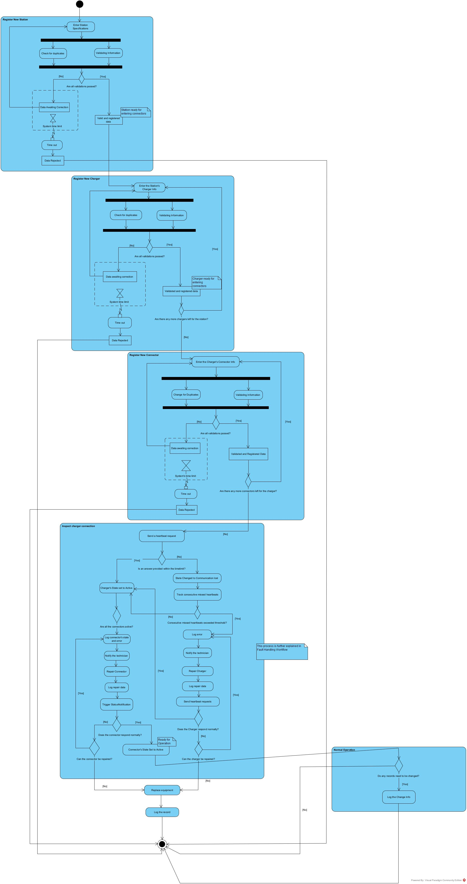

# نمودار فعالیت - چرخه عمر ایستگاه و شارژر

[فهرست گزارش‌ها](../../../INDEX.md)

# نمودار فعالیت – مدیریت چرخه عمر ایستگاه و شارژر<a href="#fn-1-842" id="fnref-1-842">1</a>

## مقدمه

نمودار فعالیت<a href="#fn-2-842" id="fnref-2-842">2</a> جریان کاری «مدیریت چرخه عمر ایستگاه و شارژر»، نمایش‌دهندهٔ گام‌های متوالی و موازی فرایند ثبت، اعتبارسنجی، راه‌اندازی، پایش سلامت، تعمیر و جایگزینی دارایی‌های شبکه شارژ (ایستگاه، شارژر و کانکتور) است. این نمودار به طور خاص بر روی جزئیات عملیاتی تمرکز دارد و تعاملات بین‌افزاری و تصمیمات شرطی را به صورت شفاف نشان می‌دهد.

> **نکته:** در این نمودار، به ثبت اطلاعات مالک پرداخته نمی‌شود، زیرا این موضوع لزوماً مختص به این جریان کاری نیست و در سایر جریان‌های کاری قابل پیگیری است.

## ۱. گام اول: ثبت و اعتبارسنجی ایستگاه جدید

فرایند با **ورود اطلاعات پایه ایستگاه** (نام، موقعیت جغرافیایی، آدرس، ظرفیت برق، مشخصات ارتباطی و غیره) آغاز می‌شود.

پس از ورود اطلاعات، دو فرایند اعتبارسنجی به صورت **همزمان** انجام می‌شود:

1.  **بررسی یکتایی ایستگاه** (عدم تکراری بودن شناسه)
2.  **اعتبارسنجی محتوایی داده‌ها** (کامل و سازگار بودن اطلاعات)

> **توضیح فنی:** اگرچه در یک کامپیوتر واقعی این فرایندها بر اساس توالی حلقه‌های <a href="#fn-3-842" id="fnref-3-842">3</a>نوشته شده، به صورت کاملاً همزمان اجرا نمی‌شوند، اما از آنجا که زمان پردازش توسط کامپیوتر بسیار ناچیز است، در این نمودار به صورت **همزمان** در نظر گرفته شده‌اند.

### وضعیت‌های پس از اعتبارسنجی:

#### حالت اول – تأیید اطلاعات:

در صورت پاس کردن هر دو مرحله اعتبارسنجی، ایستگاه آمادهٔ ثبت شارژرها می‌شود و فرایند وارد گام بعدی می‌گردد.

#### حالت دوم – رد اطلاعات:

در صورت عدم تأیید (اطلاعات ناقص، ناسازگار یا تکراری بودن شناسه)، سیستم اقدامات زیر را انجام می‌دهد:

- **نمایش پیام خطا** به کاربر
- **تعیین یک بازهٔ زمانی معین و محدود** برای امکان اصلاح اطلاعات توسط کاربر

**شاخه‌های فرعی در این حالت:**

- **اگر کاربر در بازهٔ زمانی تعیین‌شده، اطلاعات جدیدی وارد کند:** چرخهٔ اعتبارسنجی از ابتدا تکرار می‌شود (بازگشت به مرحلهٔ بررسی یکتایی و اعتبارسنجی محتوایی).

- **اگر کاربر در بازهٔ زمانی تعیین‌شده اقدامی انجام ندهد:** داده‌ها به طور کامل **رد <a href="#fn-4-842" id="fnref-4-842">4</a>** می‌شوند و فرایند **متوقف می‌گردد**.

## ۲. گام دوم: ثبت و اعتبارسنجی شارژرها

پس از تأیید ایستگاه، فرایند **ورود اطلاعات شارژرها** آغاز می‌شود. مراحل ثبت و اعتبارسنجی شارژر **دقیقاً مشابه مراحل ایستگاه** است (بررسی یکتایی و اعتبارسنجی محتوایی به صورت همزمان).

**تفاوت مهم در این مرحله:**

پس از تأیید هر شارژر، سیستم بررسی می‌کند که **آیا این ایستگاه، شارژر دیگری نیز برای ثبت دارد یا خیر؟**

- **اگر پاسخ مثبت است (شارژر دیگری وجود دارد):** فرایند به ابتدای ثبت شارژر بازگشته و شارژر بعدی ثبت می‌شود.

- **اگر پاسخ منفی است (ثبت تمام شارژرها به پایان رسیده است):** فرایند وارد **گام ثبت کانکتورها** می‌شود.

## ۳. گام سوم: ثبت و اعتبارسنجی کانکتورها

مراحل ثبت و اعتبارسنجی کانکتورها **دقیقاً مشابه مراحل ثبت شارژرها** است. سیستم پس از تأیید هر کانکتور، بررسی می‌کند که آیا کانکتور دیگری برای ثبت وجود دارد یا خیر و به صورت حلقه‌ای این فرایند را تا اتمام تمام کانکتورها ادامه می‌دهد.

پس از ثبت کامل تمام دارایی‌ها (ایستگاه، شارژرها و کانکتورها)، فرایند وارد **مرحلهٔ اطمینان از عملکرد صحیح** می‌شود.

## ۴. گام چهارم: پایش سلامت شارژر (درخواست ضربان قلب<a href="#fn-5-842" id="fnref-5-842">5</a>)

برای اطمینان از عملکرد صحیح شارژر، سیستم یک **درخواست ضربان قلب** به شارژر ارسال می‌کند.

### سناریوی عدم دریافت پاسخ:

اگر از یک **بازهٔ زمانی معین** گذشت و شارژر پاسخی ارسال نکرد، سیستم اقدامات زیر را انجام می‌دهد:

1.  **وضعیت شارژر** را به **«قطع ارتباط»<a href="#fn-6-842" id="fnref-6-842">6</a>** تغییر می‌دهد.
2.  **شمارش تعداد درخواست‌های بی‌پاسخ** را آغاز می‌کند.

#### الف) اگر تعداد درخواست‌های بی‌پاسخ **کم** باشد:

- سیستم **وضعیت شارژر را فعال** باقی می‌گذارد.
- فرایند پایش سلامت ادامه می‌یابد.

#### ب) اگر تعداد درخواست‌های بی‌پاسخ **زیاد** شود (بیش از آستانه تعریف‌شده):

- سیستم **یک رکورد خطا ثبت می‌کند.**
- **مسئله به تکنسین (کارشناس فنی) ارجاع داده می‌شود.**
- فرایند **تعمیر شارژر** آغاز می‌گردد.

## ۵. گام پنجم: فرایند تعمیر و جایگزینی

### ۵.۱. تعمیر شارژر

پس از ارجاع خرابی به تکنسین، عملیات تعمیر انجام می‌شود. پس از اتمام تعمیر، سیستم **مجدداً درخواست ضربان قلب** ارسال می‌کند:

- **اگر شارژر به درستی پاسخ دهد:** وضعیت شارژر به **«فعال»** تغییر کرده و فرایند پایش سلامت ادامه می‌یابد.

- **اگر شارژر همچنان خراب باشد (پاسخ ندهد):** سیستم وارد مرحلهٔ **بررسی قابلیت تعمیر** می‌شود.

### ۵.۲. بررسی قابلیت تعمیر

- **اگر شارژر قابل تعمیر باشد:** مراحل تعمیر **از ابتدا تکرار می‌شوند** (بازگشت به مرحلهٔ ارجاع به تکنسین).

- **اگر شارژر قابل تعمیر نباشد:** سیستم اقدام به **جایگزینی تجهیز** می‌کند و **گزارش کامل جایگزینی** را در سامانه ثبت می‌نماید.

## ۶. گام ششم: پایش سلامت کانکتورها

پس از اطمینان از سلامت شارژر، سیستم به صورت جداگانه هر کانکتور را مورد بررسی قرار می‌دهد. فرایند پایش سلامت کانکتورها عیناً **مشابه فرایند مربوط به شارژر** است (شامل درخواست پینگ، شمارش بی‌پاسخی‌ها، ثبت خطا، ارجاع به تکنسین، تعمیر و جایگزینی در صورت لزوم).

## ۷. گام هفتم: ورود به بهره‌برداری و مدیریت تغییرات

در صورتی که **همهٔ کانکتورها سالم** و **شارژر فعال** باشد، دارایی‌ها رسماً **وارد مدار بهره‌برداری** می‌شوند.

در طول عمر عملیاتی دارایی‌ها، ممکن است نیاز به **ویرایش اطلاعات** یا **تعمیر مجدد** باشد. در این نمودار، به جای تفکیک مجدد همهٔ مراحل، یک گره تصمیم کلی به این صورت تعبیه شده است:

> **«آیا رکوردی نیاز به تغییر دارد؟»**

این رکورد می‌تواند مربوط به موارد زیر باشد:

- مشخصات خود دارایی (ویرایش اطلاعات)
- اطلاعات خطا
- اطلاعات نگهداری
- اطلاعات جایگزینی تجهیز

در صورت نیاز به تغییر، فرایند به مرحلهٔ مربوطه هدایت شده و پس از اصلاح، دارایی دوباره وارد مدار بهره‌برداری می‌شود. نهایتا، جریان کاری با طی کردن تمامی مراحل به انتها می‌رسد.

## ۸. جمع‌بندی

نقاط کلیدی این نمودار عبارتند از:

<table>
<colgroup>
<col style="width: 33%" />
<col style="width: 33%" />
<col style="width: 33%" />
</colgroup>
<thead>
<tr class="header">
<th style="text-align: center;" aria-sort="none" scope="col">

&#10;
</th>
<th aria-sort="none" scope="col">

&#10;
</th>
<th aria-sort="none" scope="col">

&#10;
</th>
</tr>
</thead>
<tbody>
<tr class="odd">
<td style="text-align: center;">۱</td>
<td>اعتبارسنجی همزمان</td>
<td>بررسی یکتایی و محتوایی به صورت موازی (با در نظر گرفتن محدودیت‌های پردازشی واقعی)</td>
</tr>
<tr class="even">
<td style="text-align: center;">۲</td>
<td>بازه زمانی محدود</td>
<td>تعیین زمان مشخص برای اصلاح اطلاعات کاربر در صورت بروز خطا</td>
</tr>
<tr class="odd">
<td style="text-align: center;">۳</td>
<td>حلقه‌های ثبت</td>
<td>تکرار فرایند ثبت برای تمام شارژرهای یک ایستگاه و تمام کانکتورهای یک شارژر</td>
</tr>
<tr class="even">
<td style="text-align: center;">۴</td>
<td>پایش سلامت با ضربان قلب</td>
<td>ارسال درخواست دوره‌ای برای اطمینان از اتصال و عملکرد صحیح تجهیز</td>
</tr>
<tr class="odd">
<td style="text-align: center;">۵</td>
<td>تمایز خرابی مقطعی و قطعی</td>
<td>تشخیص بر اساس تعداد بی‌پاسخی‌های متوالی (کم = مقطعی، زیاد = قطعی)</td>
</tr>
<tr class="even">
<td style="text-align: center;">۶</td>
<td>فرایند تعمیر و جایگزینی</td>
<td>تعمیر در صورت امکان، جایگزینی در صورت غیرقابل تعمیر بودن</td>
</tr>
<tr class="odd">
<td style="text-align: center;">۷</td>
<td>مدیریت تغییرات</td>
<td>اعمال تغییرات در طول عمر دارایی (ویرایش اطلاعات، خطا، نگهداری، جایگزینی)</td>
</tr>
</tbody>
</table>

این نمودار پایه‌ای دقیق برای پیاده‌سازی منطق عملیاتی سامانه در فاز **نمونه‌سازی<a href="#fn-7-842" id="fnref-7-842">7</a>** فراهم می‌آورد.

## ۹. تصویر نمودار

------------------------------------------------------------------------

## پانویس‌ها

1.  

    Charging Station Management System (CSMS) [↩](#fnref-1-842 "Back to reference 1")

    

2.  

    Activity Diagram [↩](#fnref-2-842 "Back to reference 2")

    

3.  

    Loop [↩](#fnref-3-842 "Back to reference 3")

    

4.  

    Reject [↩](#fnref-4-842 "Back to reference 4")

    

5.  

    Heartbeat [↩](#fnref-5-842 "Back to reference 5")

    

6.  

    Disconnected [↩](#fnref-6-842 "Back to reference 6")

    

7.  

    Prototyping [↩](#fnref-7-842 "Back to reference 7")

    

