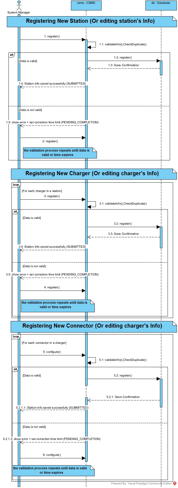
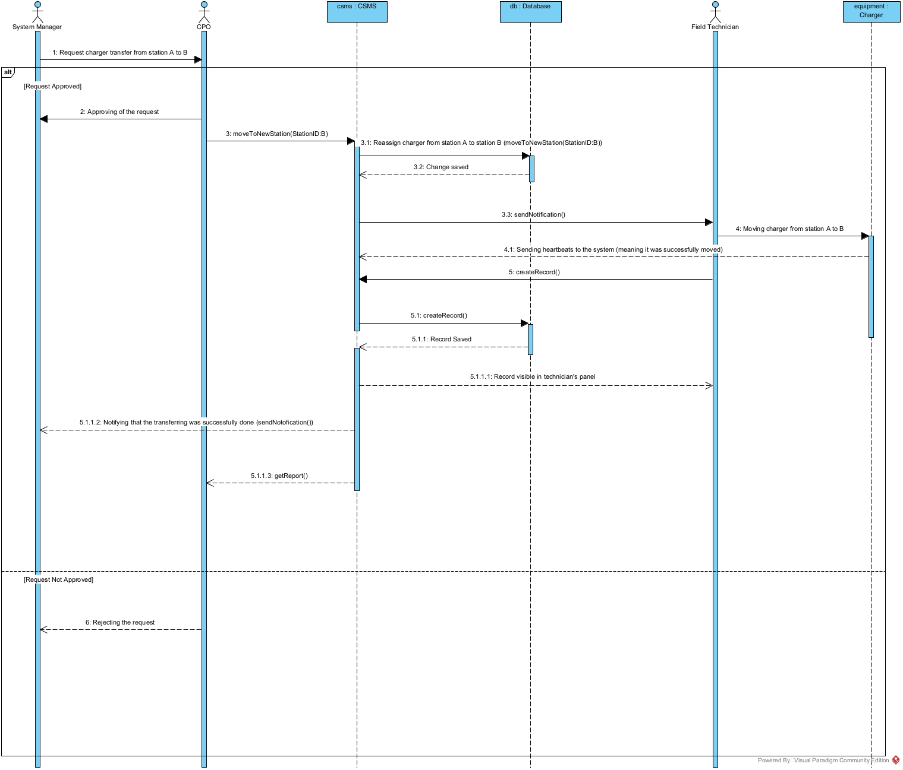
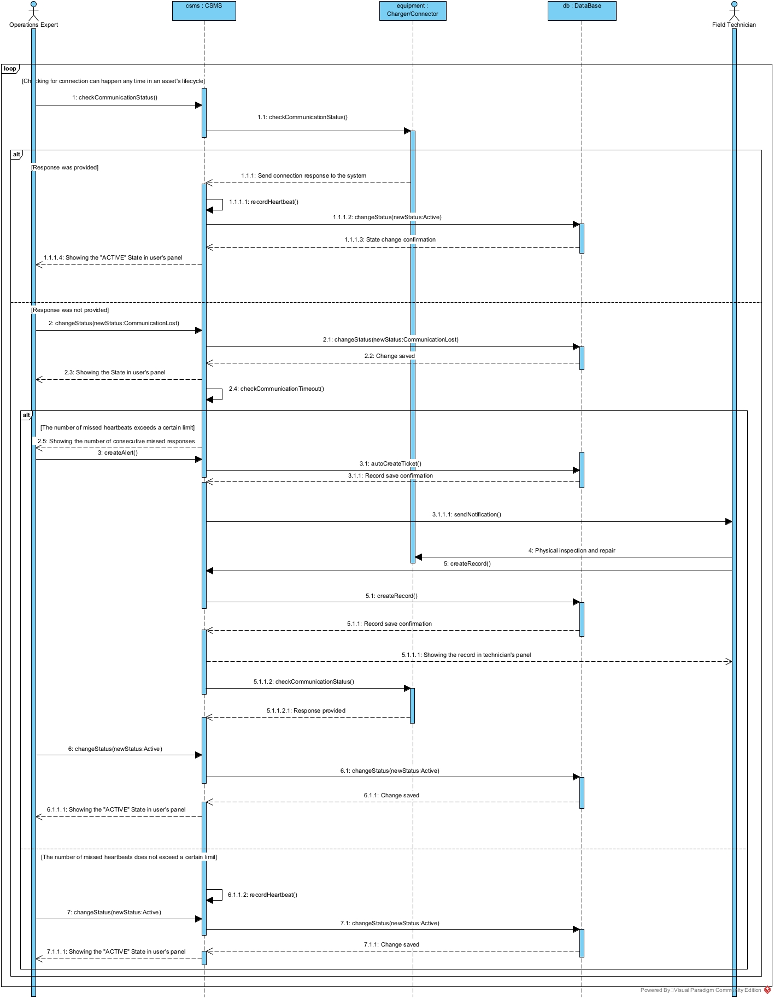

# نمودار توالی - چرخه عمر ایستگاه و شارژر

[فهرست گزارش‌ها](../../../INDEX.md)

# نمودار توالی – مدیریت چرخه عمر ایستگاه و شارژر

## مقدمه

نمودارهای توالی<a href="#fn-1-7083" id="fnref-1-7083">1</a> این جریان کاری، بر اساس **منطق مستخرج از نمودار فعالیت** طراحی شده‌اند. نمودار فعالیت به عنوان یک نقشه راه، ترتیب کلی فرایندها را مشخص کرد و نمودارهای توالی، **جزئیات تعاملات بین‌افزاری و ترتیب پیام‌ها** را بین بازیگران و سامانه به نمایش می‌گذارند.

جریان کاری مدیریت چرخه عمر ایستگاه و شارژر، شامل فرایندهای متعددی است:

1.  **درج و ویرایش اطلاعات** ایستگاه، شارژر و کانکتور
2.  **تغییر وضعیت عملیاتی** تجهیزات (پایش سلامت و تشخیص قطع ارتباط)
3.  **انتقال شارژر** بین ایستگاه‌ها

دو فرایند دیگر یعنی **گزارش‌گیری** و **جایگزینی تجهیز** در این نمودارها گنجانده نشده‌اند، زیرا:

- گزارش‌گیری مختص این جریان کاری نیست و در سایر جریان‌های کاری نیز حضور دارد.
- جایگزینی تجهیز به طور مفصل در جریان کاری «رسیدگی به خرابی<a href="#fn-2-7083" id="fnref-2-7083">2</a>» شرح داده می‌شود و آوردن آن در اینجا موجب طولانی‌ و ناخوانا شدن نمودارها می‌گردید.

> **نکته طراحی:** امکان قرار دادن هر فرایند در قالب فریم‌های جداگانه در یک فایل واحد وجود داشت، اما به منظور **افزایش خوانایی**، سه نمودار مجزا تهیه شده است.

## ۱. نمودار توالی – فرایند درج و ویرایش اطلاعات (ایستگاه، شارژر، کانکتور)

### ۱.۱. بازیگران

<table>
<colgroup>
<col style="width: 50%" />
<col style="width: 50%" />
</colgroup>
<thead>
<tr class="header">
<th aria-sort="none" scope="col">

&#10;
</th>
<th aria-sort="none" scope="col">

&#10;
</th>
</tr>
</thead>
<tbody>
<tr class="odd">
<td><strong>مدیر سامانه</strong><a href="#fn-3-7083" id="fnref-3-7083">3</a></td>
<td>تنها بازیگر این فرایند – مسئول ورود و ویرایش اطلاعات</td>
</tr>
<tr class="even">
<td>سامانه مدیریت ایستگاه‌ها<a href="#fn-4-7083" id="fnref-4-7083">4</a></td>
<td>پذیرش درخواست‌ها، اعتبارسنجی، هماهنگی با پایگاه داده<a href="#fn-5-7083" id="fnref-5-7083">5</a></td>
</tr>
<tr class="odd">
<td>پایگاه داده</td>
<td>ذخیره‌سازی پایدار اطلاعات و بازگرداندن تأییدیه</td>
</tr>
</tbody>
</table>

### ۱.۲. شرح فرایند

#### ثبت یا ویرایش اطلاعات ایستگاه

مدیر سامانه، اطلاعات پایه ایستگاه (نام، موقعیت جغرافیایی، آدرس، ظرفیت برق، مشخصات ارتباطی و غیره) را وارد سامانه می‌کند. سامانه بلافاصله **دو مرحله اعتبارسنجی را به صورت همزمان** انجام می‌دهد:

- **بررسی یکتایی:** اطمینان از عدم تکراری بودن شناسه ایستگاه
- **اعتبارسنجی محتوایی:** بررسی کامل و سازگار بودن داده‌های ورودی

**حالت اول – اطلاعات معتبر است:**

سامانه داده‌ها را به پایگاه داده ارسال کرده و درخواست ذخیره‌سازی می‌کند. پایگاه داده پس از ذخیره موفق، **تأییدیه ذخیره‌سازی<a href="#fn-6-7083" id="fnref-6-7083">6</a>** را به سامانه بازمی‌گرداند. سامانه نیز این موفقیت را در پنل مدیر سامانه نمایش می‌دهد.

**حالت دوم – اطلاعات نامعتبر است:**

سامانه اقدامات زیر را انجام می‌دهد:

- نمایش **پیام خطا** در پنل مدیر سامانه
- تعیین یک **بازه زمانی محدود** برای اصلاح اطلاعات
- مدیر سامانه اطلاعات جدید را وارد می‌کند
- **چرخه اعتبارسنجی از ابتدا تکرار می‌شود**

این حلقه تا زمانی ادامه می‌یابد که:

- داده‌ها **معتبر** شوند (موفقیت و خروج از حلقه)، یا
- **زمان مجاز به پایان برسد** (رد درخواست و پایان فرایند)

#### ثبت یا ویرایش اطلاعات شارژر

فرایند ثبت شارژر **دقیقاً مشابه ایستگاه** است، با این تفاوت که یک حلقه برای تکرار روی تمام شارژرهای یک ایستگاه وجود دارد.

#### ثبت یا ویرایش اطلاعات کانکتور

فرایند ثبت کانکتور **دقیقاً مشابه شارژر** است، با این تفاوت که حلقه روی **تمام کانکتورهای یک شارژر** اجرا می‌شود.

## ۲. نمودار توالی – فرایند انتقال شارژر بین ایستگاه‌ها

### ۲.۱. بازیگران

<table>
<colgroup>
<col style="width: 50%" />
<col style="width: 50%" />
</colgroup>
<thead>
<tr class="header">
<th aria-sort="none" scope="col">

&#10;
</th>
<th aria-sort="none" scope="col">

&#10;
</th>
</tr>
</thead>
<tbody>
<tr class="odd">
<td><strong>مدیر سامانه</strong></td>
<td>مبدأ درخواست – ثبت درخواست جابه‌جایی</td>
</tr>
<tr class="even">
<td><strong>اپراتور شبکه شارژ</strong><a href="#fn-7-7083" id="fnref-7-7083">7</a></td>
<td>تصویب‌کننده استراتژیک – بالاترین سطح تصمیم‌گیری</td>
</tr>
<tr class="odd">
<td><strong>تکنسین فنی</strong>[^8</td>
<td>انجام‌دهنده عملیات میدانی جابه‌جایی</td>
</tr>
<tr class="even">
<td>سامانه</td>
<td>هماهنگ‌کننده فرایند، ذخیره تغییرات، ارسال اعلان‌ها</td>
</tr>
<tr class="odd">
<td>پایگاه داده</td>
<td>ذخیره تغییر وابستگی شارژر</td>
</tr>
<tr class="even">
<td>شارژر (تجهیز)</td>
<td>ارسال ضربان قلب<a href="#fn-9-7083" id="fnref-9-7083">8</a> برای تأیید عملکرد صحیح</td>
</tr>
</tbody>
</table>

### ۲.۲. شرح فرایند

> **فرض سناریو:** در این نمودار فرض شده است که پیشنهاد جابه‌جایی شارژر از سوی **مدیر سامانه** مطرح می‌شود. هرچند امکان شروع درخواست از سوی خود سامانه یا اپراتور شبکه شارژ نیز وجود دارد، اما این سناریو رایج‌ترین حالت را نشان می‌دهد.

#### مرحله ۱ – ثبت درخواست

مدیر سامانه، درخواست انتقال یک شارژر مشخص را از ایستگاه مبدأ (A) به ایستگاه مقصد (B) در سامانه ثبت می‌کند.

#### مرحله ۲ – بررسی و تصمیم‌گیری استراتژیک

سامانه درخواست را به **اپراتور شبکه شارژ** ارجاع می‌دهد. این تصمیم استراتژیک است و حتما باید زیر نظر اپراتور شبکه شارژ انجام گیرد.

**حالت اول: رد درخواست:**

- اپراتور شبکه شارژ، مراتب **عدم موافقت** خود را به همراه دلیل (در صورت نیاز) به مدیر سامانه اعلام می‌کند.
- فرایند در همین مرحله **پایان می‌یابد**.

**حالت دوم: تأیید درخواست:**

- اپراتور شبکه شارژ، **تصویب رسمی** خود را در سامانه ثبت می‌کند.
- در این مرحله، **ایستگاه مقصد نهایی** را نیز تعیین و ثبت می‌شود.
- **نکته مهم:** طبق نمودار مورد کاربری، این تصمیم‌گیری استراتژیک **در حیطه اختیارات اپراتور شبکه شارژ** است و مدیر سامانه نمی‌تواند آن را انجام دهد.

#### مرحله ۳ – اعمال تغییرات در دیتابیس

پس از تأیید اپراتور شبکه شارژ، سامانه مقصد نهایی و وابستگی اداری شارژر را در پایگاه داده ثبت می‌کند. وضعیت اجرای میدانی جداگانه پیگیری می‌شود و تا ثبت نصب و تأیید آمادگی، تجهیز در مقصد برای شروع نشست جدید عرضه نمی‌شود. پایگاه داده تأییدیهٔ ذخیره‌سازی تصمیم را به سامانه بازمی‌گرداند.

#### مرحله ۴ – اعلان به تکنسین فنی

سامانه یک **اعلان وظیفه<a href="#fn-10-7083" id="fnref-10-7083">9</a>** به تکنسین فنی ارسال می‌کند که شامل جزئیات جابه‌جایی (شارژر مورد نظر، ایستگاه مبدأ، ایستگاه مقصد) است.

#### مرحله ۵ – انجام عملیات میدانی

تکنسین فنی، شارژر را به صورت فیزیکی از ایستگاه A خارج و در ایستگاه B نصب می‌کند.

#### مرحله ۶ – تأیید عملکرد صحیح شارژر

شارژر از ایستگاه جدید خود، یک **پیام ضربان قلب** به سامانه ارسال می‌کند. این پیام برقراری ارتباط را نشان می‌دهد. آمادگی بهره‌برداری با ثبت نتیجهٔ نصب و تأیید وضعیت عملیاتی تجهیز تعیین می‌شود.

> **نکته:** در صورت عدم ارسال ضربان قلب، تجهیز نیاز به تعمیر دارد که این سناریو به طور مفصل در نمودار توالی «پایش سلامت و تعمیر» و نیز در جریان کاری «رسیدگی به خرابی» پوشش داده شده است.

#### مرحله ۷ – ثبت جزئیات عملیات توسط تکنسین

تکنسین فنی، **گزارش کامل عملیات انجام‌شده** (شامل زمان جابه‌جایی، وضعیت نصب، هرگونه نکته خاص) را در سامانه وارد می‌کند. سامانه این رکورد را در پایگاه داده ذخیره کرده و تأییدیه دریافت می‌کند. تکنسین می‌تواند در پنل کاربری خود، رکورد ذخیره‌شده را مشاهده کند.

#### مرحله ۸ – اعلان موفقیت به مدیر سامانه

سامانه یک اعلان به **مدیر سامانه** ارسال می‌کند مبنی بر اینکه فرایند انتقال با موفقیت به پایان رسیده است.

#### مرحله ۹ – گزارش‌گیری اختیاری توسط اپراتور شبکه شارژ

در صورت تمایل، **اپراتور شبکه شارژ** می‌تواند یک **گزارش کامل** از این رویداد (شامل زمان درخواست، زمان تأیید، زمان انجام، جزئیات فنی) از سامانه دریافت کند.

## ۳. نمودار توالی – فرایند پایش سلامت، تشخیص قطع ارتباط و تعمیر

### ۳.۱. بازیگران

<table>
<colgroup>
<col style="width: 50%" />
<col style="width: 50%" />
</colgroup>
<thead>
<tr class="header">
<th aria-sort="none" scope="col">

&#10;
</th>
<th aria-sort="none" scope="col">

&#10;
</th>
</tr>
</thead>
<tbody>
<tr class="odd">
<td><strong>کارشناس عملیات<a href="#fn-11-7083" id="fnref-11-7083">10</a></strong></td>
<td>درخواست‌دهنده دستی بررسی اتصال – تنها کسی که می‌تواند وضعیت را تغییر دهد</td>
</tr>
<tr class="even">
<td><strong>تکنسین فنی</strong></td>
<td>انجام‌دهنده بازرسی، تعمیر و ثبت جزئیات</td>
</tr>
<tr class="odd">
<td>سامانه</td>
<td>ارسال درخواست‌های ضربان قلب یا پینگ<a href="#fn-12-7083" id="fnref-12-7083">11</a>، ردیابی شمارنده خطاها، هماهنگی با پایگاه داده</td>
</tr>
<tr class="even">
<td>پایگاه داده</td>
<td>ذخیره تغییرات وضعیت، رکوردهای خطا و رکوردهای تعمیر</td>
</tr>
<tr class="odd">
<td>تجهیز (شارژر یا کانکتور)</td>
<td>پاسخ به درخواست‌های اتصال</td>
</tr>
</tbody>
</table>

### ۳.۲. ماهیت چرخه‌ای فرایند

کل این فرایند یک **چرخه مستمر** است، زیرا بررسی اتصال تجهیزات در طول عمر عملیاتی آن‌ها به طور دائمی انجام می‌شود:

- **حالت خودکار:** سامانه به صورت دوره‌ای و خودکار، درخواست ضربان قلب برای شارژرها یا درخواست پینگ برای کانکتورها ارسال می‌کند.
- **حالت دستی:** زمانی که یک تجهیز به دلایلی مشکوک به مشکل است (مثلاً رفتار نامنظم یا گزارش کاربران)، کارشناس عملیات می‌تواند به صورت دستی درخواست بررسی اتصال را صادر کند.در این فرآیند فرض شده درخواست به صورت دستی اعمال می‌گردد.

### ۳.۳. شرح فرایند

#### شاخه اول – تجهیز پاسخ می‌دهد (اتصال برقرار است)

1.  **درخواست بررسی اتصال:** کارشناس عملیات (یا سامانه به صورت خودکار) درخواست بررسی اتصال تجهیز را صادر می‌کند.
2.  **ارسال درخواست به تجهیز:** سامانه یک درخواست ضربان قلب (برای شارژر) یا درخواست پینگ (برای کانکتور) به تجهیز ارسال می‌کند.
3.  **دریافت پاسخ:** تجهیز پاسخ موفقیت‌آمیز به سامانه ارسال می‌کند.
4.  **بازنشانی شمارنده خطاها:** سامانه، شمارنده **تعداد بی‌پاسخی‌های متوالی** مربوط به این تجهیز را به صفر بازنشانی می‌کند.
5.  **تغییر وضعیت به فعال:** کارشناس عملیات، وضعیت تجهیز را در سامانه به **"فعال"** تغییر می‌دهد.
6.  **اعمال در پایگاه داده:** سامانه این تغییر وضعیت را در پایگاه داده ذخیره می‌کند. پایگاه داده تأییدیه ذخیره‌سازی را بازمی‌گرداند.
7.  **نمایش به کاربر:** کارشناس عملیات می‌تواند وضعیت فعال تجهیز را در پنل خود مشاهده کند.

#### شاخه دوم – تجهیز پاسخ نمی‌دهد (اتصال برقرار نیست)

**مرحله ۱ – تغییر وضعیت به "اتصال از دست رفته":**

- کارشناس عملیات (نه سامانه به صورت خودکار) پس از **تحلیل شرایط**، وضعیت تجهیز را به **"اتصال از دست رفته"**<a href="#fn-13-7083" id="fnref-13-7083">12</a> تغییر می‌دهد.
- **دلیل واگذاری این تصمیم به انسان:** در شرایط خاص ایران (ناپایداری شبکه برق، اختلالات اینترنت، نوسانات ولتاژ و سایر عوامل محیطی)، تشخیص قطعی بودن قطع ارتباط نیازمند قضاوت انسانی است تا از ثبت خطاهای کاذب جلوگیری شود.

**مرحله ۲ – ذخیره تغییر وضعیت:**

- سامانه تغییر وضعیت را در پایگاه داده اعمال می‌کند. پایگاه داده تأییدیه ذخیره‌سازی را بازمی‌گرداند.
- کارشناس عملیات وضعیت جدید را در پنل خود مشاهده می‌کند.

**مرحله ۳ – ردیابی تعداد بی‌پاسخی‌های متوالی:**

- سامانه به طور خودکار، تعداد دفعاتی که این تجهیز به درخواست‌های ضربان قلب پاسخ نداده را **به صورت متوالی** شمارش می‌کند.

**زیرشاخه ۳-الف – تعداد بی‌پاسخی‌ها از حد آستانه بیشتر نشده است (خرابی مقطعی):**

- در صورتی که تجهیز مجدداً اتصال برقرار کرد و به درخواست بعدی پاسخ داد:
  - سامانه شمارنده خطاها را صفر می‌کند.
  - کارشناس عملیات وضعیت تجهیز را به **"فعال"** بازمی‌گرداند.
  - فرایند به حالت عادی بازمی‌گردد.

**زیرشاخه ۳-ب – تعداد بی‌پاسخی‌ها از حد آستانه بیشتر شده است (تشخیص خرابی قطعی):**

- کارشناس عملیات **اطلاعات خطا** (نوع خطا، زمان تشخیص، توضیحات تکمیلی) را وارد سامانه می‌کند.
- سامانه این رکورد خطا را در پایگاه داده ذخیره کرده و تأییدیه دریافت می‌کند.
- سامانه به **تکنسین فنی** اعلان می‌فرستد که یک خرابی قطعی رخ داده و نیاز به تعمیر دارد.

#### مرحله ۴ – فرایند تعمیر (خلاصه)

> **نکته:** شرح کامل فرایند تعمیر در جریان کاری «رسیدگی به خرابی» ارائه شده است. در اینجا تنها یک خلاصه برای تکمیل نمودار آورده می‌شود.

1.  **بازرسی و تعمیر توسط تکنسین:** تکنسین فنی به محل مراجعه کرده، تجهیز را بازرسی و تعمیر می‌کند.
2.  **ثبت جزئیات تعمیر:** تکنسین، جزئیات تعمیر انجام‌شده (نوع خرابی، اقدام انجام‌شده، قطعات تعویضی) را در سامانه وارد می‌کند.
3.  **ذخیره رکورد تعمیر:** سامانه رکورد تعمیر را در پایگاه داده ذخیره کرده و تأییدیه می‌گیرد. تکنسین می‌تواند رکورد را در پنل خود مشاهده کند.
4.  **درخواست مجدد بررسی اتصال:** سامانه مجدداً درخواست ضربان قلب (یا پینگ) به تجهیز ارسال می‌کند.
    - **در این سناریو فرض بر پاسخ موفق است.**
    - در صورت عدم پاسخ موفق، چرخه تعمیر تکرار می‌شود یا (در صورت غیرقابل تعمیر بودن) فرایند جایگزینی تجهیز آغاز می‌گردد (که در جریان کاری رسیدگی به خرابی شرح داده شده است).
5.  **دریافت پاسخ موفق:** تجهیز پاسخ موفق به سامانه ارسال می‌کند.
6.  **تغییر وضعیت به فعال:** کارشناس عملیات، وضعیت تجهیز را در سامانه به **"فعال"** تغییر می‌دهد.
7.  **اعمال در دیتابیس و نمایش به کاربر:** سامانه تغییر وضعیت را در پایگاه داده ذخیره کرده، از پایگاه داده تأییدیه می‌گیرد و کارشناس عملیات وضعیت فعال را در پنل خود مشاهده می‌کند.

## ۴. جمع‌بندی

سه نمودار توالی تهیه‌شده در این جریان کاری، به ترتیب:

<table>
<colgroup>
<col style="width: 50%" />
<col style="width: 50%" />
</colgroup>
<thead>
<tr class="header">
<th aria-sort="none" scope="col">

&#10;
</th>
<th aria-sort="none" scope="col">

&#10;
</th>
</tr>
</thead>
<tbody>
<tr class="odd">
<td><strong>نمودار اول</strong></td>
<td>درج و ویرایش اطلاعات ایستگاه، شارژر و کانکتور (با حلقه‌های اعتبارسنجی و تکرار)</td>
</tr>
<tr class="even">
<td><strong>نمودار دوم</strong></td>
<td>انتقال شارژر بین ایستگاه‌ها (شامل سطوح دسترسی استراتژیک و عملیاتی)</td>
</tr>
<tr class="odd">
<td><strong>نمودار سوم</strong></td>
<td>پایش سلامت، تشخیص قطع ارتباط و تعمیر (با تمایز بین خرابی مقطعی و قطعی)</td>
</tr>
</tbody>
</table>

این نمودارها بر اساس منطق مستخرج از **نمودار فعالیت** طراحی شده‌اند و **جزئیات تعاملات بین‌افزاری** (ترتیب پیام‌ها، نوع پیام‌ها، بازیگران درگیر، شاخه‌های شرطی و حلقه‌ها) را برای پیاده‌سازی در **فاز نمونه‌سازی<a href="#fn-14-7083" id="fnref-14-7083">13</a>** فراهم می‌کنند.

## ۵. تصاویر نمودارها

------------------------------------------------------------------------

## پانویس‌ها

1.  

    Sequence Diagrams [↩](#fnref-1-7083 "Back to reference 1")

    

2.  

    Fault Handling [↩](#fnref-2-7083 "Back to reference 2")

    

3.  

    System Manager [↩](#fnref-3-7083 "Back to reference 3")

    

4.  

    Charge Station Management System (CSMS) [↩](#fnref-4-7083 "Back to reference 4")

    

5.  

    Database [↩](#fnref-5-7083 "Back to reference 5")

    

6.  

    Save Confirmation [↩](#fnref-6-7083 "Back to reference 6")

    

7.  

    Charge Point Operator (CPO) [↩](#fnref-7-7083 "Back to reference 7")

    

8.  

    Heartbeat [↩](#fnref-9-7083 "Back to reference 8")

    

9.  

    Task Notification [↩](#fnref-10-7083 "Back to reference 9")

    

10. 

    Operations Expert [↩](#fnref-11-7083 "Back to reference 10")

    

11. 

    Ping Request [↩](#fnref-12-7083 "Back to reference 11")

    

12. 

    Communication Lost [↩](#fnref-13-7083 "Back to reference 12")

    

13. 

    Prototyping [↩](#fnref-14-7083 "Back to reference 13")

    

