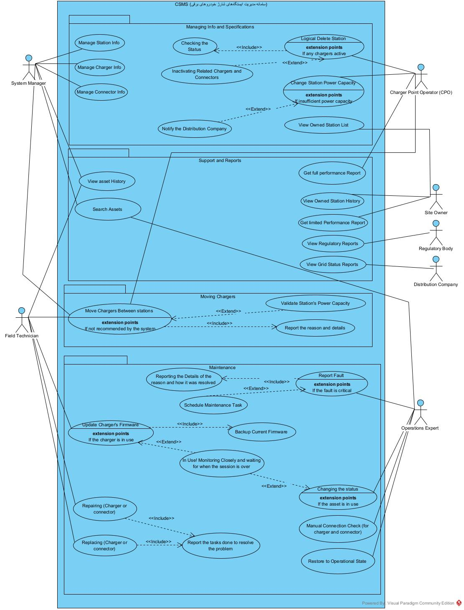

# نمودار مورد کاربرد - چرخه عمر ایستگاه و شارژر

[فهرست گزارش‌ها](../../../INDEX.md)

# نمودار مورد کاربرد – مدیریت چرخه عمر ایستگاه و شارژر<a href="#fn-1-7769" id="fnref-1-7769">1</a>

## مقدمه

نمودار مورد کاربرد<a href="#fn-2-7769" id="fnref-2-7769">2</a> جریان کاری «مدیریت چرخه عمر ایستگاه و شارژر»، تعاملات بین بازیگران<a href="#fn-3-7769" id="fnref-3-7769">3</a> و کارکردهایی را نشان می‌دهد که سامانه در این بخش پشتیبانی می‌کند. هدف اصلی این جریان کاری، ایجاد ساختاری منسجم برای مدیریت دارایی‌های شبکه شارژ (ایستگاه، شارژر و کانکتور) در طول عمر بهره‌برداری آن‌ها است.

بازیگران این نمودار بر اساس مستند پروژه و تحقیقات تکمیلی تیم در فاز اول، استخراج شده‌اند. همچنین برای افزایش خوانایی، کلیه کارکردهای سامانه در چهار **بسته<a href="#fn-4-7769" id="fnref-4-7769">4</a>** دسته‌بندی شده‌اند:

1.  **مدیریت اطلاعات** (اطلاعات ایستگاه، شارژر و کانکتور)
2.  **بخش گزارش‌گیری** (مختص این جریان کاری)
3.  **انتقال شارژر بین ایستگاه‌ها** (موجود در واقعیت، هرچند در فایل پروژه نیامده بود)
4.  **تعمیر و نگهداری** (شامل تعمیر و جایگزینی در صورت عدم موفقیت تعمیر)

## ۱. معرفی بازیگران<a href="#fn-5-7769" id="fnref-5-7769">5</a>

در جدول زیر، کلیه بازیگران (ذی‌نفعان فعال) درگیر در جریان کاری «مدیریت چرخه عمر ایستگاه و شارژر» به همراه شرح وظایف و سطح دسترسی هر یک معرفی شده‌اند:

<table>
<colgroup>
<col style="width: 33%" />
<col style="width: 33%" />
<col style="width: 33%" />
</colgroup>
<thead>
<tr class="header">
<th style="text-align: center;" aria-sort="none" scope="col">

&#10;
</th>
<th aria-sort="none" scope="col">

&#10;
</th>
<th aria-sort="none" scope="col">

&#10;
</th>
</tr>
</thead>
<tbody>
<tr class="odd">
<td style="text-align: center;">۱</td>
<td>مدیر سامانه<a href="#fn-6-7769" id="fnref-6-7769">6</a></td>
<td>مسئول پیکربندی، نگهداری و پشتیبانی نرم‌افزار سامانه. ایجاد، ویرایش و حذف موجودیت‌ها (ایستگاه، شارژر، کانکتور)، مدیریت دسترسی کاربران و تنظیمات پایه سامانه بر عهده وی است. دارای دسترسی سطح بالا (مدیر<a href="#fn-7-7769" id="fnref-7-7769">7</a>) به داده‌ها بوده، اما در تصمیم‌گیری‌های کسب‌وکاری و استراتژیک نقشی ندارد.</td>
</tr>
<tr class="even">
<td style="text-align: center;">۲</td>
<td>اپراتور شبکه شارژ<a href="#fn-8-7769" id="fnref-8-7769">8</a></td>
<td>بالاترین سطح اختیار تصمیم‌گیری در سازمان بهره‌بردار شبکه را داراست. سیاست‌گذاری کلان شبکه، تصویب تغییرات ظرفیت ایستگاه‌ها و مشاهده گزارش‌های جامع و کامل شبکه از وظایف اصلی وی محسوب می‌شود. نقش ایشان کاملاً استراتژیک بوده و در امور عملیاتی روزمره دخالت مستقیم ندارد.</td>
</tr>
<tr class="odd">
<td style="text-align: center;">۳</td>
<td>کارشناس عملیات<a href="#fn-9-7769" id="fnref-9-7769">9</a></td>
<td>مسئول پایش مستمر و روزانه شبکه. تغییر وضعیت عملیاتی ایستگاه، شارژر و کانکتور، ثبت و پیگیری رویدادهای خرابی، زمان‌بندی تعمیرات و انجام گزارش‌گیری عملیاتی بر عهده وی است. دسترسی خواندنی/نوشتنی به وضعیت‌ها و رویدادها دارد، اما فاقد توانایی حذف ساختارها یا تغییر پیکربندی کلی سامانه می‌باشد.</td>
</tr>
<tr class="even">
<td style="text-align: center;">۴</td>
<td>کارشناس فنی (تکنسین میدانی)<a href="#fn-10-7769" id="fnref-10-7769">10</a></td>
<td>انجام اقدامات فیزیکی در محل (میدانی) نظیر جایگزینی قطعات سخت‌افزاری معیوب، به‌روزرسانی سفت‌افزار<a href="#fn-11-7769" id="fnref-11-7769">11</a> شارژرها، بررسی اتصال فیزیکی و بازگرداندن تجهیزات به وضعیت عملیاتی از منظر فیزیکی. دسترسی وی محدود بوده و صرفاً بر روی دستگاه‌هایی اعمال می‌شود که به او تخصیص یافته است. عمده دسترسی وی از نوع نوشتنی برای ثبت نتایج اقدامات میدانی می‌باشد.</td>
</tr>
<tr class="odd">
<td style="text-align: center;">۵</td>
<td>مالک ایستگاه<a href="#fn-12-7769" id="fnref-12-7769">12</a></td>
<td>ذی‌نفعی که مالکیت فیزیکی یک یا چند ایستگاه شارژ را در اختیار دارد. وی امکان ایجاد تغییر در داده‌های سامانه را ندارد، اما می‌تواند فهرست ایستگاه‌های تحت مالکیت خود، تاریخچه عملیاتی آن‌ها و نیز گزارش‌های محدود و از پیش تعریف‌شده را مشاهده نماید.</td>
</tr>
<tr class="even">
<td style="text-align: center;">۶</td>
<td>نهاد ناظر<a href="#fn-13-7769" id="fnref-13-7769">13</a></td>
<td>این بازیگر بر اساس تحقیقات تطبیقی تیم در فاز اول پروژه اضافه شده است. نهادهای قانونی و نظارتی که بر عملکرد شبکه شارژ نظارت دارند، صرفاً به گزارش‌های محدود و مشخص (در سطح دسترسی تعریف‌شده برای خود) دسترسی خواهند داشت.</td>
</tr>
<tr class="odd">
<td style="text-align: center;">۷</td>
<td>شرکت توزیع برق<a href="#fn-14-7769" id="fnref-14-7769">14</a></td>
<td>این بازیگر نیز حاصل تحلیل سامانه‌های مشابه در فاز اول می‌باشد. شرکت توزیع برق به گزارش‌های محدود مرتبط با ظرفیت برق و تغییرات آن دسترسی دارد و در مواردی که ظرفیت برق ایستگاه برای پاسخگویی به نیاز جدید کافی نباشد، اطلاعیه مربوطه را دریافت می‌کند.</td>
</tr>
</tbody>
</table>

## ۲. دسته‌بندی کارکردهای سامانه (بسته‌ها)

### ۲.۱. بسته مدیریت اطلاعات

این بسته شامل فعالیت‌هایی است که عمدتا مدیر سامانه و اپراتور شبکه می‌توانند انجام دهند:

- **ثبت اطلاعات پایه دارایی** (نام، کد شناسایی، موقعیت جغرافیایی، آدرس، ظرفیت برق، وضعیت بهره‌برداری و مشخصات ارتباطی - مرتبط با مدیر سامانه)
- **تعریف شارژرها و کانکتورها** (مدل، شماره سریال، توان نامی، نوع ارتباط، نسخه پروتکل اتصال شارژر باز<a href="#fn-15-7769" id="fnref-15-7769">15</a>، وضعیت عملیاتی، تعداد و نوع کانکتور - مرتبط با مدیر سامانه)
- **ویرایش اطلاعات** (در صورت نیاز به روزرسانی به دلیل تغییر مالک، تغییر موقعیت، تغییر پیکربندی، افزایش/کاهش ظرفیت، اضافه شدن کانکتور جدید و... - مرتبط با مدیر سامانه)
- **حذف کامل یک ایستگاه** (تصمیم استراتژیک - مربوط به اپراتور شبکه شارژ)
- **تغییر ظرفیت برق ایستگاه** (در صورتی که ظرفیت ناکافی باشد، به شرکت توزیع برق اطلاع داده می‌شود - مربوط به اپراتور شبکه شارژ، چون تصمیم استراتژیک است)
- **بازگرداندن به وضعیت عملیاتی** (پس از رفع مشکل توسط کارشناس عملیات)
- **مشاهده لیست دارایی‌های تحت تملک** (مرتبط با مالک سایت)

### ۲.۲. بسته گزارش‌گیری

- **گزارش کامل شبکه** (برای اپراتور شبکه، شامل همه جنبه‌ها برای تصمیمات کلان)

- **گزارش محدود برای مالک ایستگاه** (فقط ایستگاه‌های تحت مالکیت)

- **گزارش برای نهاد ناظر** (در سطح دسترسی تعریف‌شده)

- **گزارش برای شرکت توزیع برق** (به ویژه در موارد تغییر ظرفیت)

- **امکان مشاهده سوابق ایستگاه‌های تحت تملک** (برای مالک سایت)

- - **امکان جست‌وجوی دارایی‌ها** (برای مدیر سامانه)

- - **امکان مشاهده سوابق دارایی‌ها** (برای مدیر سامانه و کارشناس فنی ( به منظور سهولت در تعمیر))

### ۲.۳. بسته انتقال شارژر بین ایستگاه‌ها

این بسته علیرغم نبودن در فایل اولیه پروژه، به دلیل رایج بودن در دنیای واقعی اضافه شده است:

- **تصویب درخواست انتقال** (توسط اپراتور شبکه – سطح استراتژیک)
- **ثبت تنظیمات و رکورد انتقال** (توسط مدیر سامانه)
- **انجام عملیات میدانی جابه‌جایی** (توسط تکنسین)
- **اعتبارسنجی ظرفیت برق ایستگاه مقصد** (در صورت عدم تأمین، پیام مناسب صادر شود)

### ۲.۴. بسته تعمیر و نگهداری

- **ثبت خطا** (به صورت خودکار توسط سامانه یا دستی توسط کارشناس عملیات)
- **تعمیر دارایی** (توسط تکنسین و ثبت گزارش اقدام انجام‌شده)
- **جایگزینی دارایی** (در صورت عدم موفقیت تعمیر، توسط تکنسین و ثبت گزارش)
- **به‌روزرسانی سفت‌افزار شارژر** (توسط تکنسین)
- **بررسی دستی اتصال** (در صورت نیاز به نظارت بیشتر توسط کارشناس عملیات)
- **برنامه‌ریزی وظیفه نگهداری** (توسط کارشناس عملیات)
- **بازگرداندن به وضعیت عملیاتی** (پس از تعمیر توسط کارشناس عملیات – نه خود تکنسین)

## ۳. شرح فعالیت‌های هر بازیگر

### ۳.۱. مدیر سامانه

مدیر سامانه مسئول پیکربندی و نگهداری خود نرم‌افزار است. او:

- ایجاد/حذف موجودیت‌ها (ایستگاه، شارژر، کانکتور) را انجام می‌دهد.
- مدیریت دسترسی کاربران و تنظیمات پایه سیستم را بر عهده دارد.
- دسترسی سطح مدیر به داده‌ها دارد، ولی تصمیم کسب‌وکاری نمی‌گیرد.

**فعالیت‌های این نقش در نمودار مورد کاربری:**

- **ورود و ویرایش اطلاعات دارایی‌ها** (اطلاعات ایستگاه، شارژر و کانکتور)
- **مشاهده تاریخچه اتفاقات** که برای هر دارایی افتاده است (مثلاً تغییر وضعیت‌ها، تغییرها و جابه‌جایی‌ها)
- **ثبت تنظیمات و رکورد انتقال شارژر** بین ایستگاه‌ها در سیستم
- **جست‌وجوی دارایی‌ها**  
  *(توجه شود: خودش جابه‌جایی را انجام نمی‌دهد، و خودش تصمیم‌گیر نهایی نیست!)*

### ۳.۲. اپراتور شبکه شارژ

اپراتور شبکه بالاترین سطح تصمیم‌گیری در سازمان بهره‌بردار شبکه است. او:

- سیاست‌گذاری کلان شبکه را انجام می‌دهد.
- تغییرات ظرفیت را تصویب می‌کند.
- گزارش‌های کل شبکه را مشاهده می‌کند.
- دسترسی خواندنی/نوشتنی به همه چیز دارد، ولی کارش استراتژیک است نه عملیاتی روزانه.

**فعالیت‌های این نقش در نمودار مورد کاربری:**

- **گرفتن گزارش کامل** – بقیه بازیگران هم می‌توانند به صورت محدود و در سطح دسترسی خودشان گزارش بگیرند، اما گزارش این نقش یک گزارش کامل است چون تصمیمات کلان را می‌گیرد، پس باید به همه جنبه‌ها اشراف داشته باشد.
- **تصویب حذف کلی یک ایستگاه** (زمانی که قرار است ایستگاه کلاً جمع شود)
- **تصویب تغییر ظرفیت شارژ ایستگاه** – در اینجا اگر ظرفیت ناکافی باشد، باید به شرکت توزیع برق اطلاع داده شود.
- **تصویب درخواست انتقال شارژر** بین ایستگاه‌ها

> **نکته مهم:** چون اپراتور شبکه شارژ بالاترین سطح تصمیم‌گیری است، این‌طور نیست که به بقیه بخش‌های سامانه دسترسی نداشته باشد، ولی مستقیماً درگیر آن بخش‌ها نیست.

### ۳.۳. مالک ایستگاه

مالک ایستگاه نمی‌تواند خودش تغییری در سامانه ایجاد دهد. دسترسی او محدود و عمدتاً مشاهده‌ای است.

**فعالیت‌های این نقش در نمودار مورد کاربری:**

- **مشاهده لیست ایستگاه‌هایی که متعلق به خودش است**
- **مشاهده تاریخچه آن ایستگاه‌ها**
- **دریافت گزارش‌های محدود** (در سطح دسترسی خود)

### ۳.۴. کارشناس عملیات

کارشناس عملیات مسئول پایش روزانه شبکه است. او:

- تغییر وضعیت ایستگاه/شارژر/کانکتور را انجام می‌دهد.
- خرابی‌ها را ثبت و پیگیری می‌کند.
- زمان‌بندی تعمیرات را انجام می‌دهد.
- گزارش‌گیری عملیاتی دارد.
- دسترسی خواندنی/نوشتنی به وضعیت‌ها و رویدادها دارد، **بدون توانایی حذف یا تغییر ساختار**.

**فعالیت‌های این نقش در نمودار مورد کاربری:**

- **تغییر وضعیت دارایی‌ها** (مثلاً به غیرفعال، خارج از سرویس، در حال تعمیر و...)
- **بازگرداندن به وضعیت فعال** (زمانی که دارایی دوباره آماده بهره‌برداری شد)
- **گزارش خطا به صورت دستی**  
  *(نکته مهم: حالت عادی، سامانه خودش خطا را گزارش می‌دهد، اما این به این معنا نیست که به دخالت انسانی نیاز ندارد. فرض کنید یک شارژر همیشه با توانی کمی کمتر از حالت عادی کار می‌کرده، اما از نظر سامانه آنقدر کم نیست که خطا تلقی شود. بعد از تعمیر، اگر کارشناس عملیات ببیند دوباره با همان توان کم کار می‌کند، دستی می‌آید و یک خطا را گزارش می‌دهد.)*
- **بررسی دستی اتصال دارایی‌ها**  
  *(معمولاً خود سامانه چک می‌کند، اما اگر دارایی به هر دلیلی نیاز به نظارت بیشتری داشته باشد، به صورت دستی هم می‌شود چک کرد.)*
- **جستجو بین دارایی‌ها**
- **زمان‌بندی وظایف نگهداری**

### ۳.۵. کارشناس فنی (تکنسین میدانی)

تکنسین مسئول اقدام فیزیکی میدانی است. او:

- جایگزینی سخت‌افزار را انجام می‌دهد.
- سفت‌افزار شارژر را به‌روزرسانی می‌کند.
- اتصال را بررسی می‌کند.
- دارایی را به وضعیت عملیاتی بازمی‌گرداند (از نظر فیزیکی).
- دسترسی محدود دارد – فقط روی دستگاه‌هایی که به او اختصاص داده شده، و عمدتاً دسترسی نوشتنی برای ثبت نتیجه اقدام میدانی.

**فعالیت‌های این نقش در نمودار مورد کاربری:**

- **مشاهده تاریخچه دارایی‌ها** – چون ممکن است برای تعمیر بهتر به او کمک کند.
- **تعمیر دارایی** (شارژر یا کانکتور)
- **جایگزینی دارایی** (اگر تعمیر جواب نداد)
- **ثبت گزارش کامل از اقدامات انجام‌شده** در هر دو حالت (تعمیر و جایگزینی) – شامل دلیل مشکل و نحوه رفع آن
- **به‌روزرسانی سفت‌افزار شارژر**
- **انجام عملیات میدانی جابه‌جایی شارژر** (اگر تصمیم به جابه‌جایی بین ایستگاه‌ها گرفته شده باشد)

> **نکته:** تکنسین خودش **مستقیماً نمی‌تواند وضعیت دارایی را در سامانه دوباره فعال کند.** آن وظیفه بر عهده **کارشناس عملیات** است. تکنسین فقط اقدام میدانی را انجام می‌دهد و گزارش می‌دهد.

### ۳.۶. نهاد ناظر

این بازیگر از تحقیقات خود تیم در فاز اول استخراج شده است.

**فعالیت این نقش:**

- **مشاهده گزارش‌های محدود** در سطح دسترسی تعریف‌شده برای خود

### ۳.۷. شرکت توزیع برق

این بازیگر نیز از تحقیقات خود تیم در فاز اول استخراج شده است.

**فعالیت‌های این نقش:**

- **دریافت گزارش‌های محدود** به ویژه در موارد مربوط به ظرفیت برق و تغییرات آن
- **دریافت اطلاعیه در مواقعی که ظرفیت برق ایستگاه ناکافی است** (مثلاً زمانی که اپراتور شبکه شارژ تصمیم به افزایش ظرفیت می‌گیرد)

## ۴. جمع‌بندی

در این نمودار مورد کاربری، تمام بازیگران اصلی مرتبط با چرخه عمر ایستگاه و شارژر شناسایی شدند. سعی شده است مرز دقیق بین نقش‌ها حفظ شود – برای مثال:

<table>
<colgroup>
<col style="width: 33%" />
<col style="width: 33%" />
<col style="width: 33%" />
</colgroup>
<thead>
<tr class="header">
<th aria-sort="none" scope="col">

&#10;
</th>
<th aria-sort="none" scope="col">

&#10;
</th>
<th aria-sort="none" scope="col">

&#10;
</th>
</tr>
</thead>
<tbody>
<tr class="odd">
<td>مدیر سامانه</td>
<td>تنظیمات را ثبت می‌کند</td>
<td>تصمیم استراتژیک نمی‌گیرد</td>
</tr>
<tr class="even">
<td>اپراتور شبکه شارژ</td>
<td>تصمیمات کلان را می‌گیرد</td>
<td>درگیر جزئیات عملیاتی نمی‌شود</td>
</tr>
<tr class="odd">
<td>کارشناس عملیات</td>
<td>وضعیت را تغییر می‌دهد</td>
<td>حذف ساختاری نمی‌تواند انجام دهد</td>
</tr>
<tr class="even">
<td>تکنسین</td>
<td>کار فیزیکی می‌کند</td>
<td>نمی‌تواند وضعیت را در سامانه فعال کند</td>
</tr>
</tbody>
</table>

تفکیک کارکردها در چهار بسته (مدیریت اطلاعات، گزارش‌گیری، انتقال شارژر، تعمیر و نگهداری) نیز به خوانایی نمودار و جلوگیری از تداخل وظایف کمک شایانی کرده است. این نمودار پایه‌ای مستحکم برای طراحی نمونه اولیه در **فاز نمونه‌سازی<a href="#fn-16-7769" id="fnref-16-7769">16</a>** فراهم می‌آورد.

## ۵. تصویر نمودار

------------------------------------------------------------------------

## پانویس‌ها

1.  

    Charging Station Management System (CSMS) [↩](#fnref-1-7769 "Back to reference 1")

    

2.  

    Use Case Diagram [↩](#fnref-2-7769 "Back to reference 2")

    

3.  

    Actors [↩](#fnref-3-7769 "Back to reference 3")

    

4.  

    Package [↩](#fnref-4-7769 "Back to reference 4")

    

5.  

    Actors [↩](#fnref-5-7769 "Back to reference 5")

    

6.  

    System Manager [↩](#fnref-6-7769 "Back to reference 6")

    

7.  

    Admin-level [↩](#fnref-7-7769 "Back to reference 7")

    

8.  

    Charge Point Operator (CPO) [↩](#fnref-8-7769 "Back to reference 8")

    

9.  

    Operations Expert [↩](#fnref-9-7769 "Back to reference 9")

    

10. 

    Field Technician [↩](#fnref-10-7769 "Back to reference 10")

    

11. 

    Firmware [↩](#fnref-11-7769 "Back to reference 11")

    

12. 

    Site Owner [↩](#fnref-12-7769 "Back to reference 12")

    

13. 

    Regulatory Body [↩](#fnref-13-7769 "Back to reference 13")

    

14. 

    Distribution Company [↩](#fnref-14-7769 "Back to reference 14")

    

15. 

    Open Charge Point Protocol (OCPP) [↩](#fnref-15-7769 "Back to reference 15")

    

16. 

    Prototyping [↩](#fnref-16-7769 "Back to reference 16")

    

