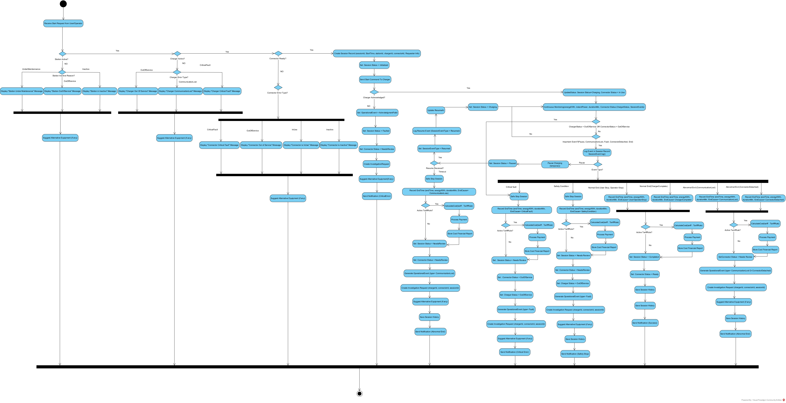

# نمودار فعالیت فرایند مدیریت نشست شارژ

[فهرست گزارش‌ها](../../../INDEX.md)

# نمودار فعالیت

## ۱. مقدمه و سلسله‌مراتب تجهیزات

هدف این فرآیند، مدیریت کامل چرخه یک نشست شارژ از آغاز تا پایان و ایجاد داده های قابل اعتماد برای کنترل عملیات، محاسبه هزینه، تحلیل عملکرد و ارزیابی کیفیت سرویس است. اهمیت این فرآیند در این است که نشست شارژ هسته عملیاتی سامانه محسوب میشود و بسیاری از قابلیت های دیگر مثل گزارشگیری، تحلیل درآمد، تشخیص خطا، ارزیابی بهره برداری و تجربه کاربر، به ثبت دقیق و ساختاریافته آن وابسته هستند. در این سامانه، رابطه تجهیزات به صورت سلسله‌مراتبی و به شرح زیر است:

- **ایستگاه شارژ**: محل فیزیکی ارائه خدمت شارژ که می‌تواند شامل یک یا چند شارژر باشد.
- **شارژر**: تجهیز اصلی شارژ که برق را به خودرو منتقل می‌کند و می‌تواند دارای یک یا چند کانکتور باشد.
- **کانکتور**: نقطه اتصال فیزیکی بین شارژر و خودرو. وضعیت عملیاتی کانکتور (مانند: آماده، در حال استفاده، خارج از سرویس) نقش مستقیم و نهایی در امکان شروع یا ادامه نشست شارژ دارد.

**ذینفعان اصلی این فرآیند**: اپراتور شبکه شارژ، کارشناس عملیات، مالک ایستگاه، مدیر سامانه و کاربر/راننده خودرو. در این نمودار منظور از User , Operator همان راننده خودرو و اپراتور شبکه شارژ است.

## ۲. فاز اول: آماده‌سازی و شروع نشست

**شرط شروع**: دریافت درخواست شارژ (از طریق اپلیکیشن کاربر یا دستور اپراتور) و قرارگیری کانکتور در وضعیت "آماده". قبل از ایجاد نشست، سیستم وضعیت تجهیزات را به صورت زنجیره‌وار (سلسله‌مراتبی) بررسی می‌کند:

1.  **بررسی وضعیت ایستگاه**: اگر ایستگاه غیرفعال، خارج از سرویس و یا در حال نگهداری باشد، درخواست رد شده و علت آن به کاربر نمایش داده می‌شود. سپس سیستم به صورت خودکار یک ایستگاه یا تجهیز جایگزین به کاربر پیشنهاد می‌دهد.
2.  **بررسی وضعیت شارژر**: اگر شارژر غیرفعال، قطع ارتباط و دارای خطای بحرانی باشد، علت خطا نمایش داده شده و تجهیز جایگزین پیشنهاد می‌شود.
3.  **بررسی وضعیت کانکتور**: اگر کانکتور مشغول، غیرفعال، خارج از سرویس یا دارای خطای جدی باشد، سامانه از شروع نشست جلوگیری کرده و وضعیت را به کاربر/اپراتور نمایش داده و تجهیز جایگزین پیشنهاد می‌دهد.

**ایجاد نشست و شروع عملیات**: اگر وضعیت ایستگاه و شارژر فعال و وضعیت کانکتور آماده بود.

- سامانه یک **نشست شارژ جدید** با **شناسه یکتا**<a href="#fn-1-3494" id="fnref-1-3494">1</a> ایجاد می‌کند.
- اطلاعات اولیه شامل: زمان شروع، شناسه ایستگاه، شناسه شارژر، شناسه کانکتور، وضعیت اولیه نشست و اطلاعات درخواست‌دهنده ثبت می‌شوند.
- سامانه **دستور شروع شارژ**<a href="#fn-2-3494" id="fnref-2-3494">2</a> را از طریق بستر ارتباطی به شارژر ارسال می‌کند و منتظر پاسخ می‌ماند.

**نتیجه ارسال دستور**:

- **الف) تایید شارژر**: اگر شارژر دستور را قبول کند، وضعیت نشست به «در حال شارژ» و وضعیت کانکتور به «در حال استفاده» تغییر می‌کند. سیستم وارد فاز دوم (پایش مستمر) می‌شود.
- **ب) رد درخواست توسط شارژر**: اگر شارژر درخواست را تایید نکند (یا خطای عملیاتی رخ دهد):
  - وضعیت نشست به «خراب» و وضعیت کانکتور به «نیازمند بررسی» تغییر می‌کند.
  - یک **درخواست بررسی**<a href="#fn-3-3494" id="fnref-3-3494">3</a> ایجاد می‌شود تا علت خطا توسط اپراتور پیگیری شود.
  - یک **تجهیز جایگزین** (در صورت وجود) به کاربر پیشنهاد می‌شود.
  - ارسال اعلان خطا به کاربر/اپراتور ارسال می‌شود.

## ۳. فاز دوم: اجرا، پایش و پاسخ به رویدادها

در این فاز، سامانه به صورت پیوسته داده‌های عملکردی نشست را دریافت و ذخیره می‌کند:

- انرژی مصرف‌شده
- مدت زمان شارژ
- توان لحظه‌ای
- وضعیت کانکتور و شارژر
- رخدادهای احتمالی (رخدادهای نشست)

**مدیریت رویدادها و خطاها در حین شارژ**:

1.  **خطای بحرانی / تغییر وضعیت به «خارج از سرویس»**: این مورد در نمودار چون باعث توقف نشست می‌شود به عنوان دلایل پایان نشست در نمودار رسم شده است.

    - سامانه نشست را به صورت **ایمن متوقف**<a href="#fn-4-3494" id="fnref-4-3494">4</a> می‌کند.
    - وضعیت نشست را به «نیازمند بررسی» و وضعیت شارژر و کانکتور به «خارج از سرویس» تغییر می‌کند.
    - یک **رخداد خرابی** و بعد از آن یک **درخواست بررسی** برای رسیدگی ایجاد می‌شود. ادامه شارژ روی همان تجهیز ممنوع است.

2.  **رخداد مهم (نیاز به توقف موقت)**:

    - در صورت وقوع یک رخداد مهم یا غیرعادی، شارژر دچار مکث <a href="#fn-5-3494" id="fnref-5-3494">5</a> می‌شود.
    - وضعیت نشست به مکث تغییر می‌یابد.
    - سیستم تصمیم می‌گیرد که آیا باید نشست از سر گرفته <a href="#fn-6-3494" id="fnref-6-3494">6</a> شود یا خاتمه یابد.
      - **از سرگیری شارژ**: وضعیت نشست به «در حال شارژ» بازگشته و چرخه پایش مستمر ادامه می‌یابد.
      - **خاتمه قطعی**: اگر از سرگیری امکان‌پذیر نباشد، نشست به صورت ایمن متوقف شده و وضعیت ایستگاه و کانکتور به «نیازمند بررسی» تغییر می‌کند و یک **رخداد خرابی** و بعد از آن یک **درخواست بررسی** برای رسیدگی ایجاد می‌شود. ادامه شارژ روی همان تجهیز ممنوع است. و تاریخچه‌ی نشست در سیسیتم ذخیره می‌شودو یک اعلان پایان غیرعادی نمایش داده می‌شود.

## ۴. فاز سوم: پایان، محاسبه هزینه و به‌روزرسانی وضعیت

پایان نشست شارژ ممکن است به دلایل مختلفی رخ دهد که شامل موارد زیر است:

- درخواست توقف توسط کاربر
- دستور اپراتور
- تکمیل شارژ خودرو
- بروز خطای شارژر
- قطع ارتباط
- شرایط ایمنی نامناسب

**اقدامات در پایان نشست (برای تمامی دلایل ذکر شده)**:

1.  **ثبت اطلاعات نهایی**<a href="#fn-7-3494" id="fnref-7-3494">7</a>: سامانه زمان پایان، انرژی نهایی مصرفی، مدت کل شارژ، وضعیت نهایی و علت پایان را ذخیره می‌کند.
2.  **بررسی تعرفه و محاسبه هزینه**<a href="#fn-8-3494" id="fnref-8-3494">8</a>:
    - **تعرفه فعال است**: هزینه نشست بر اساس اطلاعات ثبت شده (انرژی، زمان، نرخ) محاسبه شده و برای استفاده در بخش مالی یا گزارش‌گیری ذخیره می‌شود.
    - \*\*تعرفه فعال نیست \*\*: در صورت عدم وجود تعرفه فعال، پس از محاسبه، وضعیت کانکتور و نشست و شارژر تغییر می‌کند و یک **رخداد عملیاتی** و **درخواست بررسی** ایجاد می‌شودو تجهیز جایگزین هم پیشنهاد می‌شود. تاریخچه‌ی نشست ذخیره شده و در آخر اعلان متناسب با دلیل پایان ارسال می‌شود.
3.  **به‌روزرسانی وضعیت کانکتور**<a href="#fn-9-3494" id="fnref-9-3494">9</a>: کانکتور از حالت «در حال استفاده» خارج شده و بسته به شرایط پایان نشست به یکی از وضعیت‌های زیر تغییر می‌کند:

- **آماده**: اگر پایان عادی بوده و تجهیز سالم است.
- **نیازمند بررسی**: اگر پایان همراه با خطای شارژر یا قطع ارتباط باشد.
- **خارج از سرویس**: اگر خطای بحرانی رخ داده باشد.
- در نمودار رسم شده تغییر وضعیت‌های شارژر و نشست هم متناسب با حالت‌های مختلف پایان به طور کامل نوشته شده است.

4.  **ایجاد رخداد و درخواست بررسی**<a href="#fn-10-3494" id="fnref-10-3494">10</a>: اگر نشست با خطا، قطع غیرعادی یا شرایط ایمنی پایان یافته باشد، سامانه یک **رخداد عملیاتی** و **درخواست بررسی** برای پیگیری توسط اپراتور ایجاد می‌کند.
5.  **ذخیره تاریخچه و اطلاع‌رسانی**<a href="#fn-11-3494" id="fnref-11-3494">11</a>: تاریخچه کامل نشست ذخیره شده و یک پیام با محتوای **نوع خطا** (اگر خطایی رخ داده باشد) به کاربر/اپراتور ارسال می‌شود.

## تصویر نمودار

## پانویس‌ها

1.  

    Unique ID [↩](#fnref-1-3494 "Back to reference 1")

    

2.  

    Start command [↩](#fnref-2-3494 "Back to reference 2")

    

3.  

    Investigation request [↩](#fnref-3-3494 "Back to reference 3")

    

4.  

    Safety stop [↩](#fnref-4-3494 "Back to reference 4")

    

5.  

    Pause [↩](#fnref-5-3494 "Back to reference 5")

    

6.  

    Resume [↩](#fnref-6-3494 "Back to reference 6")

    

7.  

    Record Session End Info [↩](#fnref-7-3494 "Back to reference 7")

    

8.  

    Calculate session cost [↩](#fnref-8-3494 "Back to reference 8")

    

9.  

    Update Final Connector Status [↩](#fnref-9-3494 "Back to reference 9")

    

10. 

    Create Operational Event for Abnormal End [↩](#fnref-10-3494 "Back to reference 10")

    

11. 

    Store Notification Log [↩](#fnref-11-3494 "Back to reference 11")

    

