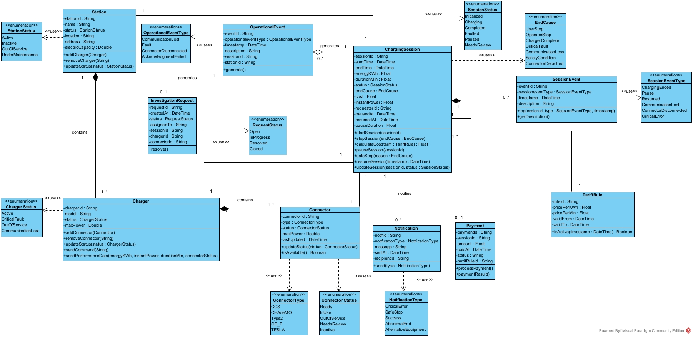

# نمودار کلاس فرایند مدیریت نشست شارژ

[فهرست گزارش‌ها](../../../INDEX.md)

# نمودار کلاس سیستم مدیریت نشست شارژ

## مقدمه

این نمودار کلاس، ساختار داده‌ای و منطقی فرایند مدیریت نشست شارژ را نمایش می‌دهد. در این نمودار، کلاس‌های اصلی، ویژگی‌ها<a href="#fn-1-3531" id="fnref-1-3531">1</a>، متودها<a href="#fn-2-3531" id="fnref-2-3531">2</a> و نحوه ارتباط آن‌ها با یکدیگر مشخص شده است. بخشی از این روابط از طریق Enumerations مقادیر ثابت خود را دریافت می‌کنند.

## انواع کلاس‌ها و توضیحات به همراه روابط

### ۲.۱. کلاس ایستگاه

ایستگاه شارژ «محل فیزیکی ارائه خدمت شارژ» است. سیستم باید بتواند وضعیت کلی ایستگاه (فعال/غیرفعال) را بررسی کند و در صورت غیرفعال بودن، از شروع نشست جلوگیری کرده و تجهیز جایگزین پیشنهاد دهد.

- **ویژگی‌ها**: مانند شناسه، نام، وضعیت، موقعیت، آدرس و ظرفیت<a href="#fn-3-3531" id="fnref-3-3531">3</a>
- **متدها**:
  - `addCharger(charger: Charger)`
  - `removeCharger(chargerID: String)`
  - `updateStatus(status: StationStatus)`
- **روابط**:
  - یک ایستگاه شامل یک یا چند شارژر است (1 - 1..\*). نماد لوزی توپر در سمت ایستگاه نشان‌دهنده مالکیت قوی است.
  - یک ایستگاه به یک نشست شارژ تعلق دارد (1 به 1).
  - برای وضعیت‌های مختلف ایستگاه هم از Enumerations استفاده شده است و از آن برای وضعیت‌های مختلف استفاده می‌کند.

### ۲.۲. کلاس شارژر

شارژر «تجهیز اصلی شارژ است که برق را به خودرو منتقل می‌کند». پیش از شروع نشست، وضعیت شارژر (فعال/خطای بحرانی/خارج از سرویس) توسط سیستم بررسی می‌شود. همچنین سامانه پس از ایجاد نشست، دستور شروع شارژ را مستقیماً به شارژر ارسال می‌کند.

- **ویژگی‌ها**: شناسه، مدل، وضعیت و حداکثر توان
- **متدها**:
  - `addConnector(connector: Connector)`
  - `removeConnector(connectorID: String)`
  - `updateStatus(status: ChargerStatus)`
  - `sendCommand(command: String)`
  - `sendPerformanceData(energyKWh, instantPower, durationMin, connectorStatus)`
- **روابط**:
  - یک شارژر شامل یک یا چند کانکتور است (1 به 1..\*).
  - چند شارژر به یک ایستگاه تعلق دارد (1..\* به 1).
  - یک شارژر به یک تشست شارژ تعلق دارد (1 به 1).
  - برای وضعیت‌های مختلف Enumeration استفاده می‌کند.

### ۲.۳. کلاس کانکتور

کانکتور «نقطه اتصال فیزیکی بین شارژر و خودرو است و وضعیت عملیاتی آن (آماده، در حال استفاده، خارج از سرویس) نقش مستقیم در امکان شروع یا ادامه نشست شارژ دارد.» سیستم قبل از شروع نشست، وضعیت کانکتور را به‌عنوان آخرین و مهم‌ترین سطح بررسی می‌کند.

- **ویژگی‌ها**: شناسه، نوع، وضعیت، حداکثر توان، آخرین زمان آپدیت
- **متدها**:
  - `updateStatus(status: ConnectorStatus)`
  - `isAvailable(): Boolean`
- **روابط**:
  - هر کانکتور به یک نشست شارژ مرتبط است (1 به 1). هر نشست شارژ دقیقاً به یک کانکتور متصل می‌شود.
  - چند کانکتور می‌تواند به یک شارژر تعلق داشته باشد.(1..\* به 1)
  - برای مدل و وضعیت خود از دو Enumeration استفاده می‌کند.

### ۲.۴. کلاس نشست شارژ

نشست شارژ «هسته عملیاتی سامانه محسوب می‌شود». این کلاس کل چرخه عمر یک بار شارژ را از ابتدا تا انتها مدیریت می‌کند: ایجاد نشست، ثبت زمان شروع، ثبت انرژی مصرف‌شده، مدیریت توقف/پاز، محاسبه هزینه و ثبت علت پایان. تمام داده‌های قابل اعتماد برای گزارشگیری و تحلیل درآمد از این کلاس استخراج می‌شوند.

- **ویژگی‌ها**: شناسه نشست، زمان شروع، زمان پایان، انرژی تحویلی، مدت زمان (دقیقه)، وضعیت، علت پایان، هزینه، شناسه کانکتور، شناسه درخواست‌دهنده، زمان توقف موقت، زمان از سرگیری، مدت زمان توقف موقت
- **متدها**:
  - `startSession(sessionId)`
  - `calculateCost(tariff: TariffRule): Float`
  - `pauseSession(sessionId)`
  - `resumeSession(timesetamp: DateTime)`
  - `updateSession(sessionId, status: SessionStatus)`
  - `safeStop(reason: EndCause)`
- **روابط**:
  - یک نشست شارژ شامل صفر یا چند رخداد نشست است (1 به 0..\*).
  - یک نشست شارژ می‌تواند صفر یا چند اعلان ایجاد کند (0..\*).
  - هر نشست شارژ از یک تعرفه برای محاسبه‌ی هزینه استفاده می‌کند ولی یک تعرفه برای چند نشست می‌تواند استفاده شود.
  - هر نشست شارژ می‌تواند صفر یا یک رکورد پرداخت را ذخیره کند (0..1).
  - یک نشست شارژ می‌تواند صفر یا چند رخداد عملیاتی ایجاد کند (1 به 0..\*).
  - برای وضعیت نشست، دلایل پایان نشست از Enumeration استفاده می‌کند. سایر روابط در کلاس‌های دیگر توضیح داده شده است.

### ۲.۵. کلاس رخداد نشست

سیستم باید «هر رخداد مهم در سوابق نشست ثبت شود تا امکان تحلیل کیفیت سرویس، بررسی خطا و محاسبه دقیق هزینه وجود داشته باشد.» این کلاس برای ثبت رویدادهای داخلی نشست مانند شارژر خراب، مکث، از سرگیری یا قطع ارتباط طراحی شده است.

- **ویژگی‌ها**: شناسه، نوع رخداد، توضیحات و مهر زمانی<a href="#fn-4-3531" id="fnref-4-3531">4</a>
- **متدها**:
  - `getDescription()`
  - `log(sessionId, type: SessionType, timestamp)`
- **روابط**:
  - هر رخداد نشست بخشی از یک نشست شارژ است ( 0..\* به 1).
  - برای نوعش از Enumeration استفاده می‌کند.

### ۲.۶. کلاس رخداد عملیاتی

«اگر نشست با خطا یا قطع غیرعادی پایان یافته باشد، سامانه باید یک رخداد عملیاتی یا درخواست بررسی ایجاد کند تا توسط اپراتور پیگیری شود.» همچنین اگر شارژر درخواست شروع را تایید نکند، یک خطای عملیاتی ایجاد می‌شود.

- **ویژگی‌ها**: شناسه رخداد، نوع رخداد عملیاتی، مهر زمانی، توضیحات، شناسه نشست، شناسه ایستگاه
- **متدها**:
  - `generate()`
- **روابط**:
  - یک رخداد عملیاتی می‌تواند صفر یا یک درخواست بررسی ایجاد کند (0..1).
  - هر نشست شارژ می‌تواند صفر یا چند رخداد عملیاتی تولید کند. اما هر رخداد عملیاتی فقط برای یک نشست است.
  - برای نوع رخداد از Enumeration استفاده می‌کند.

### ۲.۷. کلاس درخواست بررسی

«در صورت بروز خطای بحرانی یا تغییر وضعیت به خارج از سرویس، سامانه یک درخواست بررسی برای پیگیری توسط اپراتور ایجاد می‌کند.» این کلاس امکان ثبت درخواست، تعیین وضعیت (باز/در حال بررسی/حل شده) و واگذاری به کارشناس عملیات را فراهم می‌کند.

- **ویژگی‌ها**: شناسه درخواست، زمان ایجاد، وضعیت، واگذارشده به، شناسه نشست، شناسه شارژر، شناسه کانکتور
- **متدها**:
  - `resolve()`
- **روابط**:
  - این کلاس از یک رخداد عملیاتی ناشی می‌شود (برای بررسی خطاها یا رخدادها).
  - برای نوع درخواست از Enumeration استفاده می‌کند.

### ۲.۸. کلاس اعلان

سامانه باید «نوتیفیکیشن خطا به کاربر/اپراتور ارسال کند» و در صورت وجود تجهیز جایگزین، «اطلاع رسانی یا پیشنهاد مراجعه به تجهیز دیگر از طریق سامانه مکمل کاربران انجام شود.» این کلاس مسئول ذخیره و ارسال پیام‌های مرتبط با نشست است.

- **ویژگی‌ها**: شناسه اعلان، نوع اعلان، پیام، مهر زمانی، شناسه دریافت‌کننده
- **متدها**:
  - `send(type: NotificationType)`
- **روابط**:
  - به یک نشست شارژ تعلق دارد.
  - برای نوع اعلان از Enumeration استفاده می‌کند.

### ۲.۹. کلاس پرداخت

طبق متن فرآیند، «پس از پایان نشست، هزینه نشست بر اساس اطلاعات ثبت شده محاسبه و برای استفاده در بخش مالی یا گزارشگیری ذخیره می‌شود.» این کلاس نتیجه نهایی تسویه مالی نشست را نگه می‌دارد.

- **ویژگی‌ها**: شناسه رکورد، شناسه نشست، مبلغ، زمان پرداخت، وضعیت، شناسه قاعده تعرفه

- - **متدها**:

- `processPayment()`

- `paymentResult()`

- **روابط**:
  - به یک نشست شارژ مرتبط است (برای تسویه مالی).

### ۲.۱۰. کلاس قاعده تعرفه

«در صورت وجود قواعد تعرفه ای فعال، هزینه نشست بر اساس اطلاعات ثبت شده محاسبه می‌شود.» این کلاس قواعد قیمت‌گذاری (قیمت هر کیلووات ساعت، هزینه ثابت، تاریخ اعتبار) را نگه می‌دارد تا سیستم بتواند هزینه نهایی را محاسبه کند.

- **ویژگی‌ها**: شناسه قاعده، قیمت به ازای هر کیلووات ساعت، تاریخ شروع اعتبار، تاریخ پایان اعتبار، فعال است
- **متدها**:
  - `isActiveAt(timestamp: DateTime): Boolean`
- **روابط**:
  - کلاس نشست شارژ برای محاسبه هزینه به این کلاس وابسته است.

# جدول روابط بین کلاس‌ها و Enumerations در نمودار کلاس

<table>
<colgroup>
<col style="width: 20%" />
<col style="width: 20%" />
<col style="width: 20%" />
<col style="width: 20%" />
<col style="width: 20%" />
</colgroup>
<thead>
<tr class="header">
<th aria-sort="none" scope="col">

&#10;
</th>
<th aria-sort="none" scope="col">

&#10;
</th>
<th aria-sort="none" scope="col">

&#10;
</th>
<th aria-sort="none" aria-labelledby="markdown-table-43-col_3" scope="col">

چندگانگی<a href="#fn-5-3531" id="fnref-5-3531">5</a>

</th>
<th aria-sort="none" scope="col">

&#10;
</th>
</tr>
</thead>
<tbody>
<tr class="odd">
<td>Station</td>
<td>ترکیب (Composition)</td>
<td>Charger</td>
<td>1 به 1...*</td>
<td>contains</td>
</tr>
<tr class="even">
<td>Charger</td>
<td>ترکیب (Composition)</td>
<td>Connector</td>
<td>1 به 1...*</td>
<td>contains</td>
</tr>
<tr class="odd">
<td>ChargingSession</td>
<td>ترکیب (Composition)</td>
<td>SessionEvent</td>
<td>1 به 0...*</td>
<td>ندارد</td>
</tr>
<tr class="even">
<td>ChargingSession</td>
<td>تجمیع (Aggregation)</td>
<td>OperationalEvent</td>
<td>1 به 0...*</td>
<td>generates</td>
</tr>
<tr class="odd">
<td>Station</td>
<td>ارتباط (Association)</td>
<td>ChargingSession</td>
<td>1 به 1</td>
<td>ندارد</td>
</tr>
<tr class="even">
<td>Charger</td>
<td>ارتباط (Association)</td>
<td>ChargingSession</td>
<td>1 به 1</td>
<td>ندارد</td>
</tr>
<tr class="odd">
<td>Connector</td>
<td>ارتباط (Association)</td>
<td>ChargingSession</td>
<td>1 به 1</td>
<td>ندارد</td>
</tr>
<tr class="even">
<td>OperationalEvent</td>
<td>ارتباط (Association)</td>
<td>InvestigationRequest</td>
<td>1 به 0...1</td>
<td>generates</td>
</tr>
<tr class="odd">
<td>ChargingSession</td>
<td>ارتباط (Association)</td>
<td>TariffRule</td>
<td>1...* به 1</td>
<td>ندارد</td>
</tr>
<tr class="even">
<td>ChargingSession</td>
<td>ارتباط (Association)</td>
<td>Payment</td>
<td>1 به 0...1</td>
<td>ندارد</td>
</tr>
<tr class="odd">
<td>ChargingSession</td>
<td>ارتباط (Association)</td>
<td>Notification</td>
<td>1 به 0...*</td>
<td>notifies</td>
</tr>
<tr class="even">
<td>Station</td>
<td>وابستگی (Dependency - use)</td>
<td>StationStatus</td>
<td>-</td>
<td>&lt;&lt;use&gt;&gt;</td>
</tr>
<tr class="odd">
<td>Charger</td>
<td>وابستگی (Dependency - use)</td>
<td>ChargerStatus</td>
<td>-</td>
<td>&lt;&lt;use&gt;&gt;</td>
</tr>
<tr class="even">
<td>Connector</td>
<td>وابستگی (Dependency - use)</td>
<td>ConnectorType</td>
<td>-</td>
<td>&lt;&lt;use&gt;&gt;</td>
</tr>
<tr class="odd">
<td>Connector</td>
<td>وابستگی (Dependency - use)</td>
<td>ConnectorStatus</td>
<td>-</td>
<td>&lt;&lt;use&gt;&gt;</td>
</tr>
<tr class="even">
<td>OperationalEvent</td>
<td>وابستگی (Dependency - use)</td>
<td>OperationalEventType</td>
<td>-</td>
<td>&lt;&lt;use&gt;&gt;</td>
</tr>
<tr class="odd">
<td>InvestigationRequest</td>
<td>وابستگی (Dependency - use)</td>
<td>RequestStatus</td>
<td>-</td>
<td>&lt;&lt;use&gt;&gt;</td>
</tr>
<tr class="even">
<td>ChargingSession</td>
<td>وابستگی (Dependency - use)</td>
<td>SessionStatus</td>
<td>-</td>
<td>&lt;&lt;use&gt;&gt;</td>
</tr>
<tr class="odd">
<td>ChargingSession</td>
<td>وابستگی (Dependency - use)</td>
<td>EndCause</td>
<td>-</td>
<td>&lt;&lt;use&gt;&gt;</td>
</tr>
<tr class="even">
<td>SessionEvent</td>
<td>وابستگی (Dependency - use)</td>
<td>SessionEventType</td>
<td>-</td>
<td>&lt;&lt;use&gt;&gt;</td>
</tr>
<tr class="odd">
<td>Notification</td>
<td>وابستگی (Dependency - use)</td>
<td>NotificationType</td>
<td>-</td>
<td>&lt;&lt;use&gt;&gt;</td>
</tr>
</tbody>
</table>

## توضیح کاربرد هر نوع رابطه در نمودار کلاس

### ۱. ترکیب<a href="#fn-6-3531" id="fnref-6-3531">6</a>- وابستگی قوی

**دلیل استفاده:** نشان‌دهنده مالکیت قطعی است؛ یعنی اگر کلاس اصلی (کل) حذف شود، کلاس‌های وابسته (جزء) نیز باید از بین بروند و بدون آن معنایی ندارند.

**در نمودار کلاس:**

- رابطه Station با Charger: یک شارژر متعلق به یک ایستگاه است. اگر ایستگاه جمع‌آوری شود، شارژر آن به صورت مستقل در آن سیستم معنایی ندارد.
- رابطه Charger با Connector: کانکتورها (پورت‌های شارژ) بخش جدایی‌ناپذیر یک دستگاه شارژر هستند.
- رابطه ChargingSession با SessionEvent: رویدادهای یک جلسه شارژ فقط متعلق به همان جلسه هستند و با حذف داده‌های جلسه، رویدادهای لحظه‌ای آن نیز بی‌معنی می‌شوند.

### ۲. تجمیع<a href="#fn-7-3531" id="fnref-7-3531">7</a>- وابستگی ضعیف

**دلیل استفاده:** نشان‌دهنده رابطه "کل و جزء" است، اما با این تفاوت که جزء می‌تواند به طور مستقل از کل به حیات خود ادامه دهد.

**در نمودار کلاس:**

- رابطه ChargingSession با OperationalEvent: یک جلسه شارژ رویدادهای عملیاتی (مانند خطاها) را تولید می‌کند. با این حال، حتی اگر جلسه شارژ به پایان برسد یا در بایگانی قرار گیرد، ممکن است این رویدادهای عملیاتی برای بررسی‌های فنی یا امنیتی همچنان در دیتابیس سیستم باقی بمانند.

### ۳. ارتباط<a href="#fn-8-3531" id="fnref-8-3531">8</a>

**دلیل استفاده:** برای نشان دادن تعامل، استفاده یا ارتباط کاری بین دو موجودیت کاملاً مستقل در سیستم استفاده شده است.

**در نمودار کلاس:**

- رابطه ChargingSession با کلاس‌های Payment، TariffRule و Station: یک جلسه شارژ در یک "ایستگاه" رخ می‌دهد، بر اساس یک "تعرفه" محاسبه می‌شود و منجر به یک "پرداخت" می‌گردد. هیچ‌کدام مالک دیگری نیستند، اما برای انجام فرآیند شارژ به هم لینک شده‌اند.

### ۴. وابستگی<a href="#fn-9-3531" id="fnref-9-3531">9</a>

**دلیل استفاده:** نشان می‌دهد که یک کلاس برای تعریف مقادیر و ویژگی‌های خود نیازمند استفاده از یک نوع داده‌ی دیگر (در اینجا نوع‌های شمارشی یا Enums) است.

**در نمودار کلاس:**

- استفاده کلاس Station از Enum StationStatus: کلاس ایستگاه برای اینکه وضعیت‌هایش را نشان دهد، از لیستی از وضعیت‌های از پیش تعریف شده در این Enum استفاده می‌کند.

  ## تصویر نمودار

  

1.  

    Attribute [↩](#fnref-1-3531 "Back to reference 1")

    

2.  

    Method [↩](#fnref-2-3531 "Back to reference 2")

    

3.  

    electricCapicity [↩](#fnref-3-3531 "Back to reference 3")

    

4.  

    timestamp [↩](#fnref-4-3531 "Back to reference 4")

    

5.  

    Multiplicity [↩](#fnref-5-3531 "Back to reference 5")

    

6.  

    Composition [↩](#fnref-6-3531 "Back to reference 6")

    

7.  

    Aggregation [↩](#fnref-7-3531 "Back to reference 7")

    

8.  

    Association [↩](#fnref-8-3531 "Back to reference 8")

    

9.  

    Dependency [↩](#fnref-9-3531 "Back to reference 9")

    

