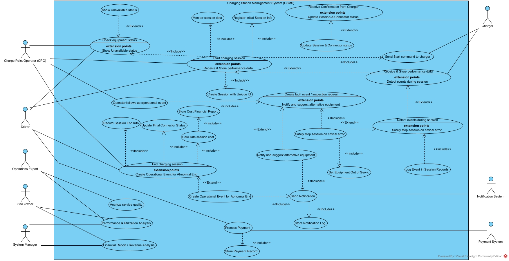

# نمودار مورد کاربرد فرایند مدیریت نشست شارژ

[فهرست گزارش‌ها](../../../INDEX.md)

# نمودار مورد کاربرد<a href="#fn-1-64" id="fnref-1-64">1</a> فرآیند مدیریت نشست شارژ

## ۱. مقدمه

این متن نمودار مورد کاربرد و تحلیل رفتاری مرتبط با آن را برای **سامانه مدیریت ایستگاه‌های شارژ (**CSMS<a href="#fn-2-64" id="fnref-2-64">2</a>**)** تشریح می‌کند. هدف از نمودار این است که با شناسایی بازیگران<a href="#fn-3-64" id="fnref-3-64">3</a> و کارکردهای اصلی<a href="#fn-4-64" id="fnref-4-64">4</a>، نمایی کلی از تعاملات و فرآیندهای سیستم ارائه شود.

## ۲. معرفی بازیگران

بازیگران، موجودیت‌هایی هستند که با سیستم تعامل دارند. این بازیگران به دو دسته انسانی و سیستمی تقسیم می‌شوند:

<table>
<colgroup>
<col style="width: 33%" />
<col style="width: 33%" />
<col style="width: 33%" />
</colgroup>
<thead>
<tr class="header">
<th aria-sort="none" scope="col">

&#10;
</th>
<th aria-sort="none" scope="col">

&#10;
</th>
<th aria-sort="none" scope="col">

&#10;
</th>
</tr>
</thead>
<tbody>
<tr class="odd">
<td><strong>انسانی</strong></td>
<td>راننده<a href="#fn-5-64" id="fnref-5-64">5</a></td>
<td>درخواست شروع/پایان نشست شارژ از طریق اپلیکیشن.</td>
</tr>
<tr class="even">
<td></td>
<td>اپراتور شبکه شارژ<a href="#fn-6-64" id="fnref-6-64">6</a></td>
<td>مدیریت نشست‌ها، صدور دستورات و پیگیری رخدادهای عملیاتی.</td>
</tr>
<tr class="odd">
<td></td>
<td>مالک سایت<a href="#fn-7-64" id="fnref-7-64">7</a></td>
<td>دریافت گزارش‌های مالی، تحلیل عملکرد و بهره‌وری تجهیزات سایت.</td>
</tr>
<tr class="even">
<td></td>
<td>مدیر سامانه<a href="#fn-8-64" id="fnref-8-64">8</a></td>
<td>تحلیل جامع عملکرد سیستم، درآمد و گزارش‌های کلان.</td>
</tr>
<tr class="odd">
<td></td>
<td>کارشناس عملیات<a href="#fn-9-64" id="fnref-9-64">9</a></td>
<td>آنالیز کیفیت سرویس و شناسایی نقاط قابل بهبود در فرآیندها.</td>
</tr>
<tr class="even">
<td><strong>سیستمی</strong></td>
<td>شارژر<a href="#fn-10-64" id="fnref-10-64">10</a></td>
<td>تجهیز فیزیکی که دستورات را از CSMS دریافت کرده و داده‌های عملکردی را ارسال می‌کند.</td>
</tr>
<tr class="odd">
<td></td>
<td>سیستم پیام‌رسان<a href="#fn-11-64" id="fnref-11-64">11</a></td>
<td>مسئول ارسال اعلان‌ها به ذی‌نفعان.</td>
</tr>
<tr class="even">
<td></td>
<td>سیستم پرداخت<a href="#fn-12-64" id="fnref-12-64">12</a></td>
<td>مسئول پردازش نهایی هزینه‌ها و ثبت تراکنش‌های مالی.</td>
</tr>
</tbody>
</table>

## ۳. تحلیل کارکردها و روابط

در این بخش، کارکردهای اصلی سامانه بر اساس نمودار توضیح داده می‌شوند.

- ‏**include (الزام):** نشان‌دهنده یک کارکرد الزامی است که همیشه به عنوان بخشی از کارکرد اصلی اجرا می‌شود.
- ‏**extend (توسعه/شرط):** نشان‌دهنده یک کارکرد اختیاری یا شرطی است که تنها در شرایط خاصی به کارکرد اصلی اضافه می‌شود.

### ۳.۱. فاز اول: شروع نشست شارژ<a href="#fn-13-64" id="fnref-13-64">13</a>

این فرآیند، نقطه آغاز تعامل کاربر با سیستم برای شارژ خودرو است و جریان اصلی آن شامل گام‌های الزامی زیر است:

- ‏**Start charging session**<a href="#fn-14-64" id="fnref-14-64">14</a>: این کارکرد اصلی توسط **راننده** یا **اپراتور شبکه شارژ** آغاز می‌شود.
- ‏(include) **Check equipment status**<a href="#fn-15-64" id="fnref-15-64">15</a> (بررسی وضعیت تجهیزات): اولین گام الزامی، بررسی در دسترس بودن تجهیزات است.
  - ‏(extend) **Show Unavailable status**<a href="#fn-16-64" id="fnref-16-64">16</a> (نمایش وضعیت عدم دسترسی): **اگر و تنها اگر** تجهیزات (ایستگاه، شارژر یا کانکتور) در دسترس نباشند، این کارکرد اجرا می‌شود.
- ‏(include) **Register Initial Session Info**<a href="#fn-17-64" id="fnref-17-64">17</a> (ثبت اطلاعات اولیه): در صورت شروع نشست، اطلاعات اولیه نشست ثبت می‌شود.
- ‏(include)**Create Session with Unique ID**<a href="#fn-18-64" id="fnref-18-64">18</a> (ایجاد نشست با شناسه یکتا): یک شناسه منحصر‌به‌فرد برای نشست جدید ایجاد می‌شود.
- ‏(include) **Send Start command to charger**<a href="#fn-19-64" id="fnref-19-64">19</a> (ارسال فرمان شروع به شارژر): وقتی نشست شروع شود، دستور شروع به **شارژر** فیزیکی ارسال می‌شود.
- ‏(extend) **Receive Confirmation from Charger**<a href="#fn-20-64" id="fnref-20-64">20</a> (دریافت تأییدیه از شارژر): سامانه منتظر پاسخ از **شارژر** می‌ماند.
- ‏(extend) **Update Session & Connector status**<a href="#fn-21-64" id="fnref-21-64">21</a> (به‌روزرسانی وضعیت): **پس از دریافت تأییدیه مثبت** از شارژر، این کارکرد اجرا شده و وضعیت نشست و کانکتور به‌روز می‌شود.
- ‏(extend) **Receive & Store performance data**<a href="#fn-22-64" id="fnref-22-64">22</a> (دریافت و ذخیره داده‌های عملکردی): در صورت شروع نشست می‌تواند داده‌های عملکردی را دریافت و ذخیره کند.

### ۳.۲. فاز دوم: پایش نشست<a href="#fn-23-64" id="fnref-23-64">23</a>

در طول اجرای نشست، سامانه به صورت پیوسته داده‌ها را پایش می‌کند.

- ‏**Receive & Store performance data**<a href="#fn-22" id="fnref-22-2">22</a> (دریافت و ذخیره داده‌های عملکردی): این کارکرد وظیفه جمع‌آوری داده‌های لحظه‌ای از شارژر را دارد.
- ‏(extend) **Detect events during session**<a href="#fn-24-64" id="fnref-24-64">24</a> (تشخیص رخدادها): این کارکرد وقتی داده‌های عملکردی دریافت و ذخیره شود می‌توان رخدادها را تشخیص داد.
- ‏(extend) **Monitor session data**<a href="#fn-25-64" id="fnref-25-64">25</a> (پایش مستمر نشست): وقتی نشست شروع شود این کارکرد به صورت پیوسته داده‌هایی مانند انرژی، توان و زمان را در طول نشست پایش می‌کند و به کارکرد اصلی متصل است.

### ۳.۳. فاز سوم: مدیریت خطا و رویدادها

سامانه رویدادهای غیرمنتظره یا خطاها را مدیریت کرده و اقدامات لازم را انجام می‌دهد.

‏**Detect events during session**<a href="#fn-24" id="fnref-24-2">24</a> (تشخیص رخدادها): این کارکرد به طور مداوم در حال بررسی رخدادها است.

- ‏(include) **Log Event in Session Records**<a href="#fn-26-64" id="fnref-26-64">26</a> (ثبت رخداد): هر رخدادی به صورت الزامی در سوابق نشست ثبت می‌شود.
- ‏(extend) **Safely stop session on critical error**<a href="#fn-27-64" id="fnref-27-64">27</a> (توقف ایمن در خطای بحرانی): این کارکرد **تنها در صورت بروز خطای بحرانی**، کارکرد اصلی پایش را توسعه می‌دهد و نشست را متوقف می‌کند. این توقف ایمن خود شامل موارد زیر است:
  - ‏(include) **Set Equipment Out of Service**<a href="#fn-28-64" id="fnref-28-64">28</a> (خارج از سرویس کردن تجهیز): وضعیت تجهیز معیوب به صورت الزامی به "خارج از سرویس" تغییر می‌کند.
- **Create fault event / inspection request**<a href="#fn-29-64" id="fnref-29-64">29</a> (ایجاد درخواست بررسی): یک درخواست بازرسی برای **اپراتور** جهت پیگیری مشکل ایجاد می‌شود.
  - ‏(extend) **Notify and suggest alternative equipment**<a href="#fn-30-64" id="fnref-30-64">30</a> (اطلاع‌رسانی و پیشنهاد جایگزین): اگر خطای بحرانی رخ دهد، این کارکرد فعال شده و به کاربر اطلاع‌رسانی می‌کند. و طبق روابطی که دارد این اعلان ذخیره می‌شود.

### ۳.۴. فاز چهارم: خاتمه نشست و تسویه مالی

این فرآیند با درخواست کاربر، اپراتور یا به صورت خودکار (تکمیل شارژ یا بروز خطا) آغاز می‌شود.

- ‏**End charging session**<a href="#fn-31-64" id="fnref-31-64">31</a>: کارکرد اصلی خاتمه نشست.
- ‏(include) **Record Session End Info**<a href="#fn-32-64" id="fnref-32-64">32</a> (ثبت اطلاعات نهایی): اطلاعات پایانی مانند انرژی کل، زمان و علت توقف به صورت الزامی ثبت می‌شود.
- ‏(include) **Update Final Connector Status**<a href="#fn-33-64" id="fnref-33-64">33</a> (به‌روزرسانی وضعیت نهایی کانکتور): وضعیت کانکتور پس از پایان نشست به‌روز می‌شود.
- ‏(include) **Calculate session cost**<a href="#fn-34-64" id="fnref-34-64">34</a> (محاسبه هزینه): پس از پایان نشست هزینه نشست بر اساس تعرفه‌ها محاسبه می‌شود.
- ‏(include) **Store Cost Financial Report**<a href="#fn-35-64" id="fnref-35-64">35</a> (ذخیره گزارش مالی): پس از محاسبه‌ی هزینه نتایج مالی برای گزارش‌گیری‌های بعدی ذخیره می‌شود.
- ‏**Process Payment**<a href="#fn-36-64" id="fnref-36-64">36</a> (پردازش پرداخت): این کارکرد به **سیستم پرداخت** متصل است و عملیات مالی را انجام می‌دهد.
- ‏(extend) **Create Operational Event for Abnormal End**<a href="#fn-37-64" id="fnref-37-64">37</a> (ایجاد رخداد برای پایان غیرعادی): **اگر نشست به دلیلی غیر از درخواست کاربر یا تکمیل شارژ پایان یابد** (مثلاً قطع ارتباط)، یک رخداد عملیاتی برای پیگیری **اپراتور** ایجاد می‌شود.

### ۳.۵. فاز پنجم: تحلیل و گزارش‌گیری

این کارکردها توسط بازیگران مدیریتی و عملیاتی برای تحلیل داده‌های جمع‌آوری شده استفاده می‌شوند:

- ‏**Analyze service quality**<a href="#fn-38-64" id="fnref-38-64">38</a>: توسط **کارشناس عملیات** برای تحلیل کیفیت خدمات.
- ‏**Performance & Utilization Analysis**<a href="#fn-39-64" id="fnref-39-64">39</a>: توسط **مالک سایت، کارشناس عملیات** و **مدیر سامانه** برای تحلیل بهره‌وری.
- ‏**Financial Report / Revenue Analysis**<a href="#fn-40-64" id="fnref-40-64">40</a>: توسط **مالک سایت** و **مدیر سامانه** برای تحلیل درآمد.
- ‏**Operator follows up operational event**<a href="#fn-41-64" id="fnref-41-64">41</a>: **اپراتور** رخدادهای باز را پیگیری و مدیریت می‌کند.
  - ‏(include) **Create fault event / inspection request**<a href="#fn-29" id="fnref-29-2">29</a>: این کارکرد نشان می‌دهد که پیگیری رویداد عملیاتی توسط اپراتور، الزاماً و همیشه شامل ایجاد یک رویداد خطا یا درخواست بازرسی است.

## ۴. تعامل با سیستم‌های جانبی

همانطور که در نمودار مشخص است، سامانه برای تکمیل چرخه کاری خود با دو سیستم خارجی کلیدی در تعامل است:

- **تعامل با سیستم پیام‌رسان<a href="#fn-11" id="fnref-11-2">11</a>**:

  - کارکرد **Send Notification**<a href="#fn-42-64" id="fnref-42-64">42</a> مسئول ارسال تمامی پیام‌ها به ذی‌نفعان است.
  - این سیستم، اطلاعاتی مانند شروع/پایان شارژ، بروز خطا، یا پیشنهاد تجهیز جایگزین را به کاربران و اپراتورها اطلاع می‌دهد و سوابق آن در **Store Notification Log**<a href="#fn-43-64" id="fnref-43-64">43</a> ذخیره می‌شود.

- **تعامل با سیستم پرداخت<a href="#fn-12" id="fnref-12-2">12</a>**:

  - کارکرد **Process Payment**<a href="#fn-36" id="fnref-36-2">36</a> پس از محاسبه هزینه، فرآیند تسویه حساب را از طریق این سیستم انجام می‌دهد. این تعامل برای تکمیل چرخه مالی نشست ضروری است.

## تصویر نمودار

## پانویس‌ها

1.  

    Use Case [↩](#fnref-1-64 "Back to reference 1")

    

2.  

    Charging Station Management System [↩](#fnref-2-64 "Back to reference 2")

    

3.  

    Actors [↩](#fnref-3-64 "Back to reference 3")

    

4.  

    Use Cases [↩](#fnref-4-64 "Back to reference 4")

    

5.  

    Driver [↩](#fnref-5-64 "Back to reference 5")

    

6.  

    Charge Point Operator (CPO) [↩](#fnref-6-64 "Back to reference 6")

    

7.  

    Site Owner [↩](#fnref-7-64 "Back to reference 7")

    

8.  

    System Manager [↩](#fnref-8-64 "Back to reference 8")

    

9.  

    Operations Expert [↩](#fnref-9-64 "Back to reference 9")

    

10. 

    Charger [↩](#fnref-10-64 "Back to reference 10")

    

11. 

    Notification System [↩](#fnref-11-64 "Back to reference 11") [↩2](#fnref-11-2)

    

12. 

    Payment System [↩](#fnref-12-64 "Back to reference 12") [↩2](#fnref-12-2)

    

13. 

    Start Charging Session [↩](#fnref-13-64 "Back to reference 13")

    

14. 

    Start charging session [↩](#fnref-14-64 "Back to reference 14")

    

15. 

    Check equipment status [↩](#fnref-15-64 "Back to reference 15")

    

16. 

    Show Unavailable status [↩](#fnref-16-64 "Back to reference 16")

    

17. 

    Register Initial Session Info [↩](#fnref-17-64 "Back to reference 17")

    

18. 

    Create Session with Unique ID [↩](#fnref-18-64 "Back to reference 18")

    

19. 

    Send Start command to charger [↩](#fnref-19-64 "Back to reference 19")

    

20. 

    Receive Confirmation from Charger [↩](#fnref-20-64 "Back to reference 20")

    

21. 

    Update Session & Connector status [↩](#fnref-21-64 "Back to reference 21")

    

22. 

    Receive & Store performance data [↩](#fnref-22-64 "Back to reference 22") [↩2](#fnref-22-2)

    

23. 

    Monitoring [↩](#fnref-23-64 "Back to reference 23")

    

24. 

    Detect events during session [↩](#fnref-24-64 "Back to reference 24") [↩2](#fnref-24-2)

    

25. 

    Monitor session data [↩](#fnref-25-64 "Back to reference 25")

    

26. 

    Log Event in Session Records [↩](#fnref-26-64 "Back to reference 26")

    

27. 

    Safely stop session on critical error [↩](#fnref-27-64 "Back to reference 27")

    

28. 

    Set Equipment Out of Service [↩](#fnref-28-64 "Back to reference 28")

    

29. 

    Create fault event / inspection request [↩](#fnref-29-64 "Back to reference 29") [↩2](#fnref-29-2)

    

30. 

    Notify and suggest alternative equipment [↩](#fnref-30-64 "Back to reference 30")

    

31. 

    End charging session [↩](#fnref-31-64 "Back to reference 31")

    

32. 

    Record Session End Info [↩](#fnref-32-64 "Back to reference 32")

    

33. 

    Update Final Connector Status [↩](#fnref-33-64 "Back to reference 33")

    

34. 

    Calculate session cost [↩](#fnref-34-64 "Back to reference 34")

    

35. 

    Store Cost Financial Report [↩](#fnref-35-64 "Back to reference 35")

    

36. 

    Process Payment [↩](#fnref-36-64 "Back to reference 36") [↩2](#fnref-36-2)

    

37. 

    Create Operational Event for Abnormal End [↩](#fnref-37-64 "Back to reference 37")

    

38. 

    Analyze service quality [↩](#fnref-38-64 "Back to reference 38")

    

39. 

    Performance & Utilization Analysis [↩](#fnref-39-64 "Back to reference 39")

    

40. 

    Financial Report / Revenue Analysis [↩](#fnref-40-64 "Back to reference 40")

    

41. 

    Operator follows up operational event [↩](#fnref-41-64 "Back to reference 41")

    

42. 

    Send Notification [↩](#fnref-42-64 "Back to reference 42")

    

43. 

    Store Notification Log [↩](#fnref-43-64 "Back to reference 43")

    

